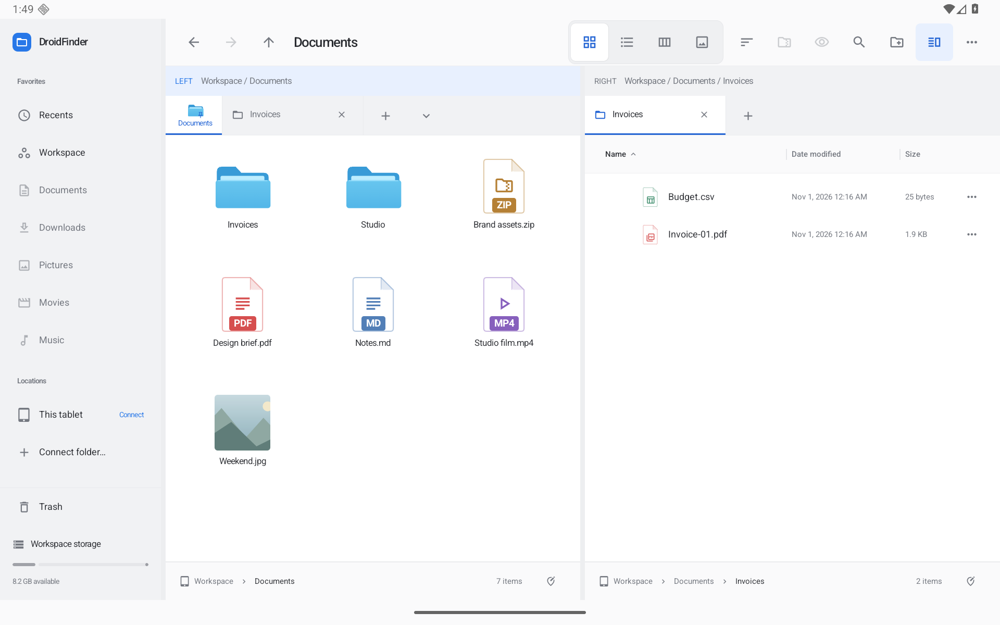

# DroidFinder

A native Android tablet file explorer inspired by macOS Finder. Kotlin, Jetpack Compose, real file operations, no account, no app-owned network connection. Cloud/network access runs through Android document providers you connect.

This is an independent implementation, not Apple source code or a macOS runtime. [Parity checklist and platform differences](PARITY.md).



Actual Android screenshot with synthetic QA documents. [Progressive loading](docs/screenshots/loading-progress.png) · [Stopped scan](docs/screenshots/loading-stopped.png) · [Compact result details](docs/screenshots/loading-details.png) · [Large catalog](docs/screenshots/loading-complete.png). [Drag feedback](docs/screenshots/dragging-cross-pane.png) · [Hover to open](docs/screenshots/dragging-hover.png) · [Opened folder](docs/screenshots/dragging-opened.png) · [Cancel restores](docs/screenshots/dragging-restored.png). [Folder settings](docs/screenshots/folder-views-settings.png) · [Columns](docs/screenshots/folder-views-columns.png) · [Saved folders](docs/screenshots/folder-views-manager.png). [Tab overview](docs/screenshots/navigation-overview.png) · [Saved layouts](docs/screenshots/navigation-workspaces.png). [File icons](docs/screenshots/file-icons.png) · [Keyboard guide](docs/screenshots/windows-shortcuts.png) · [Portrait](docs/screenshots/workspace-portrait.png) · [Compact window](docs/screenshots/workspace-window.png) · [Dark appearance](docs/screenshots/workspace-dark.png) · [PDF Peek](docs/screenshots/workspace-peek.png). Earlier captures: [Context menu](docs/screenshots/desktop-context.png) · [ZIP browser](docs/screenshots/desktop-archive.png) · [Compact transfer window](docs/screenshots/transfer-compact.png).

**0.12.0:** Progressive folder/search results, Stop/Restart, explicit incomplete-result details, higher per-tab scan limits, and streaming text search beyond the former 1 MiB cutoff. [Loading and search](docs/LOADING.md).

**0.11.0:** Compact move/copy/shortcut feedback, spring-loaded folders and tabs, proportional edge scrolling, and precise one-pixel resizing. [Dragging and resizing](docs/DRAGGING.md).

**0.10.0:** Remember views per folder across tabs, panes and windows, keep independent pane defaults, manage saved folder views, and customize detail columns with visibility controls, widths and native resizing. [Folder view workflows](docs/FOLDER-VIEWS.md).

**0.9.0:** Persistent per-tab selection/focus/expansion and scroll positions, protected pinned tabs, searchable tab overview with touch reorder, named two-pane layouts, and shared thumbnail caching. [Navigation and saved layouts](docs/NAVIGATION.md).

**0.8.0:** Adjacent Chrome-style new-tab buttons, recognizable file-type icons, Windows Explorer keyboard controls and independent windows. Dual panes share transfers and recovery, support cross-pane copy/move, and offer recursive folder comparison with optional content verification. [Workflows and verification](docs/WORKSPACES.md). Earlier: [0.7.0 compact transfers and density](docs/TRANSFER-PLANNING.md), [0.6.0 folder merging](docs/FOLDER-MERGE.md).

[Compact transfer window](docs/screenshots/transfer-compact.png) · [Expanded details](docs/screenshots/transfer-details-compact.png) · [Conflict choices](docs/screenshots/file-conflict.png)

[Full improvement roadmap](docs/ROADMAP.md) — delivery continues in verified increments; unchecked items remain in progress.

## Install or build

[Download the installable tablet preview](https://github.com/moikdev/droidfinder/releases/tag/v0.12.0-preview) · [Source repository](https://github.com/moikdev/droidfinder)

The **preview APK** is optimized and development-signed for installation on your tablet. Release APKs are unsigned until you configure your own production signing credentials.

Requires Android 11+, JDK 17+, and Android SDK 36. The layout supports tablet landscape and portrait, plus compact tablet windows. A phone-specific layout is deferred.

```sh
./gradlew assemblePreview
adb install -r app/build/outputs/apk/preview/app-preview.apk
```

On first launch, either use the private **Workspace**, choose **Connect tablet storage** to grant Android all-files access, or choose **Connect folder…** to authorize a folder through an installed document provider. Local folders and provider locations use the same views and actions. The app never creates sample files in your storage.

## Finder workflows

| Area | Implementation |
| --- | --- |
| Browsing | Sidebar, favorites, shared storage, SD/USB volumes, provider locations, pinned/reorderable tabs with independent history/search and restored selection/viewport, searchable tab overview, named layouts, reopen closed tab, back/forward/up, clickable path bar, Go to Folder, reveal enclosing folder, independent dual panes with active-pane command routing |
| Views | Remembered folder layouts, configurable detail-column visibility/widths and resizing, icons with adjustable size, sortable list with folder disclosure/expansion, browsing columns, gallery/filmstrip, resizable columns/preview/sidebar, adaptive toolbar, Comfortable/Compact density |
| Selection/input | Tap/double-tap, touch multiple selection, Ctrl/Meta-click, Shift ranges, keyboard navigation, type-to-select, mouse context actions, rectangle selection, native dragging with action/destination feedback, spring-loaded folder/tab navigation and viewport edge scrolling |
| Organizing | Create folder/text file, New Folder with Selection, destination picker, rename, batch rename (replace/prefix/suffix/numbered format), duplicate, copy/cut/paste, copy/move to other pane, folder comparison with optional content verification |
| Undo/Redo | Session history for create/copy/move/rename, batch rename, grouping, Trash/restore, archives, shortcuts, and tag edits; content fingerprints stop Undo from removing later edits |
| Tags/appearance | Multiple named tags per item, custom tag colors/names, tag editing/deletion/filtering, custom folder color/symbol, persistent favorites, per-folder views and pane defaults |
| Search | Progressive cancellable results with explicit limits/errors, streaming UTF-8 content matching, recursive names, kind/date/size/tag/text-content criteria, saved live Smart Folders, Recents, hidden files, groups by kind/date/tag/size |
| Peek / Quick Look | Images with EXIF orientation, pinch/button zoom, all PDF pages with navigation/zoom, audio controls, video play/pause and seeking, text preview, folder counts/size and Get Info |
| File integration | Android default apps/Open With, temporary read grants for sharing, full-path copy, inert `.finderlink` shortcuts |
| Archives/Trash | Named ZIP creation with compression levels, read-only archive browsing, extraction with path checks; recoverable Trash and restore, Undo, explicit confirmation for permanent deletion/emptying |
| Transfers | Persistent copy/move queue, pause/resume/cancel, notification controls, per-file results/retry, reorder, foreground service, browsing during transfers, metadata estimates, capacity preflight, phase progress/ETA and explicit interruption review |
| Conflicts | Compare incoming/existing items; keep both, skip, rename or replace with recoverable Undo/Redo; folder merging, nested member retries and apply-to-remaining choices |
| Persistence | Named two-pane layouts, per-tab selection/focus/expansion and scoped viewport positions, tabs/current locations, view/sort/group settings, sizes, preview/hidden/extension preferences, theme, favorites, tags, Smart Folders, provider grants, folder appearance, Trash recovery metadata |

Mouse users can drag file icons. On touch, select items and hold the drag grip in the selection bar, then drop onto a folder, breadcrumb, sidebar location, or tab. Hold Ctrl when starting a drag to copy, Shift to move, or Alt / Ctrl+Shift to create an app shortcut. Hold over a valid folder or inactive tab to open it; cancellation restores temporary navigation. Hold near a viewport edge to scroll. [Interaction details](docs/DRAGGING.md). Files can also be dragged out to compatible Android apps; content-URI drops from other apps can be imported into writable folders.

## Keyboard

Press **F1** or choose **Keyboard shortcuts…** in Actions for the searchable guide. Ctrl follows Windows Explorer conventions; Meta preserves Finder view and duplicate aliases. Android controls system-wide Windows-key commands and window placement.

| Shortcut | Action |
| --- | --- |
| Alt D / Ctrl L / F4 | Edit the address bar |
| Ctrl E / Ctrl F / F3; F5 / Ctrl R | Search; refresh |
| Ctrl N; Alt F4 | New independent window; close this window |
| Ctrl T / W / Shift T | New tab; close tab (or last window); reopen closed tab |
| Ctrl Tab / Ctrl Shift Tab; Ctrl Page Up/Down | Next/previous tab |
| Ctrl 1–8 / Ctrl 9 | Numbered tab / last tab |
| Ctrl Shift 1–4 | Extra large, large, medium and small icons |
| Ctrl Shift 5 / 6 / 7 / 8 / 9 | Names list, details, tiles, content, gallery |
| Ctrl Num +; Ctrl wheel | Fit list columns to contents; zoom icons |
| Ctrl Shift E; Num + / − / * | Reveal folder tree; expand/collapse/expand subtree |
| Ctrl \; F6 / Shift F6 | Toggle dual panes; cycle browser/address/search focus areas |
| Ctrl Shift N; F2 | New folder; rename/batch rename |
| Ctrl A / C / X / V | Select all / copy / cut / paste |
| Ctrl Insert / Shift Insert; Ctrl Shift C | Copy / paste; copy full path |
| Delete / Ctrl D; Shift Delete | Trash; permanent-delete confirmation |
| Ctrl Z / Ctrl Y / Ctrl Shift Z | Undo / redo |
| Alt Enter; Alt P / Alt Shift P | Properties; preview / details inspector |
| Alt Left/Right/Up; Backspace | Back / forward / parent; back |
| Arrows / Shift arrows; Home/End / Page Up/Down | Navigate / extend selection; first/last / page |
| Ctrl arrows; Ctrl Space; Ctrl Shift arrows | Move focus; toggle focused item; add a selection range |
| Shift F10 / Menu; F10 | File/background context menu; Actions |
| Space; Enter; Escape | Peek; open; dismiss or clear selection |
| F11 | Immersive full screen |
| Meta 1–4; Meta D | Finder icons/list/columns/gallery; duplicate |
| Ctrl period; Ctrl Alt S | Hidden files; sidebar |

Normal text-field editing shortcuts remain available while editing. Toolbar actions, menus, and preferences provide touch equivalents. The [workspace and input notes](docs/WORKSPACES.md) record Android equivalents and remaining coverage.

## Storage, privacy, and recovery

- Android all-files access is optional and user-controlled. Other apps' private directories remain protected. [Android storage access](https://developer.android.com/training/data-storage/manage-all-files). Play Store distribution requires the corresponding file-manager permission review.
- Provider permissions are scoped to folders you authorize and retained through Android's persistable grants. Read-only items remain readable/copyable; writes, moves, rename and deletion follow provider capabilities. Providers may require their own account or network access.
- **Uninstalling DroidFinder or clearing its data deletes Workspace, Trash, tags, favorites, Smart Folders and folder appearance.** Restore important files to shared/provider storage first. Trash and provider previews consume internal storage, including when the original lived on USB/SD/cloud storage.
- Transfers can ask about conflicts, keep both, skip or replace with recovery. Folder merges preserve existing destination folders, verify content before source cleanup, and record recoverable per-member results. Copies without an explicit replacement and restores choose unused names. Hidden staging items are exposed under their final names only after successful copying. Sources are removed only after destination copies complete. No silent overwrites. Providers must support the create/rename/delete operations needed for staged transfers.
- Undo/Redo is a 50-command session history; it does not survive a process restart. Changed-file checks protect later edits. Permanent deletion is intentionally not undoable and clears history. Batch failures preserve completed work; a mid-operation storage disconnect may require reviewing the affected folders.
- Transfers use an Android `dataSync` foreground service and an application-owned model, so closing/recreating the activity does not cancel a copy. Android can still force-stop/kill an app or enforce service limits. On the next launch an interruption journal offers a destination review. Completed items are kept; incomplete `.droidfinder-*` staging items may remain after process death. Transfers are not blindly replayed after a crash. [Foreground services](https://developer.android.com/develop/background-work/services/fgs/service-types).
- Symlinks are not copied/compressed. Trash deletion and folder-size traversal do not follow symlinks. App shortcuts are inspectable data files, not executable links or macOS aliases.
- ZIP extraction rejects traversal/duplicate paths, caps output at 10,000 entries / 2 GiB, and cleans staging on ordinary failures/cancellation.
- Search examines up to 50,000 entries per root, lists at most 5,000 results, and reports limited/inaccessible results. Recents shows up to 200 newest modified files across accessible roots. Text-content search reads the first 1 MiB of supported text files; it is an on-demand search, not Spotlight's system index.
- Provider image/document previews cache up to 128 MiB per file; Peek audio/video uses the authorized content URI directly. Larger/unsupported files can open in another app. Cloud providers choose supported formats, offline behavior, naming and timestamp semantics. Real third-party accounts and physical USB/SD hardware still require device testing.
- Tags, shortcuts, favorites and folder appearance are app metadata. App-initiated moves/copies/renames update stored paths. Edits made outside DroidFinder can invalidate path-based metadata and shortcuts. They are not macOS extended attributes.

## Verification

```sh
./scripts/check.sh
ANDROID_SERIAL=emulator-5582 ./scripts/check.sh --device
```

Use a dedicated emulator/device for instrumentation, so other apps' tests cannot take focus. The test suite covers filesystem collisions, nested/cancelled transfers, Undo/Redo and edited-file protection, batch rename, malicious archives, tags/shortcuts, actual tablet UI workflows, a debug-only document provider, PDF/audio Quick Look, and transfer lifecycle behavior. The fixture provider is excluded from preview/release builds.

GitHub Actions is manual-only while hosted runner quota is unavailable. Pushes and pull requests do not start runners. Builds, unit tests, lint and tablet instrumentation run on this PC using the scripts above; the Linux box can be used separately if needed. The manual workflow remains available for a future explicit run and uploads reports plus the unsigned APK. Local verification is recorded in [VALIDATION.md](VALIDATION.md). The installable preview is development-signed; production distribution requires your signing key.

To produce validated preview artifacts and SHA-256 checksums with Python 3.9+:

```sh
./scripts/package-preview.py
# Optional: run UI tests on a dedicated device after the build
ANDROID_SERIAL=emulator-5582 ./scripts/package-preview.py --device
```

The script validates preview/release version agreement, verifies the development signature, rejects debuggable APKs and debug fixture providers, and writes artifacts plus build metadata under `captures/release/`. It does not publish or create production signing keys.

## Code map

- `FileEngine`, `ZipArchive`, `FileHistory`, `BatchRename`, `TransferControl`: safe local operations, session command history, name planning, cancellation/progress.
- `DocumentAccess`: document-provider capabilities, grants, cross-storage IO, previews and recoverable provider Trash.
- `TransferWorker`, `MergePlanner`, `TransferEstimate`, `SqliteTransferStore`: serialized jobs, safe folder merging, durable member plans and legacy migration.
- `FinderSession`, `FinderModel`, `FinderApplication`, `TransferService`: shared operation state, independent pane navigation, app lifetime, queue/notification and recovery.
- `FolderViews`, `FolderViewDialog`: atomic shared folder profiles, pane-default isolation, view settings and profile management.
- `NavigationState`, `SavedWorkspaces`, `WorkspaceDialogs`: bounded tab restoration, atomic named layouts and tab overview.
- `FinderWorkspace`, `FolderComparison`, `FolderComparisonDialog`: resizable/adaptive panes and bounded, cancellable folder comparison.
- `TagStore`, `FolderStyleStore`, `SearchRules`: persistent metadata, shortcuts, Smart Folder criteria and grouping.
- `FinderApp`, `FinderViews`, `FinderDialogs`, `DesktopMenus`, `DesktopTabs`, `ArchiveDialogs`, `ViewModeSelector`, `TransferStrip`, `FinderDragDrop`, `MarqueeSelection`: tablet UI and pointer/keyboard workflows.
- `ExplorerShortcuts`, `ShortcutGuideDialog`, `KeyboardScrolling`, `NavigationTree`: Windows controls, help, focus scrolling and folder disclosure.
- `ThumbnailRepository`: shared 24 MiB image cache, deduplicated decoding and consumer-aware cancellation.
- `FileType`, `FileVisuals`, `QuickLookMedia`: file graphics, MIME classification, previews, document/image zoom and media controls.
- `MainActivity`: Android storage authorization, opening and sharing.
