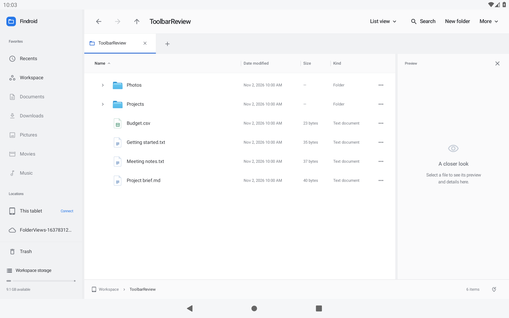
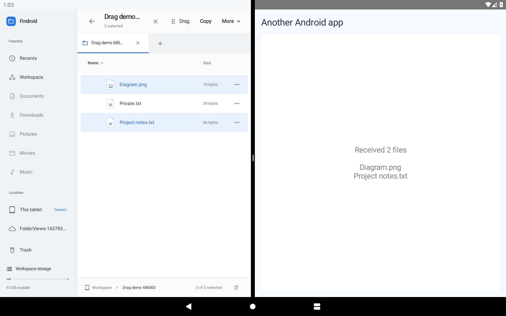
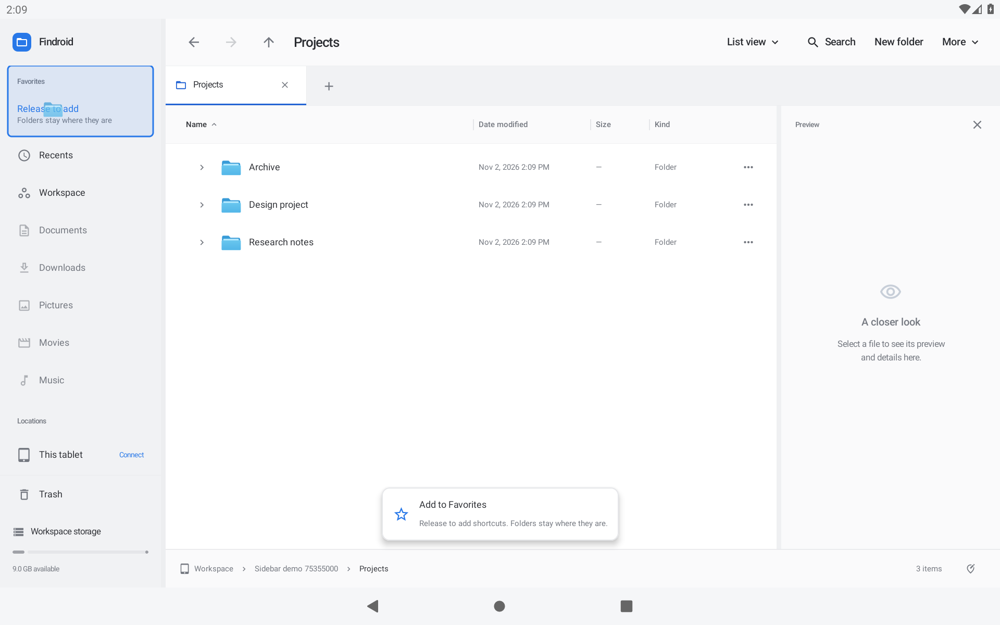
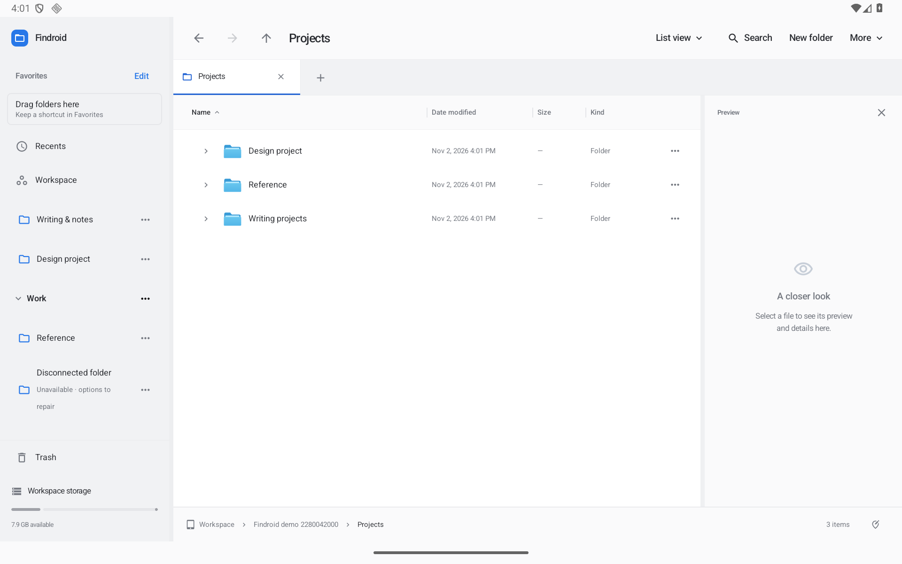
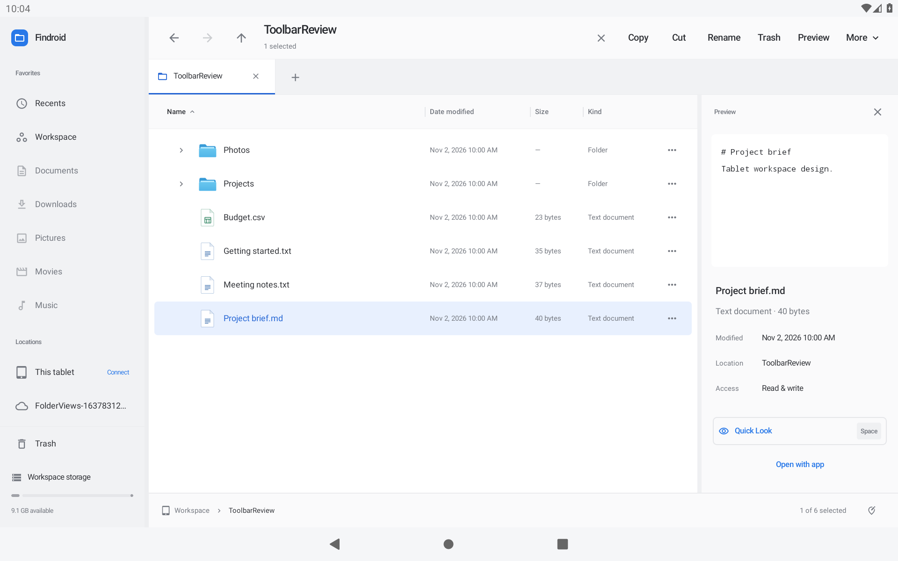
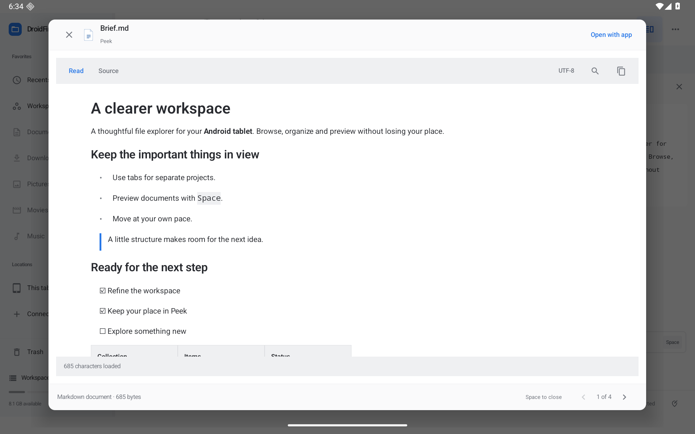

# Findroid

**A Finder-inspired file explorer that makes room for your files on Android.**

Browse folders, preview documents, organize a project, and move files between locations with tabs and two panes. Designed around the extra space on a tablet, with layouts for phones and support for a keyboard and mouse.

Native Android. Kotlin and Jetpack Compose. No account required.

**[Download the Android APK](https://github.com/moikdev/findroid/releases/tag/v0.32.0-preview)** · [What’s supported](PARITY.md) · [Test results](VALIDATION.md)



*Actual app screenshot with sample files. Android 11 or newer required. The current release is a development-signed preview.*

## Start here

1. Open the [0.32.0 release](https://github.com/moikdev/findroid/releases/tag/v0.32.0-preview) and download **`Findroid-0.32.0-preview.apk`**. Choose the preview APK; the unsigned APK is for developers.
2. Open it on your Android device. If Android asks, allow the app you used to download it to install apps, then confirm installation.
3. Launch Findroid and choose where to work:
   - **Workspace** is Findroid’s private folder. Use it to try the app immediately.
   - **Connect device storage** grants access to shared device storage through Android’s all-files permission.
   - **Connect folder…** lets you authorize a particular folder, USB/SD location, or an installed cloud document provider.

On a touchscreen, tap a file's name to open it, hold its name to start selecting, and hold its icon to drag. With a mouse, click to select, double-click to open, and drag the icon directly.

**Already using an older DroidFinder build?** Findroid uses a new app ID from version 0.26, so it installs separately from versions 0.24 and earlier. Copy any files you need out of the old app’s private Workspace before removing it.

## The features I’d try first

### Preview a file without losing your place

**Peek / Quick Look** is one of the best reasons to use a file explorer with a large screen. Check a photo, read a PDF, inspect a spreadsheet, or play a clip while keeping the surrounding folder close at hand.

- Images have zoom, pan, temporary rotation, and photo information.
- PDFs have thumbnails, contents, search, bookmarks, and a saved reading position.
- Markdown, CSV, JSON, code, and plain text have dedicated previews.
- Audio and video have playback controls, speed adjustment, and subtitle support where the media supports it.

Select a file for the side preview, or use **Quick Look** for a closer view. With a keyboard, select a file and press **Space**.

### Drop files into another app

Open Findroid beside another app in Android’s split screen. **Hold a file icon**, drag it across, and release it over the other app’s file-drop area. With a mouse, drag the icon directly.

For several files, hold a file’s **name** to start selecting, tap the other files, then hold **Drag** in the selection toolbar. Holding one of the selected file icons also carries the selection.

Other apps receive copies; your originals stay in place. The receiver gets temporary read access to the files you drop. Use **Share** for destinations that do not accept Android file drops. [Drag-and-drop guide](docs/DRAGGING.md).



*Actual Android 11 tablet capture with synthetic files and a separate QA receiving app.*

### Keep a folder in Favorites

Hold a **folder icon**, drag it to **Drag folders here** under Favorites, and release when the sidebar says **Release to add**. With a mouse, drag the icon directly. You can also select several folders and hold **Drag** to pin them together.

The folder stays in its original location. Findroid saves a shortcut in the sidebar, remembers it after restart, and keeps an existing favorite when you drop it again. Dropping files onto an existing favorite folder still copies or moves them into that folder. [Favorites and dragging](docs/DRAGGING.md#pin-folders-in-favorites).



*Actual optimized Android tablet capture with synthetic project folders.*

### Make Favorites work your way

**Hold a favorite's folder icon and drag it to the insertion line** to change its order. Its **…** menu can rename just the sidebar label, reveal the original, open it in another pane, move it into a group, or remove the shortcut. Your folders stay where they are.

Choose **Edit** beside Favorites to hide unused built-in locations or create collapsible groups. Missing folders show an explicit unavailable state with reconnect and repair actions. Duplicate names show their paths. Labels, groups and order survive restarting the app.



*Actual optimized Android tablet capture with synthetic folders. [Sidebar and navigation guide](docs/SIDEBAR-AND-NAVIGATION.md).*

### Find the action you need

Open **More → Find an action or folder…**, or press **Ctrl+Shift+P**. Type “rename,” “show hidden files,” or “preferences.” Commands explain when they are unavailable.

Use **Ctrl+K** or **More → Jump to folder…** for favorites, recent tab destinations, current folder children, breadcrumbs and authorized paths. Choose with the arrow keys and Enter. These controls stay inside named menus, keeping the main toolbar simple.

### Put the source and destination side by side

Two panes make a simple job feel simple: keep Downloads on one side and your project folder on the other, then copy or move selected files across. Each pane keeps its own tabs, location, search, and selection.

Save a named layout for a recurring task. Compare two folders when you need to see what differs, with optional file-content verification. [More about panes and layouts](docs/WORKSPACES.md).

### See what will happen before changing lots of files

The small details here matter. A filename collision offers **keep both, skip, rename, or replace**. Folder merges show conflicts. Batch rename lets you review the proposed names before applying numbering, text changes, or a saved preset.

Transfers have a queue with progress, pause, cancellation, and per-file results. Trash gives you a way back, and many operations support Undo during the current session. Interrupted transfers offer a review when you return to the app. [Transfers](docs/TRANSFER-CENTER.md) · [Batch rename](docs/RENAMING.md).

### Organize a project without rearranging every folder

Use **tags** to label files, **collections** to bring related files from different locations into one view, and **Smart Folders** to save searches that update when you open them.

For example, tag work documents “Project Atlas,” collect the files you need for a meeting, or save a search for large videos. Search can combine filename, kind, date, size, tags, and text content. [Tags and collections](docs/ORGANIZATION.md) · [Search options](docs/TAG-SEARCH.md).

### Make the folder fit the work

Choose **Icons, List, Columns, or Gallery** from the view menu. Use a list for details, columns to follow a folder hierarchy, or a gallery to browse images. Resize the sidebar and preview, choose which detail columns appear, and remember a view for a particular folder.

Natural sorting keeps `Photo 2` before `Photo 10`. Tabs remember where you were. The tablet toolbar keeps everyday actions visible with named controls for **Search**, **New folder**, and **More**.

## More useful tools

| When you need to… | Findroid can help with… |
| --- | --- |
| Look inside a ZIP | Browse and search it, preview supported members, and extract selected files. |
| Free up space | Inspect folder sizes, find large or old files, and review duplicate-file results before cleanup. |
| Check a download | Generate checksums, compare an expected hash, and write checksum sidecar files. |
| Save something from another app | Use Android’s share sheet and **Save to Findroid**, with destination review and retry. |
| Work with a keyboard | Navigate files, manage tabs, copy/paste, rename, and open the searchable **F1** shortcut guide. |
| Return to a familiar setup | Restore tabs, favorites, folder views, and named two-pane layouts. |

<table>
<tr>
<td width="50%"></td>
<td width="50%"></td>
</tr>
<tr><td>Named actions when files are selected.</td><td>Built-in document previews.</td></tr>
</table>

## Updates from inside the app

**Coming from 0.29?** Install the current preview APK over it once. The repository was renamed to `moikdev/findroid`, and 0.30 corrects the updater's repository address.

After installing this preview, open **More → App updates** to check for future versions. Optional automatic checks run at most once a day when the app opens or resumes. Downloads begin when you choose them.

Findroid verifies the downloaded APK’s size, SHA-256, app identity, version, Android compatibility, and signing certificate before asking Android to install it. Android may first ask you to allow Findroid as an installation source.

**Install updates over the existing app.** Uninstalling first removes its private data. Future update APKs must keep the same signing key. [How updates work](docs/APP-UPDATES.md).

## Your files and Android storage

Findroid does not require an account or upload your files. Update checks use HTTPS to read this repository’s release information and download an APK when requested. Cloud providers you connect handle their own accounts and network access.

Workspace, Trash, tags, and saved layouts live in the app’s private storage. **Uninstalling Findroid or clearing its data deletes those items.** Keep important files in shared storage or another backed-up location.

Android’s permissions still apply. A connected provider may be read-only or lack an operation; physical USB/SD devices and third-party cloud providers need device-specific testing. Read errors, incomplete searches, and transfer failures are reported in the app.

## What to expect from this preview

Findroid is an independent Android app inspired by Finder. It is not an Apple product and does not run macOS code. Android sharing and document providers cover portable workflows; AirDrop, iCloud login, macOS extensions, and direct SMB/NFS/SFTP clients are outside the current implementation.

The preview uses a development signing key. Production signing and wider physical-device acceptance remain open. Undo is session-based, and a killed transfer requires review rather than automatic replay. Use copies when trying unfamiliar bulk operations.

[Supported features and platform differences](PARITY.md) · [Verification and remaining coverage](VALIDATION.md) · [Roadmap](docs/ROADMAP.md)

## Build and contribute

You need **JDK 17**, **Android SDK 36**, and an Android 11+ device or emulator. Open the project in Android Studio, or build the installable preview from a terminal:

```sh
./gradlew :app:assemblePreview
adb install -r app/build/outputs/apk/preview/app-preview.apk
```

Run the local checks:

```sh
./scripts/check.sh
```

For native UI tests, use a dedicated emulator or test device; the tests create and modify test files:

```sh
ANDROID_SERIAL=emulator-5582 ./scripts/check.sh --device
```

To prepare release APKs, checksums, and the OTA manifest:

```sh
python3 scripts/package-preview.py --notes path/to/release-notes.md
```

The preview is optimized and signed with your local development key. The release variant is unsigned until you configure signing. A locally built APK with a different key cannot update an installed published preview.

Browse the Kotlin implementation in [`app/src/main/java/dev/findroid`](app/src/main/java/dev/findroid), JVM tests in [`app/src/test`](app/src/test), and Android workflow tests in [`app/src/androidTest`](app/src/androidTest). Feature guides and real screenshots live in [`docs`](docs). Hosted checks are manual-only.

Found a problem? [Open an issue](https://github.com/moikdev/findroid/issues) with your Android version, device/window size, storage type, and steps to reproduce. Screenshots help; leave out private file contents.

## What should improve next?

The [72 next-improvement proposals](docs/NEXT-IMPROVEMENTS.md) cover sidebar management, clearer actions, search, network storage, transfers, previews, accessibility, and reliability. The recommended next pass is favorite ordering and management, followed by setup backup and faster folder navigation. These are proposals; shipped work is tracked in [the roadmap](docs/ROADMAP.md).
