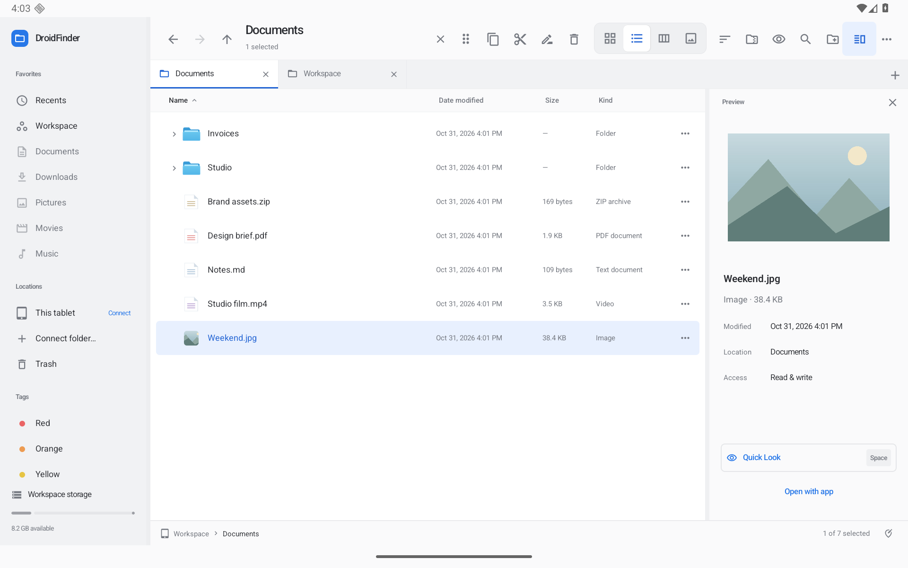

# DroidFinder

A native Android tablet file explorer inspired by macOS Finder. Kotlin, Jetpack Compose, real file operations, no account, no app-owned network connection. Cloud/network access runs through Android document providers you connect.

This is an independent implementation, not Apple source code or a macOS runtime. [Parity checklist and platform differences](PARITY.md).



Actual Android screenshot with synthetic QA documents. [Context menu](docs/screenshots/desktop-context.png) · [ZIP browser](docs/screenshots/desktop-archive.png). [Portrait](docs/screenshots/desktop-portrait.png) · [Compact window](docs/screenshots/desktop-compact.png) · [Dark appearance](docs/screenshots/desktop-dark.png)

**0.5.0:** Persistent transfer queue, pause/resume, per-file results/retry, conflict choices and recoverable replacement Undo/Redo. [Workflows and verification](docs/TRANSFER-CENTER.md).

[Transfer center](docs/screenshots/transfer-center.png) · [Conflict choices](docs/screenshots/file-conflict.png)

[Full improvement roadmap](docs/ROADMAP.md) — this is the first increment; the remaining roadmap is still in progress.

## Install or build

[Download the installable tablet preview](https://github.com/moikdev/droidfinder/releases/tag/v0.5.0-preview) · [Source repository](https://github.com/moikdev/droidfinder)

The **preview APK** is optimized and development-signed for installation on your tablet. Release APKs are unsigned until you configure your own production signing credentials.

Requires Android 11+, JDK 17+, and Android SDK 36. The layout supports tablet landscape and portrait, plus compact tablet windows. A phone-specific layout is deferred.

```sh
./gradlew assemblePreview
adb install -r app/build/outputs/apk/preview/app-preview.apk
```

On first launch, either use the private **Workspace**, choose **Connect tablet storage** to grant Android all-files access, or choose **Connect folder…** to authorize a folder through an installed document provider. Local folders and provider locations use the same views and actions. The app never creates sample files in your storage.

## Finder workflows

| Area | Implementation |
| --- | --- |
| Browsing | Sidebar, favorites, shared storage, SD/USB volumes, provider locations, reorderable tabs with independent history/search, reopen closed tab, back/forward/up, clickable path bar, Go to Folder, reveal enclosing folder |
| Views | Icons with adjustable size, sortable list with folder disclosure/expansion, browsing columns, gallery/filmstrip, resizable columns/preview/sidebar, compact toolbar |
| Selection/input | Tap/double-tap, touch multiple selection, Ctrl/Meta-click, Shift ranges, keyboard navigation, type-to-select, mouse context actions, rectangle selection, native dragging |
| Organizing | Create folder/text file, New Folder with Selection, destination picker, rename, batch rename (replace/prefix/suffix/numbered format), duplicate, copy/cut/paste |
| Undo/Redo | Session history for create/copy/move/rename, batch rename, grouping, Trash/restore, archives, shortcuts, and tag edits; content fingerprints stop Undo from removing later edits |
| Tags/appearance | Multiple named tags per item, custom tag colors/names, tag editing/deletion/filtering, custom folder color/symbol, persistent favorites and view preferences |
| Search | Recursive names, kind/date/size/tag/text-content criteria, saved live Smart Folders, Recents, hidden files, groups by kind/date/tag/size |
| Peek / Quick Look | Images with EXIF orientation, pinch/button zoom, all PDF pages with navigation/zoom, audio controls, video play/pause and seeking, text preview, folder counts/size and Get Info |
| File integration | Android default apps/Open With, temporary read grants for sharing, full-path copy, inert `.finderlink` shortcuts |
| Archives/Trash | Named ZIP creation with compression levels, read-only archive browsing, extraction with path checks; recoverable Trash and restore, Undo, explicit confirmation for permanent deletion/emptying |
| Transfers | Persistent copy/move queue, pause/resume/cancel, notification controls, per-file results/retry, reorder, foreground service, browsing during transfers and explicit interruption review |
| Conflicts | Compare incoming/existing items; keep both, skip, rename or replace with recoverable Undo/Redo; apply to remaining conflicts |
| Persistence | Tabs/current locations, view/sort/group settings, sizes, preview/hidden/extension preferences, theme, favorites, tags, Smart Folders, provider grants, folder appearance, Trash recovery metadata |

Mouse users can drag file icons. On touch, select items and hold the drag grip in the selection bar, then drop onto a folder, breadcrumb, sidebar location, or tab. Hold Ctrl/Alt when starting a drag to copy. Files can also be dragged out to compatible Android apps; content-URI drops from other apps can be imported into writable folders.

## Keyboard

| Shortcut | Action |
| --- | --- |
| Ctrl/Meta F, L | Search; Go to Folder |
| Ctrl/Meta T, W, Shift T | New tab; close tab; reopen closed tab |
| Ctrl Tab / Shift Tab; Ctrl Page Up/Down | Next/previous tab |
| Ctrl/Meta 1–4; R | Icons/list/columns/gallery; refresh |
| Shift F10 | File or background context menu |
| Ctrl/Meta N / Shift N | New folder |
| Ctrl/Meta A, C, X, V, D | Select all; copy; cut; paste; duplicate |
| Ctrl/Meta Z, Shift Z / Ctrl Y | Undo; Redo |
| Ctrl/Meta I, O | Get Info; open |
| Ctrl/Meta period | Hidden files |
| Ctrl/Meta Alt S | Sidebar |
| Alt Left/Right/Up | Back; forward; enclosing folder |
| Arrow keys; Home/End | Select/navigate; Shift extends selection |
| Space; Enter; F2 | Peek; open; rename/batch rename |
| Space / Escape in Peek; arrows | Close preview; browse files |
| Delete / Ctrl/Meta Delete | Move to Trash |
| Ctrl/Meta Shift Delete | Empty Trash confirmation |

Normal text-field editing shortcuts remain available while editing. Toolbar actions, menus, and preferences provide touch equivalents.

## Storage, privacy, and recovery

- Android all-files access is optional and user-controlled. Other apps' private directories remain protected. [Android storage access](https://developer.android.com/training/data-storage/manage-all-files). Play Store distribution requires the corresponding file-manager permission review.
- Provider permissions are scoped to folders you authorize and retained through Android's persistable grants. Read-only items remain readable/copyable; writes, moves, rename and deletion follow provider capabilities. Providers may require their own account or network access.
- **Uninstalling DroidFinder or clearing its data deletes Workspace, Trash, tags, favorites, Smart Folders and folder appearance.** Restore important files to shared/provider storage first. Trash and provider previews consume internal storage, including when the original lived on USB/SD/cloud storage.
- Transfers can ask about conflicts, keep both, skip or replace with recovery. Folder merge remains in the roadmap. Copies without an explicit replacement and restores choose unused names. Hidden staging items are exposed under their final names only after successful copying. Sources are removed only after destination copies complete. No silent overwrites. Providers must support the create/rename/delete operations needed for staged transfers.
- Undo/Redo is a 50-command session history; it does not survive a process restart. Changed-file checks protect later edits. Permanent deletion is intentionally not undoable and clears history. Batch failures preserve completed work; a mid-operation storage disconnect may require reviewing the affected folders.
- Transfers use an Android `dataSync` foreground service and an application-owned model, so closing/recreating the activity does not cancel a copy. Android can still force-stop/kill an app or enforce service limits. On the next launch an interruption journal offers a destination review. Completed items are kept; incomplete `.droidfinder-*` staging items may remain after process death. Transfers are not blindly replayed after a crash. [Foreground services](https://developer.android.com/develop/background-work/services/fgs/service-types).
- Symlinks are not copied/compressed. Trash deletion and folder-size traversal do not follow symlinks. App shortcuts are inspectable data files, not executable links or macOS aliases.
- ZIP extraction rejects traversal/duplicate paths, caps output at 10,000 entries / 2 GiB, and cleans staging on ordinary failures/cancellation.
- Search examines up to 50,000 entries per root, lists at most 5,000 results, and reports limited/inaccessible results. Recents shows up to 200 newest modified files across accessible roots. Text-content search reads the first 1 MiB of supported text files; it is an on-demand search, not Spotlight's system index.
- Provider image/document previews cache up to 128 MiB per file; Peek audio/video uses the authorized content URI directly. Larger/unsupported files can open in another app. Cloud providers choose supported formats, offline behavior, naming and timestamp semantics. Real third-party accounts and physical USB/SD hardware still require device testing.
- Tags, shortcuts, favorites and folder appearance are app metadata. App-initiated moves/copies/renames update stored paths. Edits made outside DroidFinder can invalidate path-based metadata and shortcuts. They are not macOS extended attributes.

## Verification

```sh
./scripts/check.sh
ANDROID_SERIAL=emulator-5582 ./scripts/check.sh --device
```

Use a dedicated emulator/device for instrumentation, so other apps' tests cannot take focus. The test suite covers filesystem collisions, nested/cancelled transfers, Undo/Redo and edited-file protection, batch rename, malicious archives, tags/shortcuts, actual tablet UI workflows, a debug-only document provider, PDF/audio Quick Look, and transfer lifecycle behavior. The fixture provider is excluded from preview/release builds.

GitHub Actions is configured to run unit tests, lint and an optimized unsigned release build on pushes/PRs, and upload reports plus the unsigned APK. GitHub currently prevents this account's runners from starting because of a billing/spending-limit issue; local verification is recorded in [VALIDATION.md](VALIDATION.md). The installable preview release is development-signed separately; a production release needs your signing key.

To produce validated preview artifacts and SHA-256 checksums with Python 3.9+:

```sh
./scripts/package-preview.py
# Optional: run UI tests on a dedicated device after the build
ANDROID_SERIAL=emulator-5582 ./scripts/package-preview.py --device
```

The script validates preview/release version agreement, verifies the development signature, rejects debuggable APKs and debug fixture providers, and writes artifacts plus build metadata under `captures/release/`. It does not publish or create production signing keys.

## Code map

- `FileEngine`, `ZipArchive`, `FileHistory`, `BatchRename`, `TransferControl`: safe local operations, session command history, name planning, cancellation/progress.
- `DocumentAccess`: document-provider capabilities, grants, cross-storage IO, previews and recoverable provider Trash.
- `FinderModel`, `FinderApplication`, `TransferService`: navigation/state, app lifetime, transfer execution/notification and recovery.
- `TagStore`, `FolderStyleStore`, `SearchRules`: persistent metadata, shortcuts, Smart Folder criteria and grouping.
- `FinderApp`, `FinderViews`, `FinderDialogs`, `DesktopMenus`, `DesktopTabs`, `ArchiveDialogs`, `ViewModeSelector`, `TransferStrip`, `FinderDragDrop`, `MarqueeSelection`: tablet UI and pointer/keyboard workflows.
- `FileVisuals`, `QuickLookMedia`: file graphics, previews, document/image zoom and media controls.
- `MainActivity`: Android storage authorization, opening and sharing.
