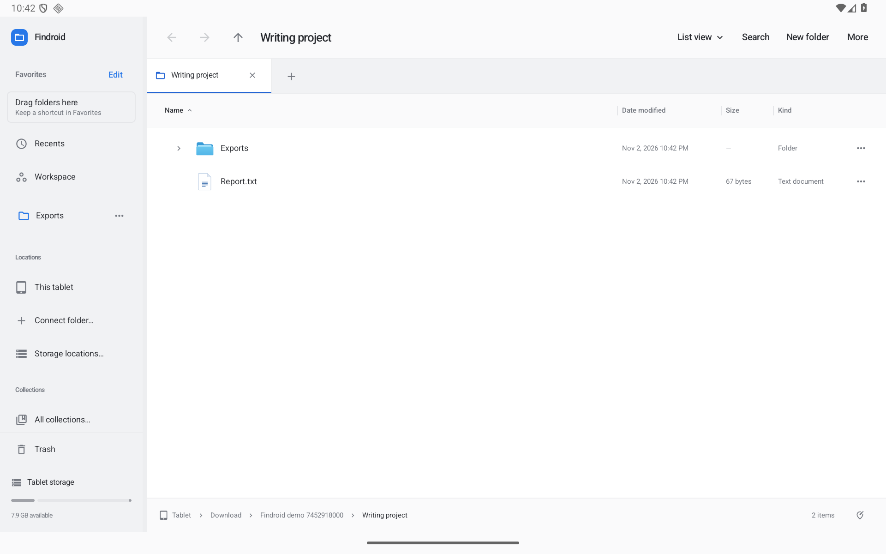
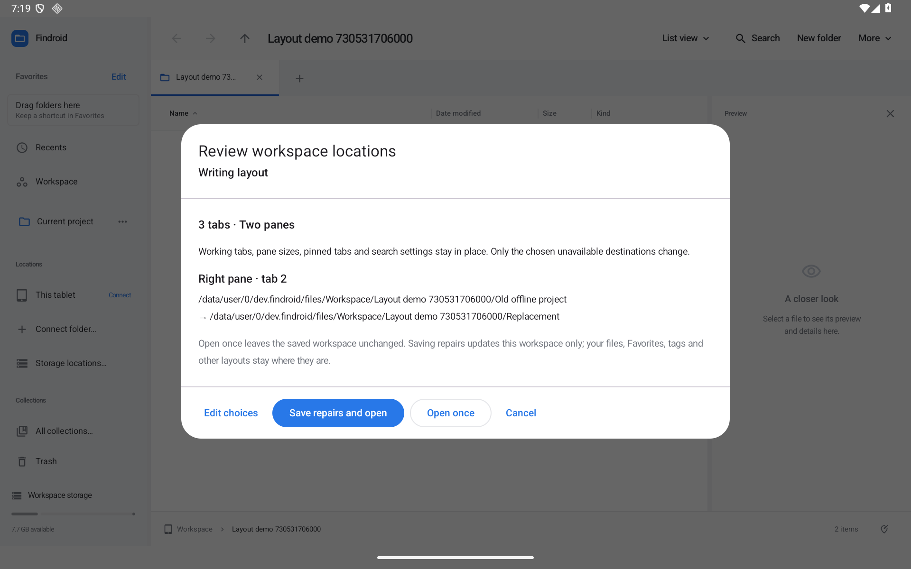
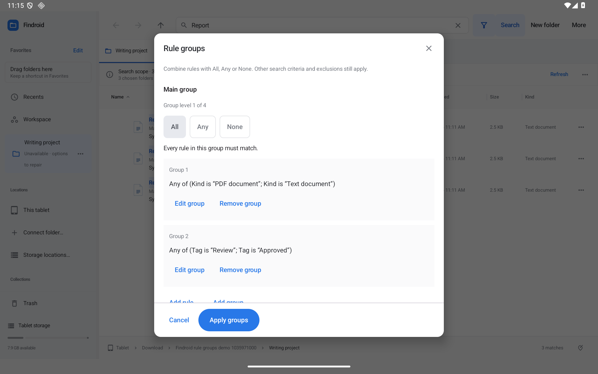
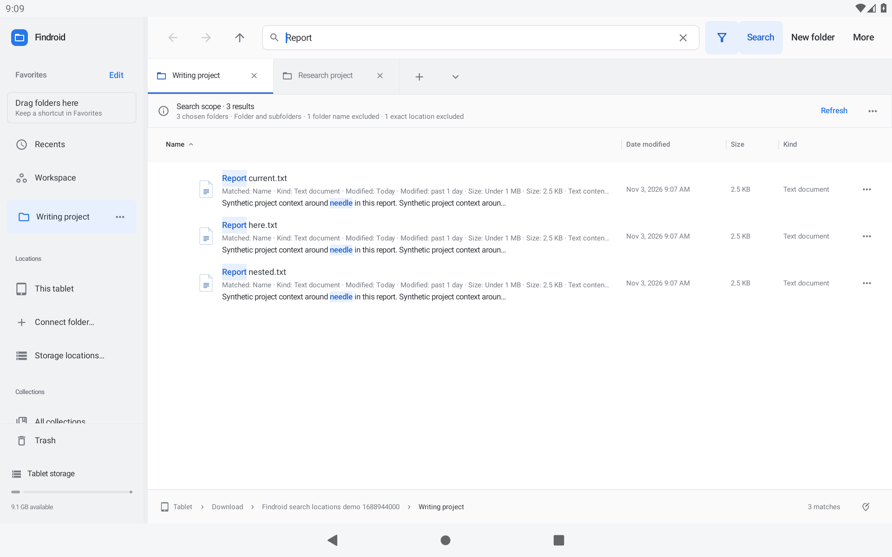
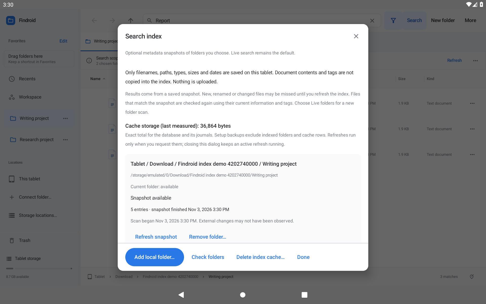
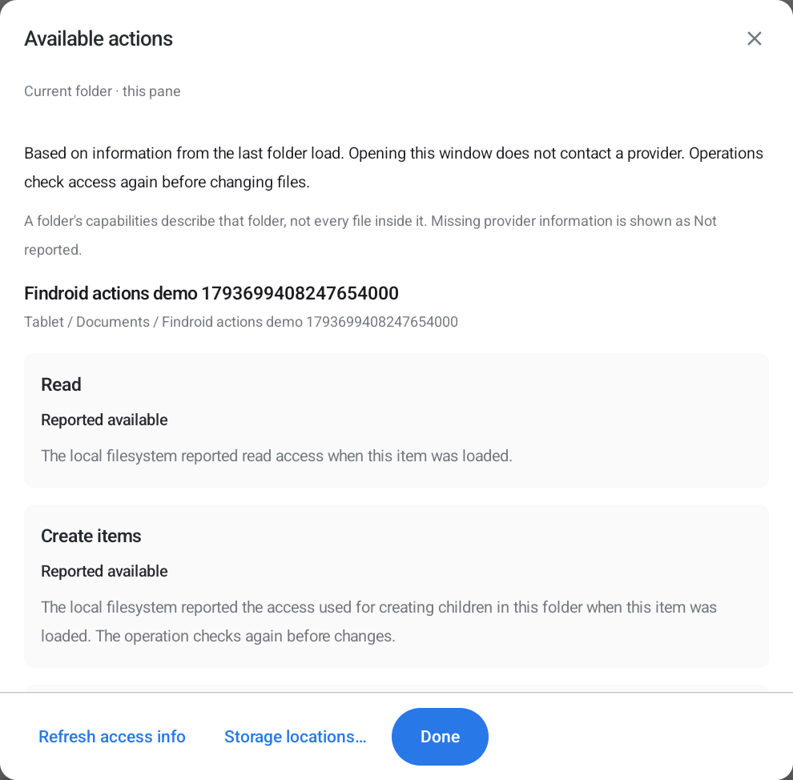
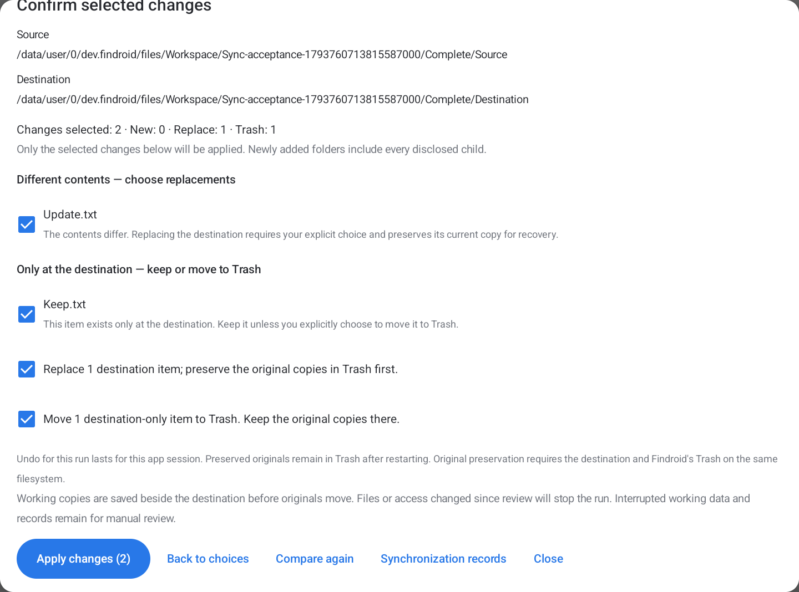
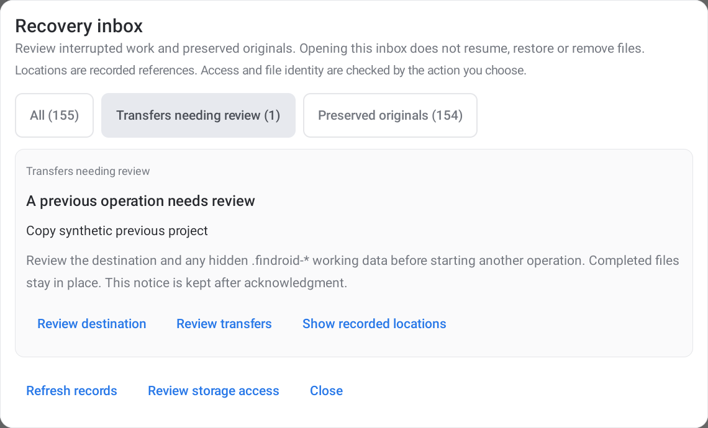

# Findroid

**A Finder-inspired file explorer that makes room for your files on Android.**

Browse folders, preview documents, organize a project, and move files between locations with tabs and two panes. Designed around the extra space on a tablet, with layouts for phones and support for a keyboard and mouse.

Native Android. Kotlin and Jetpack Compose. No account required.

**[Download the Android APK](https://github.com/moikdev/findroid/releases/tag/v0.47.0-preview)** · [What’s supported](PARITY.md) · [Test results](VALIDATION.md)



*Actual app screenshot with sample files. Android 11 or newer required. The current release is a development-signed preview.*

## Start here

1. Open the [0.47.0 release](https://github.com/moikdev/findroid/releases/tag/v0.47.0-preview) and download **`Findroid-0.47.0-preview.apk`**. Choose the preview APK; the unsigned APK is for developers.
2. Open it on your Android device. If Android asks, allow the app you used to download it to install apps, then confirm installation.
3. Launch Findroid and choose where to work:
   - **Workspace** is Findroid’s private folder. Use it to try the app immediately.
   - **Connect device storage** grants access to shared device storage through Android’s all-files permission.
   - **Connect folder…** lets you authorize a particular folder, USB/SD location, or an installed cloud document provider.

On a touchscreen, tap a file's name to open it, hold its name to start selecting, and hold its icon to drag. With a mouse, click to select, double-click to open, and drag the icon directly.

**Already using an older DroidFinder build?** Findroid uses a new app ID from version 0.26, so it installs separately from versions 0.24 and earlier. Copy any files you need out of the old app’s private Workspace before removing it.

## The features I’d try first

### Preview a file without losing your place

**Peek / Quick Look** is one of the best reasons to use a file explorer with a large screen. Check a photo, read a PDF, inspect a spreadsheet, or play a clip while keeping the surrounding folder close at hand.

- Images have zoom, pan, temporary rotation, and photo information.
- PDFs have thumbnails, contents, search, bookmarks, and a saved reading position.
- Markdown, CSV, JSON, code, and plain text have dedicated previews.
- Audio and video have playback controls, speed adjustment, and subtitle support where the media supports it.

Select a file for the side preview, or use **Quick Look** for a closer view. With a keyboard, select a file and press **Space**.

### Drop files into another app

Open Findroid beside another app in Android’s split screen. **Hold a file icon**, drag it across, and release it over the other app’s file-drop area. With a mouse, drag the icon directly.

For several files, hold a file’s **name** to start selecting, tap the other files, then hold **Drag** beside the selected count. Holding one of the selected file icons also carries the selection.

Other apps receive copies; your originals stay in place. The receiver gets temporary read access to the files you drop. Use **Share** for destinations that do not accept Android file drops. [Drag-and-drop guide](docs/DRAGGING.md).


*Actual Android 11 tablet capture with synthetic files and a separate QA receiving app.*

### Keep a folder in Favorites

Hold a **folder icon**, drag it to **Drag folders here** under Favorites, and release when the sidebar says **Release to add**. With a mouse, drag the icon directly. You can also select several folders and hold **Drag** to pin them together.

The folder stays in its original location. Findroid saves a shortcut in the sidebar, remembers it after restart, and keeps an existing favorite when you drop it again. Dropping files onto an existing favorite folder still copies or moves them into that folder. [Favorites and dragging](docs/DRAGGING.md#pin-folders-in-favorites).


*Actual optimized Android tablet capture with synthetic project folders.*

### Make Favorites work your way

**Hold a favorite's folder icon and drag it to the insertion line** to change its order. Its **…** menu can rename just the sidebar label, reveal the original, open it in another pane, move it into a group, or remove the shortcut. Your folders stay where they are.

Choose **Edit** beside Favorites to hide unused built-in locations or create collapsible groups. Missing folders show an explicit unavailable state with reconnect and repair actions. Duplicate names show their paths. Labels, groups and order survive restarting the app.


*Actual optimized Android tablet capture with synthetic folders. [Sidebar and navigation guide](docs/SIDEBAR-AND-NAVIGATION.md).*

### Reopen a project after storage changes

A saved two-pane workspace can outlive a disconnected drive or a moved folder. Findroid checks its tab destinations before opening and names the tabs that need attention. Reconnect the storage or choose a replacement, then review the changes.

**Open once** tries the repaired layout without changing its saved copy. **Save repairs and open** remembers the new locations in that workspace. Working tabs, pane layout, pinned tabs and search filters stay in place. [Workspace recovery guide](docs/WORKSPACE-RECOVERY.md).



### Take your setup to another tablet

Open **Preferences → Back up or restore setup…** to save Favorites, tags, collections, Smart Folders, workspaces, open tabs, folder appearance, rename presets, and browsing preferences in one JSON file.

Restore only the sections you want. **Merge** keeps your existing setup and combines the incoming references. If storage paths changed, choose a replacement root and review what can be found before applying. Open tabs arrive as a **Restored open tabs** workspace, ready to open when you choose.

Findroid saves a private recovery copy before restoring and checks for interrupted restores at startup. The backup contains names, paths, and settings; keep it private. Copy your actual files separately and reconnect storage access on the new tablet. [Setup backup and restore guide](docs/SETUP-BACKUP.md).


*Actual optimized Android tablet capture with synthetic project data.*

### Find the action you need

Open **More → Find an action or folder…**, or press **Ctrl+Shift+P**. Type “rename,” “show hidden files,” or “preferences.” Commands explain when they are unavailable.

Use **Ctrl+K** or **More → Jump to folder…** for favorites, recent tab destinations, current folder children, breadcrumbs and authorized paths. Choose with the arrow keys and Enter. These controls stay inside named menus, keeping the main toolbar simple.

### Keep commands clear, and reach Undo in one place

**Search, New folder, and More** keep the same names and order while you browse or select files. Selection has its own count, location and **Selection actions** beside the file list. Tap an unavailable command for its reason and a useful next step, such as copying a read-only file or reconnecting storage.

Open **More → Recent actions…** to see eligible operations and use **Undo** or **Redo**. Findroid checks the affected files first. If you edited a file afterward, recovery stops and explains why, keeping those later edits intact.

Recent actions keeps up to 50 actions across panes and app windows. Supported local changes marked **Saved for restart** survive reopening Findroid, so you can come back and undo a copy, rename, move, or Trash action. **This session only** identifies provider, replacement, organization, and unsupported actions. Nothing runs automatically when you reopen. [Undo after reopening](docs/PERSISTENT-UNDO.md).


### See why a search found a file

Matching words are highlighted in filenames. A short explanation tells you whether the match came from the name, tags, file kind, date, size, or text contents. Content searches show a nearby plain-text snippet, so you can check a result before opening it.

Use **More → Search filters…** for **This week**, **Over 1 GB**, or **Images**. Exclude one folder such as `Project A/Cache` while keeping `Project B/Cache` searchable. Save the criteria as a Smart Folder to reuse them. Calendar choices follow your local date; snippets stay in the current listing and are omitted from saved setup data. [Search guide](docs/SEARCH-CRITERIA.md).


### Run a search again

Start typing to bring up recent queries with their full filters. Tap a suggestion, or use **↓ / ↑** and **Enter**. Findroid saves finished searches, so each keystroke does not become another history entry.

Open **More → Recent searches…** to review up to 20. **Search here** reuses the query and filters in the current project; **Search original location** returns to where you used them before. **Show filters** lets you inspect the date, size, tags, text and exclusions first. Reusing rules from a Smart Folder keeps that saved folder independent.

This is useful when you repeat the same filters across projects without wanting a permanent Smart Folder for every query. You can pause recording, remove an entry, or clear history in the same window. History stays on this tablet and out of setup backups. [Recent-search guide](docs/RECENT-SEARCHES.md).


### Combine alternatives without losing the rest of your filters

Find **PDFs or text documents** tagged **Review or Approved**. Open **More → Search filters… → Add rule groups…**, choose **All**, **Any**, or **None**, and add the conditions you need. Nest groups to combine alternatives, then check the plain-language summary before applying.

The whole group still respects your chosen folders, dates, sizes, text query, and exclusions. Cancel leaves the parent draft unchanged. Save the result as a Smart Folder or reuse it from recent searches. [Rule-group guide](docs/SEARCH-RULE-GROUPS.md).



### Search a whole project, even across folders

Open **More → Search locations…** and choose up to ten folders. Search your writing folder and research folder together, including folders from a connected document provider. Overlapping locations show each document once.

A disconnected folder does not hide the results from the others. **Result details** shows which folders finished, are unavailable, or still need scanning. Save the search as a Smart Folder to keep that complete project scope across restarts.

Recent searches keep the scope too. **Search original location** reuses the chosen folders; **Search here** and typing suggestions reuse the filters in your current folder. [Search-location guide](docs/SEARCH-LOCATIONS.md).



*Actual optimized Android tablet capture with sample text files.*

### Search a chosen local library from a snapshot

For a library you search repeatedly, open **More → Search index…** and add just the local folders you want. Findroid saves filenames, paths, types, sizes and dates on the tablet. It does not copy document contents or schedule background refreshes.

In **Search criteria**, choose **Live folders** or **Local index**. Live folders remain the default. An indexed result shows its snapshot date in **Result details**, and matching files are checked again using their current information, tags and text filters.

The management window shows storage use and lets you refresh, pause, restart or remove snapshots. A failed or interrupted refresh keeps the last complete generation. Newly created, renamed or changed files may be missed until you refresh; **Use live folders** is always available for a new folder scan. Deleting the index keeps your documents, Favorites, tags and saved searches. [Local search index guide](docs/LOCAL-SEARCH-INDEX.md).



*Actual optimized Android tablet capture with synthetic project folders.*

### Understand why an action is unavailable

Select items, then choose **More → Available actions…**. With no selection, it describes the current folder. See which actions were reported available, which are unavailable, and which information a provider did not report. Mixed selections have exact counts and up to three named examples.

Opening the window uses cached information. **Refresh access info** explicitly reloads permissions and folder information in the background. A connected folder does not promise the same capabilities for all its children. Provider Trash is explained as a local recovery copy before deleting the original, with no claim to use the provider's own Trash. [Available actions guide](docs/STORAGE-ACTIONS.md).



*Actual optimized Android tablet capture with a synthetic project folder.*

### Put the source and destination side by side

Two panes make a simple job feel simple: keep Downloads on one side and your project folder on the other, then copy or move selected files across. Each pane keeps its own tabs, location, search, and selection.

Save a named layout for a recurring task. Compare two folders when you need to see what differs, with optional file-content verification. [More about panes and layouts](docs/WORKSPACES.md).

### Review folder synchronization before it runs

Keep a source folder in one pane and its destination in the other. Open **More → Compare folders… → Review synchronization…** to choose a direction and see additions, changed files, conflicts and destination-only items separately.

New items are selected first. Replacements and moves to Trash each need their own confirmation, and the original destination copies are preserved before replacements are published. Changed files or an occupied name stop the run for review. **Synchronization records…** keeps the recorded locations available after an interruption; opening it never retries the work.

This works with separate local folders on supported storage. Workspace is the tested option on Android 11; some shared-storage filesystems reject the safe rename and leave working copies for manual review. [Supported storage, Undo and recovery](docs/REVIEWED-FOLDER-SYNC.md).



*Actual optimized Android tablet dialog, scrolled to the confirmations, with synthetic files. The browser backdrop is excluded.*

### See what will happen before changing lots of files

The small details here matter. A filename collision offers **keep both, skip, rename, or replace**. Folder merges show conflicts. Batch rename lets you review the proposed names before applying numbering, text changes, or a saved preset.

Transfers have a queue with progress, pause, cancellation, and per-file results. Recent speed and time remaining describe the current phase, so copying and verification stay clear. If storage takes time to respond, the progress view explains what it is waiting for. Enlarged text and narrow panes put the named controls below the progress text. [Transfer progress](docs/TRANSFER-PROGRESS.md).

For an important copy, choose **Paste and verify…** or **Duplicate and verify…**, review the sources and destination, then choose **Copy and verify**. Findroid reads the unfinished copy back and checks its SHA-256 and byte count before making it available. **More → Transfers → Details** keeps the results and explains mismatches, read failures and incomplete work. Your source stays in place. [Copy verification](docs/COPY-VERIFICATION.md).

If Android stops a supported large local copy into **Workspace**, open **Transfers → Review saved copy…**. Check the source, destination and saved amount, then choose **Resume saved copy**. Findroid checks the saved bytes again and reads the completed file back before finishing. Closing the review starts no copy; **Discard saved bytes…** asks separately and keeps the source and destination documents. This first increment supports local files of at least 8 MiB; connected providers, folders, moves and unsupported destinations keep their existing restart behavior. [Saved-copy recovery](docs/PARTIAL-COPY-RESUME.md).


Trash gives you a way back, and many operations support Undo during the current session. Interrupted transfers offer a review when you return to the app. [Transfers](docs/TRANSFER-CENTER.md) · [Batch rename](docs/RENAMING.md).


### Find interrupted work in one place

**More → Recovery inbox…** brings failed transfers, saved partial copies, preserved originals, synchronization records and earlier operation notices together. Each record offers a named next step, such as **Review transfer**, **Review saved copy**, or **Review Trash**.

Opening the inbox reads the records. Resuming a transfer or restoring an original stays a separate decision, and complete recorded paths help you check the right destination. Acknowledging a startup notice keeps it available here after restart. [Recovery inbox guide](docs/RECOVERY-INBOX.md).



*Actual optimized Android tablet dialog with a synthetic operation notice. The browser backdrop is excluded. Available in the public 0.47 preview. Local, actual public OTA and independent immutable-archive acceptance pass.*

### Organize a project without rearranging every folder

Use **tags** to label files, **collections** to bring related files from different locations into one view, and **Smart Folders** to save searches that update when you open them.

For example, tag work documents “Project Atlas,” collect the files you need for a meeting, or save a search for large videos. Search can combine filename, kind, date, size, tags, and text content. [Tags and collections](docs/ORGANIZATION.md) · [Search options](docs/TAG-SEARCH.md).

### Make the folder fit the work

Choose **Icons, List, Columns, or Gallery** from the view menu. Use a list for details, columns to follow a folder hierarchy, or a gallery to browse images. Resize the sidebar and preview, choose which detail columns appear, and remember a view for a particular folder.

Natural sorting keeps `Photo 2` before `Photo 10`. Tabs remember where you were. The tablet toolbar keeps everyday actions visible with named controls for **Search**, **New folder**, and **More**.

## More useful tools

| When you need to… | Findroid can help with… |
| --- | --- |
| Look inside a ZIP | Browse and search it, preview supported members, and extract selected files. |
| Free up space | Inspect folder sizes, find large or old files, and review duplicate-file results before cleanup. |
| Check a download | Generate checksums, compare an expected hash, and write checksum sidecar files. |
| Save something from another app | Use Android’s share sheet and **Save to Findroid**, with destination review and retry. |
| Work with a keyboard | Navigate files, manage tabs, copy/paste, rename, and open the searchable **F1** shortcut guide. |
| Return to a familiar setup | Restore tabs, favorites, folder views, and named two-pane layouts. |

<table>
<tr>
<td width="50%"></td>
<td width="50%"></td>
</tr>
<tr><td>Named actions when files are selected.</td><td>Built-in document previews.</td></tr>
</table>

## Updates from inside the app

**Coming from 0.29?** Install the current preview APK over it once. The repository was renamed to `moikdev/findroid`, and 0.30 corrects the updater's repository address.

After installing this preview, open **More → App updates** to check for future versions. Optional automatic checks run at most once a day when the app opens or resumes. Downloads begin when you choose them.

Findroid verifies the downloaded APK’s size, SHA-256, app identity, version, Android compatibility, and signing certificate before asking Android to install it. Android may first ask you to allow Findroid as an installation source.

**Install updates over the existing app.** Uninstalling first removes its private data. Future update APKs must keep the same signing key. [How updates work](docs/APP-UPDATES.md).

## Your files and Android storage

Findroid does not require an account or upload your files. Update checks use HTTPS to read this repository’s release information and download an APK when requested. Cloud providers you connect handle their own accounts and network access.

Workspace, Trash, tags, and saved layouts live in the app’s private storage. **Uninstalling Findroid or clearing its data deletes those items.** Keep important files in shared storage or another backed-up location.

Android’s permissions still apply. A connected provider may be read-only or lack an operation; physical USB/SD devices and third-party cloud providers need device-specific testing. Read errors, incomplete searches, and transfer failures are reported in the app.

## What to expect from this preview

Findroid is an independent Android app inspired by Finder. It is not an Apple product and does not run macOS code. Android sharing and document providers cover portable workflows; AirDrop, iCloud login, macOS extensions, and direct SMB/NFS/SFTP clients are outside the current implementation.

The preview uses a development signing key. Production signing and wider physical-device acceptance remain open. Undo is session-based, and a killed transfer requires review rather than automatic replay. Use copies when trying unfamiliar bulk operations.

[Supported features and platform differences](PARITY.md) · [Verification and remaining coverage](VALIDATION.md) · [Roadmap](docs/ROADMAP.md)

## Build and contribute

You need **JDK 17**, **Android SDK 36**, **NDK 27.1.12297006**, **CMake 3.22.1**, and an Android 11+ device or emulator. The native build tools provide the atomic no-replace file publication used by saved-copy recovery and persistent local Undo. Open the project in Android Studio, or build the installable preview from a terminal:

```sh
./gradlew :app:assemblePreview
adb install -r app/build/outputs/apk/preview/app-preview.apk
```

Run the local checks:

```sh
./scripts/check.sh
```

For native UI tests, use a dedicated emulator or test device; the tests create and modify test files:

```sh
ANDROID_SERIAL=emulator-5582 ./scripts/check.sh --device
```

To prepare release APKs, checksums, and the OTA manifest:

```sh
python3 scripts/package-preview.py --notes path/to/release-notes.md
```

The preview is optimized and signed with your local development key. The release variant is unsigned until you configure signing. A locally built APK with a different key cannot update an installed published preview.

Browse the Kotlin implementation in [`app/src/main/java/dev/findroid`](app/src/main/java/dev/findroid), JVM tests in [`app/src/test`](app/src/test), and Android workflow tests in [`app/src/androidTest`](app/src/androidTest). Feature guides and real screenshots live in [`docs`](docs). Hosted checks are manual-only.

Found a problem? [Open an issue](https://github.com/moikdev/findroid/issues) with your Android version, device/window size, storage type, and steps to reproduce. Screenshots help; leave out private file contents.

## What should improve next?

The [72 next-improvement proposals](docs/NEXT-IMPROVEMENTS.md) cover sidebar management, clearer actions, search, network storage, transfers, previews, accessibility, and reliability. Favorite ordering, folder navigation, setup backup, saved-workspace recovery, clearer commands, search explanations, recent-search history, chosen search folders, nested search rules, optional local search snapshots, per-document action explanations, copy verification, saved-copy recovery, persistent local Undo, reviewed folder synchronization, and the recovery inbox have shipped in verified increments. **35 of 72 are implemented; 37 remain open or partial.** Work continues on storage connections, transfers, accessibility, and the remaining items. Follow each proposal in the [improvement tracker](docs/IMPROVEMENT-TRACKER.md).
