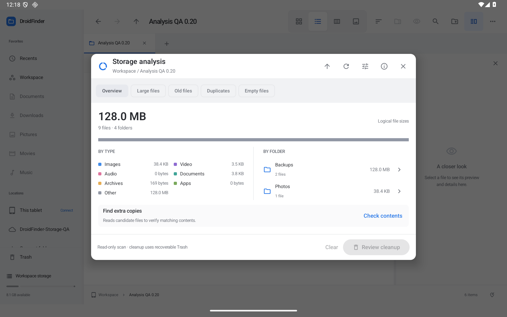
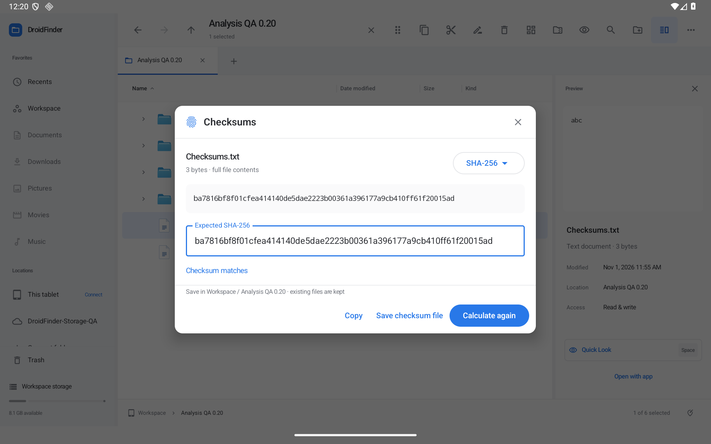

# Storage analysis and checksums — 0.20.0

Choose **Actions → Analyze storage…** to measure the current folder, or select a folder first to analyze that scope. The overview groups logical file sizes by type and top-level folder. Open a folder's chevron to analyze it, and use the enclosing-folder control to go back up. Nothing is removed during a scan or content check.

**Large files** offers 10 MB, 100 MB and 1 GB thresholds. **Old files** offers 90 days, one year and three years by reported modification time. **Empty files** finds zero-byte regular files. Thresholds, hidden-file inclusion and limits are remembered. Links, special filesystem objects and internal working files are excluded. Folder/package contents are ordinary accessible entries, not privileged access to another app's private files.

[Large files](screenshots/analysis-large.png) · [Old files](screenshots/analysis-old.png) · [Empty files](screenshots/analysis-empty.png) · [Duplicate contents](screenshots/analysis-duplicates.png) · [Cleanup review](screenshots/analysis-review.png)

## Duplicate checks and cleanup

Press **Check contents** to read candidate files. Matching sizes or names alone never produce a duplicate result. Files are streamed in 64 KiB buffers, checked with full SHA-256 digests, and re-read for metadata changes. Local hard-link aliases are excluded from extra-copy groups. Known empty files are handled by the Empty files view.

Providers that omit sizes are supported. When an unknown-size file is present, known-size singleton files are also checked so matches are not missed. Complete reads establish observed sizes; an unknown-size empty stream can then appear in Empty files. Truncated known-length streams, changed metadata and read failures do not publish a verified checksum. A capped or interrupted read never contributes a partial digest.

**Select extra copies** leaves a file in every group and prefers keeping a read-only copy when one exists. Selection remains editable. Review cleanup shows the complete scrollable selection and requires confirmation. Cleanup rechecks the file and analyzed-root identities/metadata, and duplicate cleanup rehashes both each selected file and a retained copy. Files whose sizes were established by content reads also retain a hash guard. Changed/inaccessible items are skipped and reported. At least one copy must remain outside the cleanup selection for every duplicate group.

Cleanup uses the existing foreground file-operation service, recoverable Trash and session Undo history. It does not permanently delete files or promise an immediate increase in free space: Trash still holds the data. Completed members remain recoverable if a later member fails or the user stops the operation. App operations serialize namespace mutations; live writes from another app's already-open descriptor are not transactionally locked.

## Checksums

Select one regular file and choose **Checksums…** from its Actions or cursor menu. SHA-256 is the default; SHA-512, SHA-1 and MD5 are also available for compatibility. The displayed digest is published only after the complete stream has been read and its reported identity/metadata rechecked. Unknown provider sizes are measured from the actual stream. Copy the digest or paste an expected value to see an explicit match, mismatch or format error.

Expected values can be plain hexadecimal, colon-separated hex, an algorithm-prefixed value, or a single GNU-style checksum line. A multi-file manifest is not treated as a batch verification request. Choose the matching algorithm before comparing.

**Save checksum file** shows the known containing folder, validates the name and stages a new sidecar without replacing existing files. If the parent is not known, open the containing folder first. Successful saves enter session Undo. Sidecars use the selected algorithm's extension and the [GNU untagged checksum format](https://www.gnu.org/software/coreutils/manual/html_node/cksum-output-modes.html), including escaped backslashes, line feeds and carriage returns in names. A checksum records the contents that were read; later edits naturally require calculating it again.

[Mismatch](screenshots/checksum-mismatch.png) · [SHA-512](screenshots/checksum-sha512.png) · [Dark analysis](screenshots/analysis-dark.png) · [Portrait](screenshots/analysis-portrait.png) · [Smaller tablet window](screenshots/analysis-window.png)

## Bounds, cancellation and snapshot behavior

- The default scan cap is 100,000 encountered entries; options offer 50,000, 100,000 or one million. Depth is bounded to 128 levels. At most 100 detailed scan notices are retained, with a separate full notice count. Results include inaccessible, provider-pending, capped and stopped states. Unknown sizes remain explicit and partial totals are labeled as lower bounds.
- Duplicate checks default to an 8 GiB content-read budget; options offer 1 GiB, 8 GiB, 64 GiB or 1 TiB. A stream can require one additional byte to distinguish EOF at the boundary. Skipped/failed/unfinished candidates and partial scan scope remain labeled. Standalone checksum calculation reads the requested full file without this duplicate-scan budget, using a fixed-size buffer and Stop.
- Analysis measures logical file bytes, not allocated filesystem blocks, compression savings, drive capacity or guaranteed reclaimable space. Provider metadata and changes are only as strong as that provider's reporting. Unknown dates are excluded from Old files. File content is read only after Check contents or Checksums is requested.
- Stop marks the request immediately, signals supported provider cancellation and closes streams. A provider already blocked inside a Binder/cursor operation can take time to return. Late results cannot replace a newer scope. Stopped scans retain completed rows; stopped checksums publish no digest.
- Read jobs stop when their explorer window is backgrounded. Activity recreation retains the in-memory view/results/selection; backgrounding does not automatically restart reads or cleanup. Reopening analysis refreshes its snapshot. This is not a persistent index or a resumable background-analysis queue.

Full-device/indexed paging, measured large-catalog memory/performance across tablets, duplicate checking across multiple disjoint roots, Trash/cache retention, and other unchecked work remain in the [roadmap](ROADMAP.md). Phone-specific layouts remain deferred.

## Local validation

The local JDK 17 / SDK 36 build passed 165 JVM tests, optimized preview/unsigned release builds, and Android lint with 0 errors / 96 warnings. The analysis domain tests cover known/unknown sizes, categories and folder totals, links/hidden/working files, cycles/repeated document paths, caps, partial/stopped results, full-content matching, hard-link exclusion, unknown-size matches, read budgets, changed/truncated streams, known checksum vectors, manifest parsing/escaping and Unicode sidecar names.

A combined 46-case native run passed on the dedicated Android 16 / API 36 emulator: nine analysis workflows, nine existing Finder workflows, six provider cases, five storage cases, seven Workspace provider cases, seven incoming-share cases and three transfer-lifecycle cases. New cases cover filters, checksum match/mismatch, sidecar save/Undo, review/cancel/cleanup/Undo, changed-keeper and keep-one guards, unknown/read-only provider files, blocked-stream cancellation before its writer resumes, partial scan retention, stale-result rejection, activity recreation and stopping on backgrounding without automatic restart.

The optimized APK also displayed a 20,095-file / 19-folder Workspace scan without a cap or failure notice, then completed scoped analysis and SHA-256 match/mismatch and SHA-512 checks on the separate QA folder. This is an observed local scan, not a cross-device performance benchmark.

Screenshots and optimized runtime checks use synthetic QA data only. The distributed app does not seed files. The large QA binary is sparse, illustrating why logical size and drive allocation differ. Hosted GitHub runners are not used.

The final nine-case analysis rerun also passed after the layout polish and repeated unknown-size check fix. Its provider test changes content while retaining the reported timestamp and unknown size; checking again discovers the new duplicate rather than trusting a previously observed byte count. The JVM suite includes the equivalent size-changing singleton case and MIME-only category checks using the same classifier as explorer icons.

The final optimized runtime check moved a reviewed synthetic PDF to Trash and restored the verified duplicate pair through Undo. It also created the checksum sidecar in the displayed folder and undid only that generated file. Light/dark, landscape, portrait and a smaller tablet window were inspected; display overrides and light appearance were restored.
