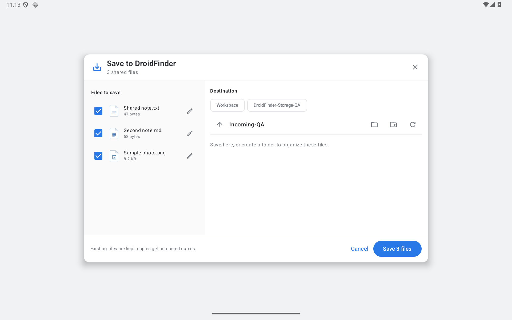

# Android picker and incoming shares — 0.19.0

DroidFinder's private Workspace is available in Android's system file picker. Other apps can open or save a selected Workspace document, or request a selected folder. Android grants access to the selected URI; the provider is protected with `MANAGE_DOCUMENTS`. Connected cloud folders, tablet storage, Trash, internal preferences and databases are not re-exported as Workspace documents. This follows Android's [document-provider contract](https://developer.android.com/guide/topics/providers/create-document-provider).

Workspace supports metadata, folder browsing, filename search, recent files, image thumbnails, read/write descriptors, folder/file creation, rename, copy, move and recoverable deletion. UUID document IDs are saved in SQLite and retained when DroidFinder explicitly moves or renames a document within Workspace. Copies get new IDs. Symbolic links, reserved working files and paths outside Workspace are rejected. Metadata/open checks detect a changed file identity before returning a descriptor. Document IDs are not filesystem paths or a substitute for Android URI permissions.

Provider deletions use DroidFinder's Trash. Other-app edits are not recorded as app Undo actions. Already-open descriptors are normal live OS file descriptors: they can outlive a setting change and write changes are not transactionally isolated from a subsequent app operation. Namespace mutations are serialized with app file operations; a new provider mutation during an app operation returns a retry error. Read-only queries can continue. This is not independent concurrent-transfer support.

**Preferences → Android integration → Workspace in Android's file picker** hides the root and rejects new document requests when disabled. It does not close descriptors that another app already opened. Android remains responsible for granted URI permissions. Re-enabling restores access to still-existing documents under those grants.

## Save to DroidFinder

Choose DroidFinder from another app's Android share sheet. Review incoming files, deselect items, edit their saved names, browse a destination or create a folder, then press Save. Destinations include Workspace and writable tablet/provider folders already authorized in DroidFinder. The folder button opens Android's system folder chooser for a new destination. Selecting DroidFinder's own Workspace maps to its local folder rather than creating a recursive connection.

Single-file and multiple-file shares, deduplicated ClipData streams and UTF-8 shared text are supported. With files and text in the same share, the text is an optional unchecked item. Text is saved as a document; URLs are not fetched. Unsafe display names are adjusted and identified in the review. Local-file URLs and DroidFinder's own outbound share URIs are rejected; copy those files using the explorer. DroidFinder excludes its own receiver from its outgoing share chooser.

Existing destination files are kept and copies receive numbered names. Each item is staged before publication. Stop cancels active reads and cleans unpublished staging files where the destination provider remains available; completed files remain. Partial results identify failed items and offer Select failed files without reselecting successful copies. Successful saves enter the existing session Undo history with changed-file guards. The completion card opens the destination in a separate explorer window.

Activity recreation retains the current draft or in-process result. Restoring after process death requires explicit review and Save; it never automatically replays an uncertain transfer. This is not a resumable incoming-transfer queue. The share activity holds temporary source access until its streams close. Closing during a save asks to stop first.

[Opened destination](screenshots/android-incoming-destination.png) · [Compact completion](screenshots/android-incoming-saved.png) · [System file picker](screenshots/android-workspace-picker.png) · [Dark](screenshots/android-incoming-dark.png) · [Portrait](screenshots/android-incoming-portrait.png) · [Smaller tablet window](screenshots/android-incoming-window.png)

## Bounds and remaining coverage

- Incoming review accepts at most 1,000 distinct streams and 2 MiB of UTF-8 text. Saved names have a 240-byte UTF-8 budget; truncation can remove a long extension. At most four metadata requests execute concurrently.
- Destination navigation inspects at most 20,000 children and retains at most 2,000 folders. Partial/provider-pending results are labeled and can be refreshed or narrowed to a specific folder.
- The Workspace provider returns at most 20,000 immediate children. Search/Recents visit at most 20,000 entries, return at most 200 filename matches or 64 recent files, and label capped results. There is no content-search index. Android clients control whether they display provider information extras.
- Cancellation signals prevent stale publication and interrupt supported stream reads. Android/provider Binder calls already executing may take time to return. The supplied blocked-pipe test proves cancellation without waiting for its writer to resume; it does not prove that every external provider is cancellable.
- Direct SMB/SFTP/WebDAV, external cross-app dragging, physical tablet/USB/SD checks, third-party account/provider matrices and multiple Android releases remain open in the [roadmap](ROADMAP.md). Phone-specific layout remains deferred.

## Local verification

The implementation is tested locally on the dedicated Android 16 / API 36 emulator, using synthetic files only. The separate `interop-client` application has its own UID and a private grantable fixture provider; it is not included in DroidFinder's preview/release APK.

Build it with `./gradlew :interop-client:assembleDebug`, install its debug APK, and launch **DroidFinder interop QA**. Its controls exercise ungranted access, the real Open/Create/Folder pickers, persisted grants, editing/renaming, single/multiple/text shares and a stalled source stream. Avoid running UIAutomator while instrumentation owns the emulator.

The provider tests cover root/child/path metadata, stable IDs across rename/move/database reopen, create/read/write/copy/delete, root/outside/symlink/staging rejection, changed-file descriptors, app-operation guards and opt-out behavior. Incoming-share tests cover intent deduplication and bounds, keep-both/Undo, partial save and targeted retry, blocked-stream cancellation, activity recreation, restored review, rejection of own-provider inputs, provider destinations and read-only destination controls.

Local JDK 17 / SDK 36 checks passed: **148 JVM tests**, optimized preview and unsigned release builds, and Android lint with **0 errors / 94 warnings**. The combined **36-case native run** passed: seven Workspace provider cases, six incoming-share cases, five storage cases, six existing provider cases, nine Finder cases and three transfer-lifecycle cases. One additional provider-destination/read-only/Undo incoming-share case passed separately. Its first attempt incorrectly requested a persistent grant for a same-UID fixture without a system picker result; the harness now registers that fixture without persistence. Actual picker grants are checked with the separate-UID client.

The first provider runs exposed Android's `/data/user/0` versus `/data/data` path aliases and unsafe ID recovery from reused inode numbers. Workspace paths are now normalized, and ID relocation is explicit rather than inferred from an unrelated inode match. The passing regression includes ID retention through the app rename window and database reopen. The packaging check also verifies the optimized provider's manifest permission/export/grant contract and excludes debug fixtures.

After the final appearance/layout polish, all seven incoming-share native cases passed together again. Landscape, dark appearance, portrait (800 × 1280 dp) and a smaller tablet window (640 × 800 dp) were inspected on the optimized build. The dark-mode status/navigation icons now follow the app theme, and stacked tablet layouts allocate room for three incoming files before scrolling.

The separate-UID client verified real DocumentsUI Open/Create/Folder selection, read/write content, tree-based creation and stable IDs after rename. Three incoming documents were copied byte-for-byte from its private provider. The optimized preview also installed and cold-started, received and saved the three-file share, and read a saved document after an emulator restart. After releasing the saved write permission and restarting the emulator, reading remained allowed and a new write descriptor was correctly denied. A process-only restart was insufficient on this Android image because its original persistable write-grant eligibility remained in memory; the device restart removed that eligibility.

The final optimized preview saved the three-file batch again and opened its destination in an independent explorer window. Display size/density overrides and light appearance were restored. Hosted GitHub runners are not used.
