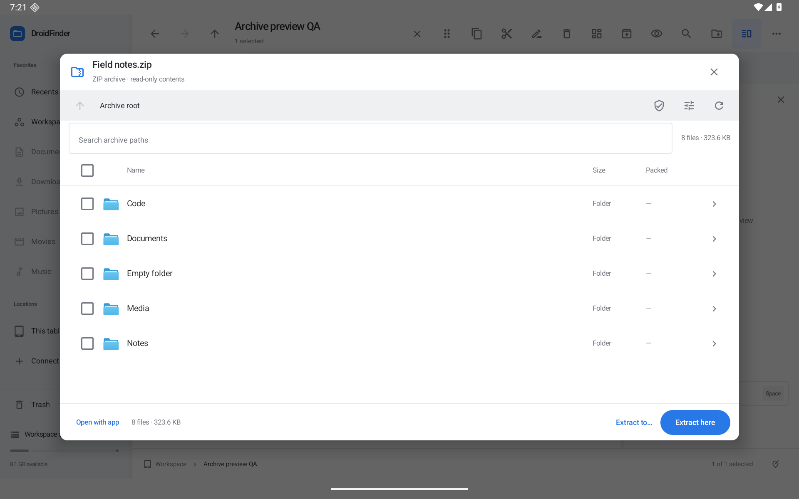

# Archive browser — 0.16.0

ZIP archives now support member previews, recursive path search, file/folder selection, selective extraction and integrity checks. The browser remains read-only: browsing, checking and Peek do not rewrite the source archive. Extraction is an explicit operation into a newly named folder.

The tablet browser is capped at 620 dp high (and 86% of the available screen on smaller windows), so portrait tablets do not turn a short archive into a nearly full-screen sheet. Longer listings scroll.

## Workflows

- Open a ZIP to browse folders. Search matches paths throughout the archive, including nested members. Size and packed-size columns describe files; Compact tablet windows omit the packed column.
- Select files or folders using their checkboxes. Selecting a folder includes its descendants. **Extract selected** preserves member paths inside the new output folder; with no selection, **Extract here** extracts everything. **Extract to…** chooses another writable local/provider destination. Normal extraction retains session Undo/Redo.
- Use a member's eye button, double-click, Space/Enter on a focused member, or its mouse/touch context actions to Peek. Images, PDFs, video, audio and structured text use the existing native readers. Arrow navigation prepares the next member on demand. The header identifies the archive and member path. **Open with app** grants another app read access to the prepared snapshot.
- Ctrl/Meta+F focuses archive search; Ctrl/Meta+A selects visible rows; Alt+Up moves to the parent archive folder. Search input owns spaces. Closing Peek returns to the archive browser.
- **Check ZIP integrity** reads each file and independently compares expanded size and CRC32. Failed members are counted and listed separately. Resource-limited/stopped checks remain explicitly incomplete; they never display an all-passed result. CRC32 detects accidental damage, not authenticity.
- **ZIP limits** stores entry, total expanded-byte, per-file, expansion-ratio and per-preview budgets. Standard/Light/Larger presets remain editable. Limits apply to browser checks/previews and ordinary extraction commands.

[Search and selection](screenshots/archive-search.png) · [Integrity check](screenshots/archive-check.png) · [Markdown member](screenshots/archive-markdown.png) · [PDF member](screenshots/archive-pdf.png) · [Portrait](screenshots/archive-portrait.png) · [Limits](screenshots/archive-limits-portrait.png) · [Compact window](screenshots/archive-window.png) · [Dark](screenshots/archive-dark.png)

## Bounds and publication

Standard limits: 10,000 central-directory entries, 2 GiB expanded output, 512 MiB per file, 1000:1 expansion ratio and 128 MiB per member preview. Ratio checks apply after 1 MiB per file. Configurable ceilings are 50,000 entries, 8 GiB expanded/per-file, 100,000:1 ratio and 256 MiB per preview. Inferred folder nodes are capped at twice the entry budget; member paths at 4,096 characters and 128 components.

Before indexing, the reader validates declared and actual entry counts, ZIP32/ZIP64 offsets, and bounded header snapshots on the same open file. Fixed indexing ceilings are 8 MiB of captured metadata, 16 KiB of filename metadata per header, 128 extra fields per header, and 65,536 extra fields across the archive. These checks are cancellable and also apply when editable limits are raised; malformed count and extra-field records are rejected.

Central-directory inspection does not inflate payloads or require that the entire archive fit the extraction byte budget. Selective extraction reads selected payloads only, while still validating all member paths and structural collisions. Absolute/traversal/drive/backslash paths, file/folder conflicts, duplicate file aliases, unsupported compression and missing size/checksum metadata are rejected. Supported methods are stored and deflated ZIP; encrypted ZIP and other archive formats remain open work.

Extraction checks known capacity, writes under hidden staging, verifies actual byte counts/CRC/ratio during inflation, then publishes the complete output folder. Ordinary errors/cancellation remove staging. A process kill can leave staging for manual review, as with other operations. Names never silently overwrite existing output folders. ZIP timestamps are restored when supported; Unix ownership, permissions and symlink semantics are not restored.

Peek inflates only the requested member into a private cache snapshot and publishes it after full size/CRC checks. Failed/stopped preparations remove their temporary folder. Cache work is serialized across windows, bounded to eight snapshots/512 MiB, and preserves active previews. If active previews occupy the budget, another window must close its preview first. Android may clear cache; exported grants are temporary, not a durable extraction. Provider ZIPs first use the existing bounded 128 MiB provider-file cache; larger provider ZIPs can be extracted through the operation path or opened externally.

## Verification scope

Small genuine ZIP64 fixtures exercise ZIP64 headers, size/CRC verification and extraction. A separate synthetic central-directory fixture verifies that sizes above 4 GiB remain 64-bit and are rejected before output under smaller configured limits; it does not contain a real 4 GiB payload. Actual multi-GiB ZIP64/large-file throughput, physical USB/SD, third-party providers and multiple Android versions remain open in the roadmap.

Local verification on the dedicated Android 16 / API 36 emulator: 133/133 JVM tests; a combined 8/8 native archive regression run (six new cases plus two earlier ZIP workflows); a focused 3/3 rerun of limits, integrity and member Peek; lint with 0 errors / 81 warnings; optimized preview and unsigned release builds. Builds and tests ran on this PC, without hosted runners.

Native cases cover search/selection, path-preserving extraction and Undo/Redo, Markdown/CSV/PDF/image/video member Peek, Space ownership, secondary mouse actions, valid/corrupt/ZIP64 checks, persisted limits and provider extraction. JVM cases additionally cover CRC-corruption cleanup, selected-member isolation, cancellation, entry/byte/ratio/capacity limits, unsafe aliases/collisions and 64-bit metadata. The final eight-case native run also passed after capping the window height. The initial dialog focus request was moved into the dialog composition after a native-test failure. Earlier readiness timeouts did not recur in the focused three-case run or final combined eight-case run; the test helper now saves dialog state and a screenshot on readiness failures.

QA files exist only on the dedicated emulator; the distributed app does not seed user storage.
