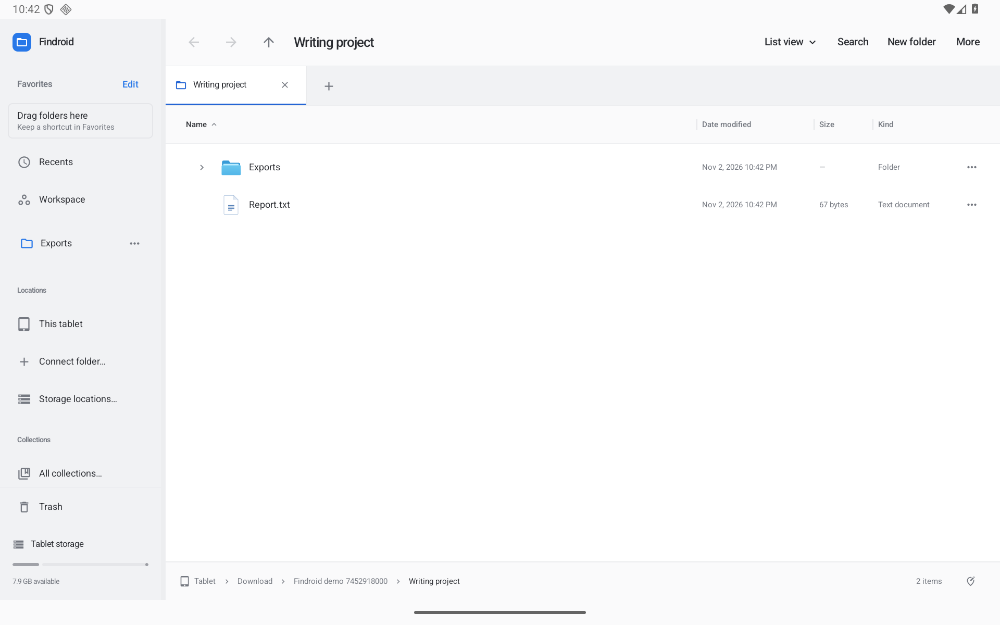
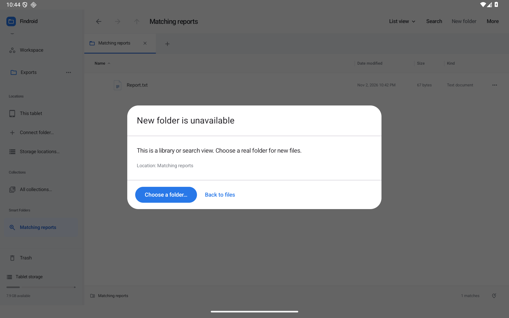
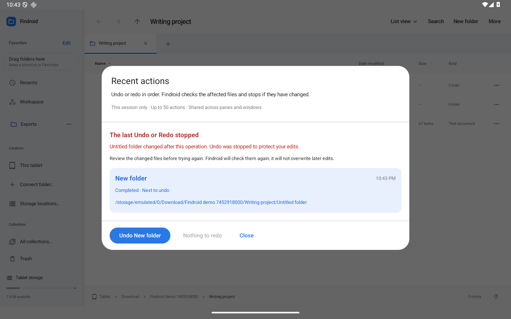

# Clear tablet commands and Recent actions

Search, New folder, and More stay in that order while you browse, select files, search, or edit the address. On narrower tablets or with enlarged text, the named commands move into an additional row. The view selector remains separate. More groups the available tools by task.

Selecting files shows the count, their current location, and **Selection actions** beside the file list. Each pane has its own selection controls. Opening Selection actions activates that pane before showing the file menu. Only the active pane has the named Drag handle; the file icons still support dragging.

## When a command is unavailable

Tap the command to see why it cannot run and what can help. Muted commands in the file menus remain interactive; their reason is also exposed to accessibility services. The same checks apply to keyboard commands and the action launcher.

- **Read-only items:** Rename checks the provider's rename capability; Cut, Move and Trash check removal capability independently. Copying remains available. The explanation can open Copy to another folder.
- **Busy operations:** Commands that need the current operation to finish offer View transfers. Browsing, copying a selection to the clipboard, and choosing queued copy/move destinations remain available.
- **Disconnected storage:** Creation and affected file commands offer Storage locations. The location stays visible so you can reconnect the correct storage.
- **Library and search views:** New files need a real folder. Choose a folder opens the folder launcher. Real search results retain their own rename/removal capabilities.
- **Clipboard:** Paste explains when nothing has been copied or cut. Paste into folder checks the selected destination folder's capability independently from its parent.
- **Other pane and archives:** A missing destination offers Show the other pane. Extract here requires a writable current destination without an active search; choose an extraction folder when that scope is unsuitable.

The policy uses information already loaded by the browser. Running an operation still performs its existing storage, name, conflict and content checks. An explanation never grants storage access or bypasses a safety check.

The organization library also adapts to short tablet windows and the software keyboard: results come before secondary catalog details, and the setup link returns when the window has room. Search fields and conflict rename offer Done to return to the surrounding controls.

## Undo and Redo in one place

Open **More → Recent actions…**, choose it from a file menu, or find it in the action launcher. The list shows the most recent eligible operations, affected names/locations, their time and whether they are completed or undone. Tap an entry to expand its details. The next action to Undo or Redo is identified; actions run in order.

Recent actions is shared across panes and app windows and keeps up to 50 actions. Since 0.45, supported local actions marked **Saved for restart** survive process restart; provider, replacement, organization and unsupported actions stay **This session only**. Reopening starts no operation. [Persistent Undo](PERSISTENT-UNDO.md) explains saved scope and manual review/reset; [Transfers](TRANSFER-CENTER.md) has separate restart/recovery behavior.

Findroid checks affected items before Undo or Redo. If a file was edited, a destination became occupied, storage disappeared, or another check fails, the operation stops and Recent actions keeps the reason visible. Review the changed files before retrying. There is no force-overwrite control. A partly completed session Undo or Redo retains its progress so retrying does not apply a completed step twice. An ambiguous saved mutation or metadata completion instead makes the saved list read-only for manual review.

An empty list explains which actions can appear and that reopening runs nothing automatically. Permanent deletion and other irreversible work do not acquire an Undo promise by appearing elsewhere in the app. Restoring a setup clears the session history because the saved references may have changed.

## Repeat the checks

- `CommandAvailabilityTest` covers capability, busy/queue, destination, search, archive and session-history decisions.
- `RecentFileActionsTest` covers immutable snapshots, ordering, limits, edited-file protection, preflight and exact-once partial retries.
- `CommandClarityWorkflowTest` uses native tablet UI and real synthetic file/provider operations for stable bounds, pane selection, explanations/recovery, Recent actions and guarded Undo.
- `scripts/check-command-clarity.py` uses native touch against the optimized APK, including a previous-version upgrade, original-byte/preference/Favorite preservation, actual Undo/Redo, later-edit protection, process restart, and tablet widths 600/800/1280 dp at font scales 1.0 and 1.6. It restores the saved setup and device settings.

`scripts/check-device-batches.py` runs a selected native suite in fresh processes. It records each batch and the installed APK digests, preserves failed attempts, and resumes only successful batches whose APKs and selectors still match. The release validation archive includes the selected class list and metadata-reset helper; it excludes the private saved setup.

Emulator results do not complete the physical TalkBack, trackpad, stylus, removable-drive or actual third-party provider acceptance items. See [the improvement tracker](IMPROVEMENT-TRACKER.md).
