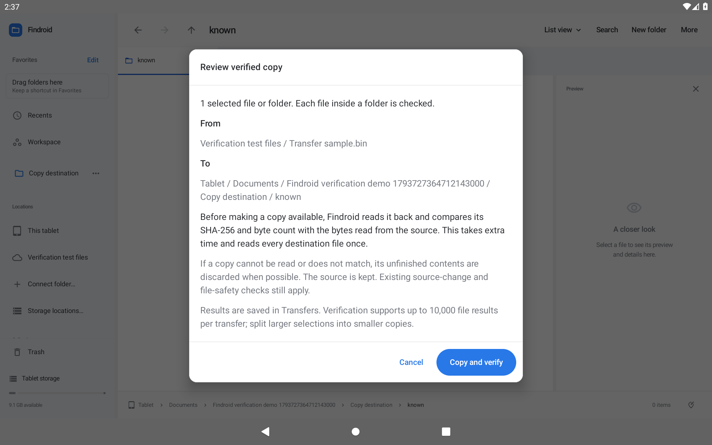
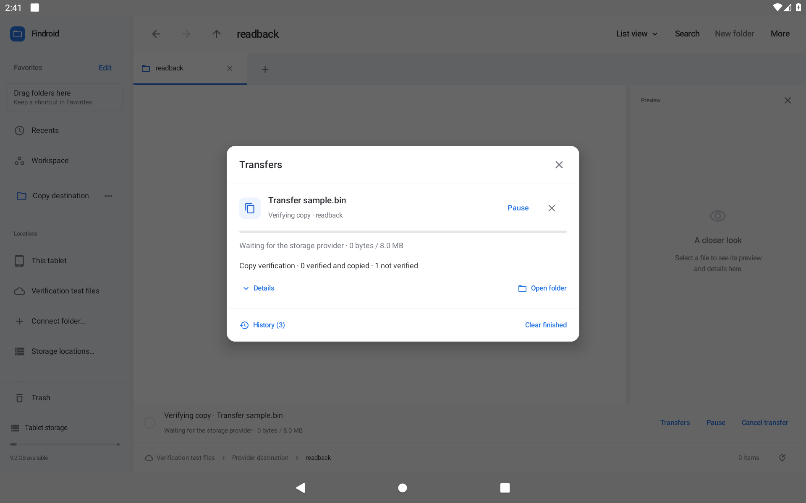
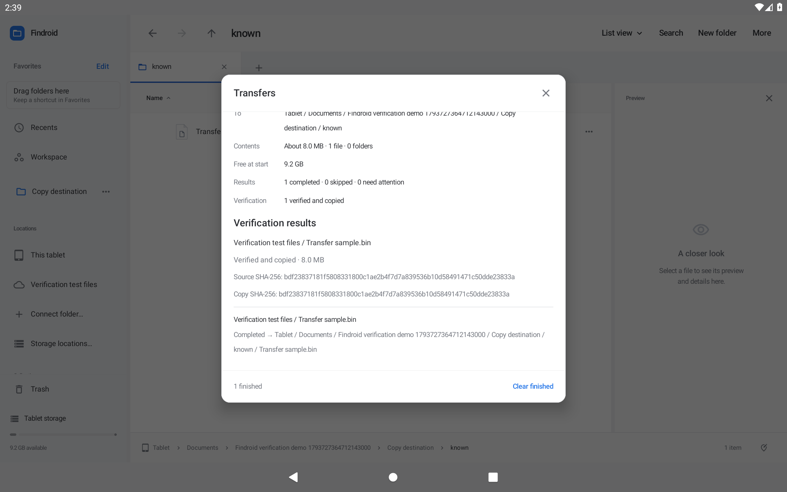
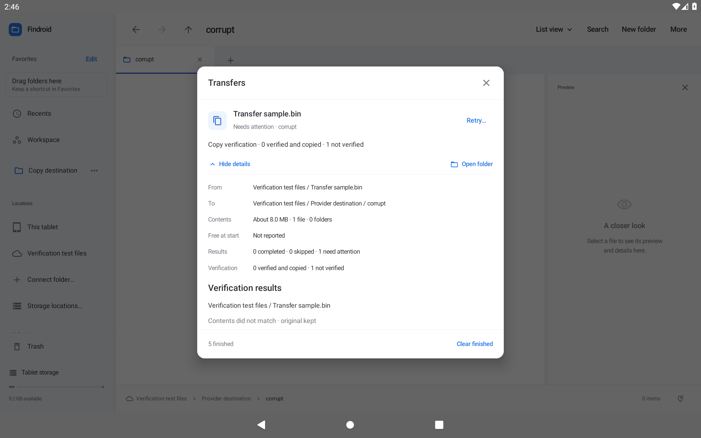

# Verify important copies

Available in the 0.43.0 preview. Local and real public OTA acceptance are complete. Immutable evidence acceptance is being completed before proposal 40 is marked implemented.

Choose **Paste and verify…** after copying files, or select files in one folder and choose **Duplicate and verify…**. A folder's context menu also offers **Paste into folder and verify…** when copied items are available. The review identifies the selected sources, destination and affected selection, and explains the extra destination reads. **Cancel** starts no work. **Copy and verify** queues the reviewed selection.

Findroid calculates SHA-256 while it reads each source file for copying. It then reads the unfinished destination back and compares both its byte count and SHA-256 before making the copy available. Files whose provider omits a size are checked against the actual bytes copied. A folder is checked file by file, including nested folders; an empty folder has no file contents to verify.

If the destination cannot be read or its contents do not match, the copy fails and the source stays in place. Findroid removes its unpublished working copy when possible. A failed reviewed replacement restores the previous destination through the existing rollback path. Cancellation and source-change checks still apply. Verification never adds its readback bytes to the transferred-byte total.

Open **More → Transfers → Details** for the verification summary and per-file results. Results distinguish verified and copied, verified but not published, skipped, unreadable, mismatched and incomplete work. A successful readback inside a folder that later fails does not claim that the folder was published. SHA-256 values describe the bytes checked at that time; they do not promise that either file will never change afterward.

The request and results are saved with the transfer. Pausing, reordering and retrying keep the verification choice. An interrupted job still requires review before retry; it does not replay automatically. Existing history defaults to **Not requested**, including older SQLite and properties journals. Ordinary copying and required Undo, move, source-change and recovery checks keep their existing behavior.

Verification is available for copies. It adds destination reads and may take longer with a slow provider. A provider that does not permit reading its newly written files cannot complete verification. Each transfer stores at most 10,000 individual results; larger selections must be split. Reaching the limit fails safely and does not silently omit checks or publish a partly checked folder.

## See it on a tablet

These are actual optimized Android 11 captures with synthetic documents and a separate provider. The review identifies the source and destination; Transfers records the per-file outcome and hashes.

## Acceptance

All 549 JVM checks pass, including the known SHA-256 vector, same-length corruption, short and overlong readback, unreadable and blocked streams, pause/cancellation, recursive local copies, staging cleanup, source changes, legacy serialization and honest publication summaries. All 27 focused Android provider, UI and migration checks pass on Android 11 and Android 16 with the frozen app/test APK pair. The focused UI regression also checks ordinary and verified copies whose provider filename differs from its document ID. Transfers shows the cached filename, with “Source item” when it is unavailable. All 426 matching native cases pass per API in 48 fresh-process batches. The exact optimized preview also passes eight copy scenarios and 18 layout configurations per API. All 72 actual optimized screenshots were inspected, and independent checks recompute complete control and detail visibility from the retained XML. Actual 0.42 → 0.43 public OTA passes on both tablets, and API36’s separate production-source download passes 1/1. Immutable evidence acceptance is being completed. Rejected runs are retained and excluded; no emulator result substitutes for physical or third-party provider acceptance.
