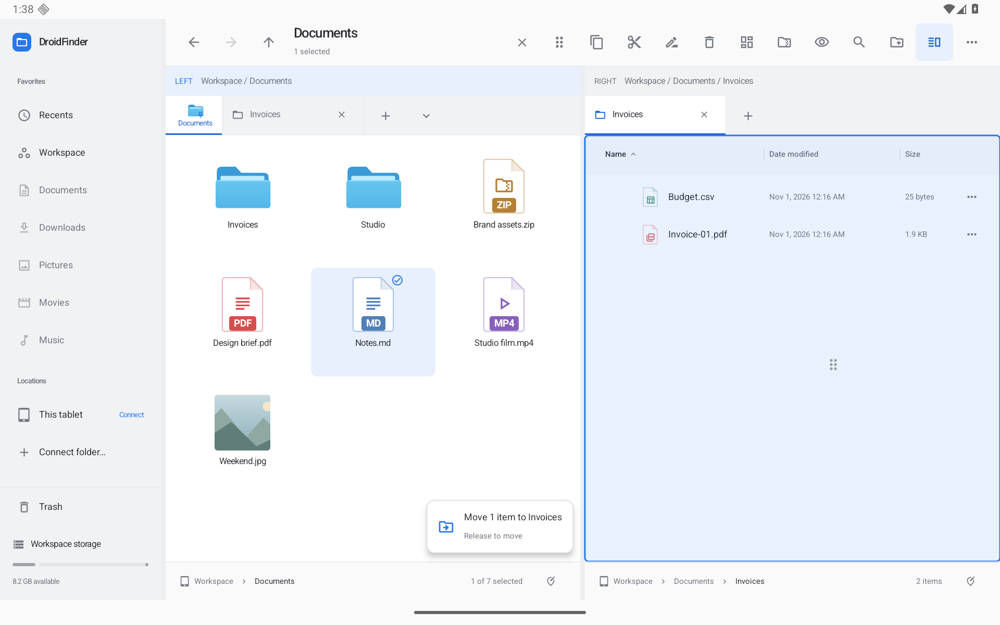
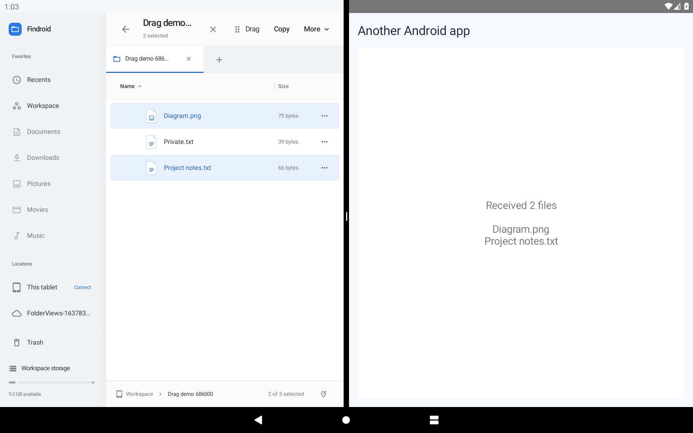
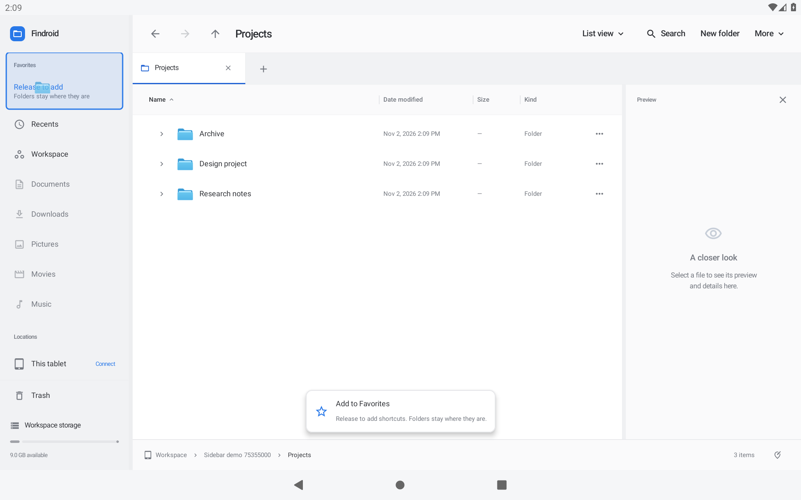

# Dragging files

The tablet uses one stable native drag target and live, clipped folder/viewport bounds. Lazy rows are eligible only while present in their viewport’s visible-item list; attached but prefetched rows cannot supply drop targets. Pointer movement updates the destination immediately. Folders revealed by scrolling or hover navigation can receive the same drag without restarting it.



Actual optimized Android captures with synthetic QA files: [Workspace](screenshots/dragging-workspace.png) · [Hold to open](screenshots/dragging-hover.png) · [Opened folder](screenshots/dragging-opened.png) · [Cancel restores](screenshots/dragging-restored.png) · [Dark](screenshots/dragging-dark.png) · [Portrait](screenshots/dragging-portrait.png) · [Fitted column](screenshots/dragging-fit-before.png) · [After manual resize](screenshots/dragging-fit-after.png).

## Drag files into another app



Version **0.30.0** adds accessible touch initiation for Android global file drags. Put Findroid and a receiving app beside each other in Android split screen, or use the device’s windowing controls.

- **One file:** hold its icon, then drag it across to the receiving app’s drop area.
- **Several files:** hold a file’s name to select it, tap more files, then hold **Drag** in the tablet selection toolbar. You can also hold an already selected file icon.
- **Mouse:** press and drag a file icon. Dragging a selected icon carries the selected files.
- **Discover the gesture:** tapping **Drag** shows a short instruction.

The external destination receives copies. Findroid keeps the originals, including when the internal drag mode is Move. Android grants the receiver temporary read access to the exact content URIs in the drop. Findroid does not grant write, persistable, or directory-prefix access. Connected document-provider file URIs are passed through with their existing metadata; local files use FileProvider content URIs. All selected MIME types are advertised, so a mixed image/document selection is recognized correctly.

The receiving app controls whether and where it accepts file drops. **Share** remains available for other destinations. Folder or mixed file/folder selections retain internal folder dragging; Share packages folders as ZIPs when sending them to another app.

## Cross-app acceptance

The separate `interop-client` QA app has its own Android UID and a real native drop target. `ExternalDragWorkflowTest` uses system split screen and native pointer injection, not fabricated drag events. It covers touch icons, the labeled selection control, holding an already selected icon, mouse input and connected-provider files. It checks copied bytes, names and types; source preservation; read denial before and after the temporary grant; write denial; and denial of access to an unselected sibling. Ordinary local drag and pointer-input regressions remain separate.

To run the checks on a dedicated tablet emulator with JDK 17:

```sh
./gradlew :app:assembleDebug :app:assembleDebugAndroidTest :interop-client:assembleDebug
adb -s emulator-5582 install -r interop-client/build/outputs/apk/debug/interop-client-debug.apk
python3 scripts/check-device.py --serial emulator-5582 --install \
  --classes dev.findroid.ExternalDragWorkflowTest \
  --output captures/external-drag/native.txt
```

For the optimized APK, `scripts/check-external-drag.py --serial <dedicated-tablet> --apk <preview.apk> --output <evidence-directory> --icon` seeds synthetic files using the same-key debug build, installs the preview, injects native touchscreen events and checks the receiver's report. It reinstalls debug briefly after the drop to compare original file bytes, then restores the exact preview. Omit `--icon` to hold the labeled Drag control.

The QA receiver is a separate application and is not bundled in Findroid. Final release results and actual screenshots are recorded in [VALIDATION.md](../VALIDATION.md).

## Pin folders in Favorites

Added in **0.31.0**. Hold a folder icon with touch or pen, or drag it with a mouse, then drop on **Drag folders here** under the sidebar's **Favorites** heading. The entire heading and hint area is a pinning target. Select several folders and hold **Drag** to add them together.

- The target outlines in blue and says **Release to add**. The status panel says **Add to Favorites** and explains that the folders stay where they are.
- Pinning saves references in the existing favorites preferences. It performs no file transfer, creates no `.finderlink` file, and survives process restart.
- Dropping an existing favorite again is idempotent, including the built-in locations. Parent-path aliases are compared using the app's organization identity, so they do not create another shortcut for the same entry.
- Read-only connected-provider folders can be pinned because saving a reference does not require write permission. They remain subject to Android's storage grants.
- File-only and mixed file/folder selections are rejected together. Availability and folder type are checked off the UI thread and checked again before adding anything.
- Cancelling saves nothing. Pinning restores temporary spring navigation instead of keeping an unrelated folder opened during the drag.
- Existing sidebar folder rows remain **transfer destinations**: drop files onto a favorite row to move/copy into that folder. Use the named area under the heading to add a shortcut.



Native touch/mouse, multi-folder selection, duplicate/alias, cancellation, read-only-provider, disappearing-source, and existing-favorite transfer/Undo scenarios are covered by `FavoritesDragWorkflowTest`. `scripts/check-favorites-drag.py` drives the optimized APK, restarts the application, opens the saved shortcut, and compares original file bytes after a same-key debug reinstall. Results are in [VALIDATION.md](../VALIDATION.md).

## Behavior

- Mouse: drag a file icon. Touch: hold a file icon, or select files and hold the labeled Drag control.
- Start with Ctrl to copy, the default or Shift to move, or Alt / Ctrl+Shift to create `.finderlink` shortcuts. The chosen mode and source paths remain fixed for that drag.
- A compact status panel identifies the action, item count and destination. Blue outlines show a valid folder; a red outline and explanation identify an invalid destination. Storage and provider checks run off the UI thread and run again before dispatching the operation.
- Hold over a writable folder, sidebar location, breadcrumb or inactive tab for 800 ms to open it. A small progress ring shows the wait. The browser background is drop-only and never opens another folder automatically.
- Cancelled drags restore temporary navigation, history, selection and folder views. A successful drop keeps the destination pane's opened route and restores any other temporarily browsed panes. Explicit navigation/tab changes made outside the drag retain ownership of their state.
- Hold near a scrolling viewport's edge to scroll, with speed proportional to edge proximity. Move into the center or leave the viewport to stop. Details/content lists, icon grids, browsing columns, the gallery strip and sidebar participate. An inner viewport takes priority when it can scroll; otherwise a parent horizontal viewport can scroll.
- The source payload and destination are captured before queued work, so entering a different folder does not change which files are transferred. Copy/move use the normal journaled queue, conflict handling and session Undo.
- Native URI permissions remain held for external imports until the import completes. Third-party app drag compatibility still requires testing against those apps.

Resize separators preserve fractional dp movement within each gesture and read current widths/ratios for each update. Slow one-pixel movements at tablet density accumulate instead of being discarded. The first manual drag after fitted/adaptive sizing starts from the displayed width instead of jumping to an old stored width. Sidebar, pane split, inspector, browsing columns and detail-column separators share the precision behavior and horizontal-resize cursor.

## Earlier validation (0.11.0)

Local JVM checks passed **97/97**. Android lint completed with **0 errors / 65 warnings**. Debug, optimized development-signed preview and unsigned release variants built locally.

A targeted Android batch ran **39 checks: 37 passed, 2 failed**. One drag driver used a row’s stale/prefetched coordinates while edge scrolling; it now waits for a fully visible row, stops scrolling, and verifies the displayed destination before releasing. The import-completion fixture initially placed its URI source outside the configured FileProvider cache root; it now uses the existing `shared/` root. A subsequent clean drag/provider run passed **16/16**. The final drag run passed **11/11** after adding immediate pointer feedback. Two subsequent resize checks passed **2/2**, including a fitted-width starting-point regression and slow one-pixel motion. This is focused validation across runs, not a claim that the entire Android suite ran cleanly in one batch. The existing all-view passive-pane native right-click stress check passed in the broader batch.

The new Android scenarios cover touch hover/drop/Undo, cancellation restoring history/selection/view, tab hover cancellation, preserving explicit navigation, Ctrl-copy/default-move with a native mouse, invalid self-drops, list/grid/gallery edge scrolling, newly revealed destinations, cross-pane restoration, single-pixel/fitted-width resizing, and exactly-once completion for successful/failed local/provider URI imports. Import completion is dispatched from the operation’s finalization hook so permission cleanup also runs when setup fails before file work begins.

Tests use the dedicated API 36 tablet emulator at 1920 × 1200, density 240. GitHub-hosted runners are not used. The full [roadmap](ROADMAP.md) remains active, including broader focus/accessibility, physical-device and external-provider coverage.

Optimized native QA confirmed cross-pane feedback, folder hover opening with remembered view changes, cancellation restoring the original Icons view and selection, Content/Columns dragging, and dark/portrait layouts. Landscape size, Light appearance and Comfortable density were restored. Screenshots use the optimized APK and synthetic QA files.

The final fitted-date resize was also checked on the optimized APK: a 45 px separator drag widened the displayed column from about 125 to 145 dp, rather than jumping to the old stored width. Both dedicated resize scenarios passed locally.
