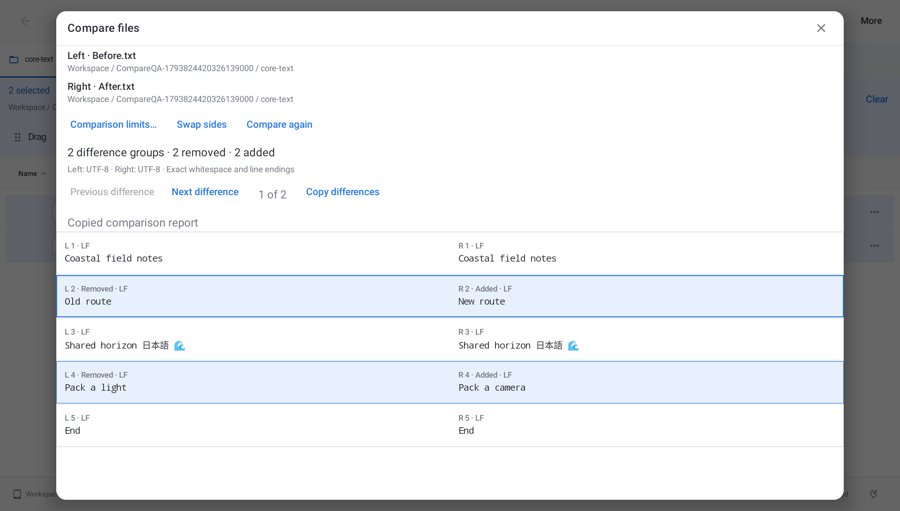
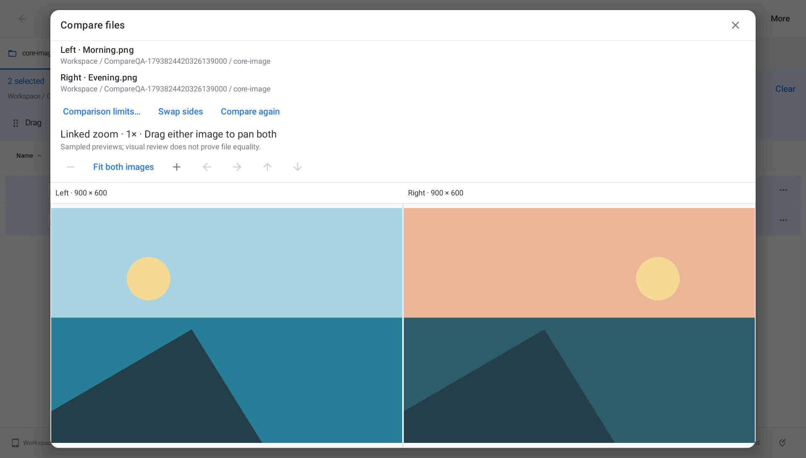

# Compare files

Select two text files or two images, then choose **Compare files…** from More, the selection's context menu, or the action launcher. Both files can also be opened from a paired row in **Compare folders… → Compare selected files…**, including nested files. The comparison reads files without merging, replacing or rewriting them.

Text appears in aligned left/right rows with original line numbers. Removed and added labels accompany the highlighting. **Next difference** and **Previous difference** move between groups, **Swap sides** reverses the pair, and **Copy differences** copies a human-readable report containing the changed lines. This report is not an applyable patch. Text can also be selected directly. **Compare again** reopens the files after an external edit and refreshes provider filenames; existing results remain a snapshot. Storage paths identify each parent folder.

Spaces, tabs, case, CRLF/LF/CR endings and a missing final newline count as differences. Tabs use a visible arrow in the display. Each row labels its line ending. UTF-8, UTF-8 BOM, UTF-16LE and UTF-16BE encodings are labelled separately; identical decoded text can use different encodings. This is not a claim of byte equality. Use Checksums for that purpose.

Images appear side by side with their oriented dimensions. Zoom and normalized pan are linked: dragging either image moves both, and the shared buttons provide a touch/keyboard alternative. **Fit both images** resets the view. EXIF rotation/mirroring is applied. Animated formats show their first decoded frame. The app labels sampled previews and explains their limits before any claim of exact visual equivalence.

*Actual optimized Android 11 tablet captures with synthetic files.*

## Bounds and failures

- Text uses recognized text/code filenames or a provider text MIME type; untyped documents may need a .txt copy. Each text file must be complete and no larger than 512 KiB, with at most 2,000 lines and 8,192 UTF-16 characters per line. Excess input is refused, never compared as an apparently identical prefix.
- Decoding is strict. Invalid encoding, UTF-32, binary/control bytes, unsupported pairs, inaccessible files and provider errors show an explanation. Office documents, PDFs, folders and mixed text/image pairs are outside this comparison's scope.
- The line diff uses about 4 million short cells, approximately 8 MB, plus bounded inputs and display rows. Interned line identities avoid repeatedly comparing long strings inside the quadratic loop.
- Image files are limited to 64 MiB each. Each decoded preview has at most 1,048,576 pixels and a 2,048-pixel edge. Zoom enlarges that preview; it does not decode extra detail. This is not a pixel-perfect, color-managed, metadata or image-equality comparison.
- Text is read directly. Provider images use fresh, bounded temporary copies, rather than trusting an older preview cache when provider metadata is stale. Temporary copies are removed after preparation, failure or cancellation.
- Preparation has a cooperative 15-second timeout. Stop, closing and swapping/retrying cancel the prior request. Provider streams use cancellation signals and polled reads. A platform image decode can finish its current native call before cancellation is observed.
- Metadata is checked before and after reading. External writers can still change a file without reliable timestamp/size changes; the view is a read-only snapshot, not a locked or atomic filesystem comparison.

Controls and content scroll independently in compact windows with enlarged text, keeping the comparison body visible. Header context can scroll out of view; scroll the controls back to review names and locations.

## Acceptance

Local acceptance is complete for application/native source `fe7e3f1ba532d23c92dbc4d7c8e225410270eddc`: 1,000 JVM cases, the same 29 focused native cases per Android 11/16 tablet, both exact optimized core workflows, and 12 balanced window/font/theme cases per API. Each API checks 84 complete named 48 dp targets, eight actual clipboard reports, visible image pairs and actual enlarged raster text. The native 4× drag check measures the same 54-pixel movement in both images after a 64-pixel gesture and Android's touch threshold. Original managed bytes/absences, Workspace, grants and display settings are restored with public 0.51 installed.

The 54 selected local capture paths are reviewed; 12 are exact glyph subsets of inspected results. Core results and nine layouts per API retain their verified bytes from the second optimized attempt; a corrected body-readiness check completes the remaining three. Both prior and final receipts, source/APK hashes, unchanged fixture generator and retained images are bound explicitly. Rejected and superseded attempts remain separate from final totals.

Actual public 53→54 OTA passes on both tablets, including installer completion, installed bytes, retained original/Favorite/preference, no repeat offer and exact restoration with public 0.52 installed. All 12 OTA PNGs are inspected; 66 selected UI capture paths are reviewed in total. All six release assets match anonymous downloads and GitHub digests. Independent verification of the [immutable validation archive](https://github.com/moikdev/findroid/releases/download/v0.52.0-preview/Findroid-0.52.0-validation.zip) passes all 701 entries, public source/evidence bindings and recorded test totals. Proposal 49 is implemented; 40 of 72 proposals are complete. Physical tablet, third-party provider and screen-reader acceptance remain open. See [validation](../VALIDATION.md).
