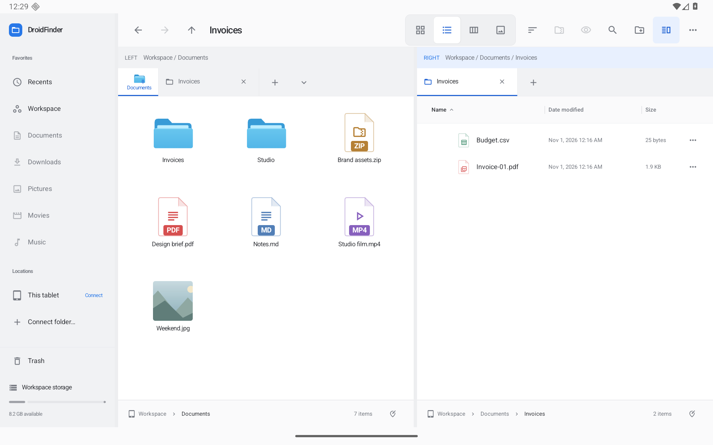

# Folder views and detail columns — 0.10.0

This increment adds remembered folder layouts and configurable detail columns. The [full roadmap](ROADMAP.md) remains active.

Actual optimized Android screenshots using synthetic QA files: [Settings](screenshots/folder-views-settings.png) · [Column controls](screenshots/folder-views-columns.png) · [Saved folders](screenshots/folder-views-manager.png) · [Dark workspace](screenshots/folder-views-dark.png) · [Portrait](screenshots/folder-views-portrait.png) · [Compact tablet window](screenshots/folder-views-window.png) · [Dark settings](screenshots/folder-views-dark-settings.png).

## Remember a folder

Open **Folder view settings…** from Actions or the sort menu. Turn on **Remember for this folder**, then choose a view, sort order and grouping. Later changes through the toolbar, keyboard or Preferences update that folder's saved view. Local folders and connected provider folders, including read-only folders, can remember views: the metadata lives in DroidFinder's private storage.

Saved choices include the Finder view and numbered Windows layout, sort/direction/grouping, hidden files, folders-first ordering, preview/details visibility, icon size, browsing-column and preview widths, fit-to-contents, and detail-column visibility/widths. Theme, density, extensions, sidebar and the navigation tree remain separate settings.

A folder's saved choices apply across tabs, panes and independent windows. Other folders use the current pane's defaults. Editing an unremembered folder updates those pane defaults, preserving the earlier browsing behavior. Use **Use as pane defaults** to promote a remembered folder's choices. **Reset folder** removes its override and immediately reapplies the current pane's defaults. Overrides are exact-folder settings; child folders do not inherit the parent's override.

The **Saved folders** button opens a searchable manager. Resetting an entry changes view metadata and leaves files in place. Unavailable folders can be removed from this list without reconnecting them.

## Detail columns

Expand **List columns** to show/hide Date modified, Size and Kind and adjust their widths. Name remains visible. Columns adapt to pane width by default: narrow panes can hide metadata columns or reduce the date width. Turn adaptation off to retain all enabled columns and use horizontal scrolling when needed. The Windows names-only layout deliberately hides metadata columns.

Drag a column's leading separator to change its width; dragging left makes that column wider. Dragging switches to fixed widths. Labels and file values share the same inset. **Fit list columns to contents** measures the visible listing; changing a column preference disables fitting. The editor also provides accessible sliders as an alternative to dragging.

## Workspaces, paths and recovery

Named workspaces retain pane defaults separately from the currently displayed folder view. Opening a workspace applies current folder overrides; it does not replace the shared folder-view collection. Older workspace files remain readable and supply defaults for the new column fields.

Local profile keys use canonical paths; paths resolving to the same canonical path share a profile. Provider keys retain their scoped document URI. App-initiated path changes update profiles and descendant profiles; new copies inherit source profiles when the destination has no profile. Existing destination profiles win when copying. During recoverable replacement, the original's profile follows it into recovery and returns with Undo. The original pane follows that original folder, matching existing navigation behavior. Recent inverse profile relocations retain displaced destination choices and subsequent view edits; the file Undo history remains session-only. Changes made outside DroidFinder can leave stale paths, which can be reset in Saved folders.

The shared writer coalesces rapid changes and serializes atomic writes. Failed writes retain the in-memory edits and expose retry; later edits can also retry saving. Unknown or unreadable metadata is preserved and protected from overwrite. There are at most 2,000 folder profiles and a 4 MiB metadata-file limit. If a copy reaches the profile limit, file copying continues and the view settings report that some copied folders use defaults. App data clearing/uninstallation removes this metadata; it is not a backup.

## Verification

The new Android checks cover atomic round trips and bounded fields, unknown/damaged-file preservation, serialized writes and edits made during a write, write-failure retry, relocation recovery and copy capacity. UI workflows cover tabs and independent windows, shared pane changes and reset, column visibility and touch resizing, the settings/manager controls, rename/copy/Undo, read-only provider reconnect, workspace precedence and pane-default isolation, and recoverable folder replacement across panes.

The initial focused run passed 20/21: the rename helper acted before the combined-click selection completed. Waiting for focus fixed it. All 13 new checks passed in the next run. The additional replacement check initially expected the pane to stay at the replaced path; existing navigation follows the original into recovery. The corrected check verifies that folder and both profiles through replacement/Undo. The manager check now handles an existing profile collection instead of assuming one saved folder. Those two corrected workflows passed together.

The full local Android run completed **127 checks: 126 passed, 1 failed, no skips**. All **14 new checks passed**. The remaining failure was the existing intermittent native Gallery right-click stress check in a passive pane; a clean full-suite pass is not claimed. The same passive-pane Gallery check passed in its isolated rerun; its intermittent full-run behavior remains documented. Local JVM tests passed **93/93**, Android lint completed with **0 errors / 65 warnings**, and both optimized variants built successfully. The optimized **0.9.0-preview → 0.10.0-preview** upgrade retained two older tabs, a pin, the existing Workspace folder and the saved Upgrade workspace. Opening that older layout worked. A new remembered Icons view survived a cold process restart; the parent retained List defaults and Back restored the Icons override. Native scripted shortcuts wait for the dialog window to finish dismissing before navigation. A subsequent native screenshot caught canonical Workspace keys displaying as internal package paths in the manager. The formatter now compares canonical roots as a fallback; an additional Android regression passed for the human-readable Workspace and descendant labels. That focused check ran after the 127-case suite. Native QA verified the two remembered layouts together, header dragging and column controls, friendly manager paths, and cold restoration. Landscape, portrait and a 640 × 800 dp tablet window were inspected. Display overrides, light appearance and Comfortable density were restored. A final visual pass also aligned the dark switch thumb with the blue app palette. Packaged artifact checks follow the verified-source packaging workflow. No physical-tablet or third-party-account coverage is claimed. Builds and tests run locally; GitHub Actions remains manual-only.

Release artifacts use `scripts/package-preview.py` to validate versions, manifests, development signatures and test-provider exclusion. Both APKs include SHA-256 checksums and clean source/build metadata. [Installable preview](https://github.com/moikdev/droidfinder/releases/tag/v0.10.0-preview).
