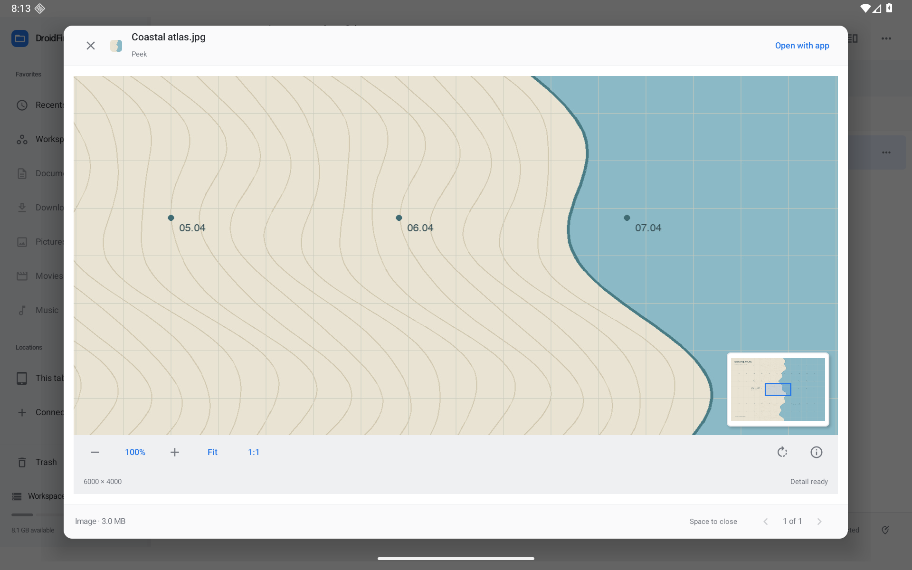

# Image Peek — 0.17.0

Image Peek now uses an overview plus a visible-region reader instead of enlarging one low-resolution bitmap. **1:1** means one source pixel per display pixel. Pinch, drag, wheel/trackpad scrolling, Ctrl/Meta+wheel, zoom presets, Fit and double-tap provide tablet and pointer navigation. A small navigator shows the current viewport; tap or drag it to move around a larger image.

Rotation is temporary and composes after the image's EXIF orientation, including mirrored/transposed cases. It never rewrites the photo. While the image view has focus, normal arrow keys retain Peek's previous/next-file behavior; Shift+arrows pan, +/− zoom, 0 fits, 1 shows actual pixels, R/Shift+R rotates, and Ctrl/Meta+I toggles information. Escape closes information before closing Peek; Space closes Peek from the image view. Information dialogs also provide Done. View zoom/center/rotation and information visibility are retained through activity recreation for an open local/provider Peek.

The information header and close control stay visible while its fields scroll. Comfortable and Compact control density follow the app preference.

The information panel shows available dimensions, stored dimensions when orientation swaps axes, format, encoded file size, color-space metadata, orientation, camera, lens, capture time/offset, aperture, exposure, ISO, focal length, artist and copyright. Unavailable EXIF fields are omitted. Capture times are shown as embedded; no timezone is invented. EXIF location coordinates remain hidden and excluded from copied details until **Reveal location** is chosen. No map/network request occurs. Providers may redact or omit metadata.

[Fit](screenshots/image-fit.png) · [Navigator/rotation](screenshots/image-rotated.png) · [Information](screenshots/image-information.png) · [Scrolled metadata](screenshots/image-metadata.png) · [Portrait information](screenshots/image-portrait-information.png) · [Portrait](screenshots/image-portrait.png) · [Compact window](screenshots/image-window.png) · [Compact controls](screenshots/image-compact.png) · [Dark](screenshots/image-dark.png)

## Loading and bounds

Local, provider and prepared archive-member images use the same reader. Double-tap zooms a fitted image to at least actual-pixel scale; photos already at 100% enlarge to 200%. Double-tapping a zoomed view returns to Fit. Provider preparation retains the existing 128 MiB encoded cache limit and supports Stop/Retry, cancellation signals and stream closure. Waiting for shared provider-cache work checks cancellation, so stopping one reader does not have to wait for an independent consumer to finish. Descriptor reads poll for readiness in 100 ms intervals, honor asset byte offsets/declared lengths, and release canceled pipe reads without waiting for the provider to send data. Existing regular-filesystem/device I/O and native codec calls can still take time to return.

Local encoded files are capped at 512 MiB; dimensions at one million pixels on either edge and one billion total source pixels. Invalid/unsupported images expose a recoverable error and the normal external-app action.

Overview output is bounded to 1,048,576 pixels and 2,048 pixels per edge. Visible-region output is bounded to 4,194,304 pixels and 4,096 per edge, using power-of-two sampling. At normal tablet viewport sizes, 1:1 decodes the visible original pixels; unusually large viewports can hit the detail budget and show a resolution-limit notice. One native decode runs at a time across windows; each reader retains an overview and its latest detail region. Replaced frames are released for garbage collection, rather than recycled while the render thread might still use them. Codec-internal buffers and temporary/replaced frames are additional memory; these output limits are not a claim about total process peak memory.

The region decoder is closed asynchronously and serialized with active reads. Stale file sizes/timestamps prevent subsequent region reads from silently using a changed source. Cancellation suppresses stale publication and closes prepared decoders. Native header/EXIF/bitmap decoding is synchronous on an IO worker: an already-running codec call finishes before its decoder is recycled. Stop is not a promise of mid-codec interruption.

Codec support follows the device's Android image decoders. When region decoding is unavailable, the sampled overview remains available with an explicit notice. Animated formats use a still frame; RAW development, image editing, animation controls, color-critical/HDR workflows and codec/device matrices are not claimed. Metadata describes the source, while temporary rotation describes the current view.

Implementation references: [Android region decoder](https://developer.android.com/reference/android/graphics/BitmapRegionDecoder), [AndroidX EXIF metadata](https://developer.android.com/reference/androidx/exifinterface/media/ExifInterface). No new dependency was added. Provider descriptor semantics use [Android OS polling](https://developer.android.com/reference/android/system/Os) and [asset offsets/lengths](https://developer.android.com/reference/android/content/res/AssetFileDescriptor).

## Verification

Local JDK 17 / SDK 36 checks: 142 JVM tests passed, including all eight EXIF transforms/inverses, rotation composition, source-pixel anchor/clamping, panorama/sampling budgets and coordinate-copy defaults. A combined 26-case native regression run passed on the dedicated Android 16 / API 36 emulator: six image workflows, four descriptor/cache tests, six earlier Peek workflows, archive member Peek, six structured-preview workflows, blocked full-text search cancellation, and two provider PDF workflows.

Native image checks compare rendered quadrant colors for all eight JPEG EXIF orientations, exercise 24-megapixel PNG region decoding and minimap/keyboard/wheel navigation, verify small-image double-tap, recreate the activity with zoom/rotation/information retained, copy metadata with location opt-in, reject malformed/oversized input, detect changed sources and stop provider preparation before its provider releases data. Descriptor tests cover idle-pipe cancellation while the writer remains open, asset offsets/lengths, larger chunked reads and independent cancellation while waiting for another cache consumer.

The first blocked-download cleanup assertion observed a separate side-preview consumer; the final test isolates Peek’s own download. The shared input path now polls descriptors and makes cache-lock waits cancellable, with the independent-consumer case covered directly. Optimized preview and unsigned release builds passed locally. Android lint reported 0 errors / 82 warnings. After the final information-header refinement, a focused two-case native rerun passed for scrolled metadata/close visibility and view recreation. These overlap the combined run. No hosted runners were used. Physical-device, codec and performance matrices remain open. Tests use synthetic images only; the distributed app does not seed user storage. The broader roadmap remains active, including direct selection on rendered PDF pages and physical-device/performance coverage.
