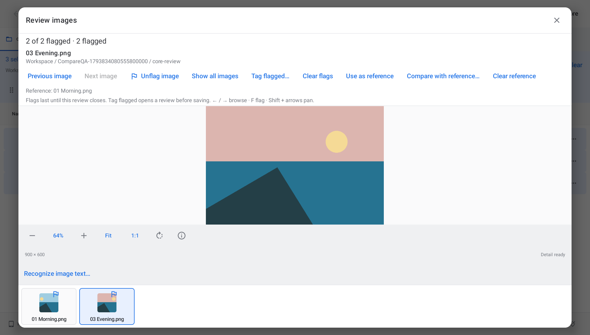

# Review a set of photos

Select 1–200 images and choose **More → Review images…**. The same command is available in the selection menu and the action launcher. Folders and other file types need to be removed from the selection first.

The review keeps the selected order and gives the current photo the existing image viewer: zoom, pan, actual pixels, temporary rotation, image information and optional OCR. Only the current photo owns a full viewer; the strip loads small thumbnails. **Previous image**, **Next image**, or a thumbnail changes the current photo without changing the browser's selection. In smaller windows or at large text sizes, scroll the review controls and viewer controls separately. The photo keeps its own visible area. Thumbnail names can be shortened; the full current name appears above the photo.

Use **Flag image** to mark a candidate. **Show flagged only** narrows the strip and navigation to those candidates. Unflagging a photo in that view moves to the next remaining candidate, or the previous one at the end. Removing the last flag returns to all images. **Clear flags** restores the full set.

Choose **Use as reference**, navigate to another image, and choose **Compare with reference…**. The existing read-only comparison opens the two files with linked zoom and pan. Closing it returns to the shortlist. The reference can remain outside the flagged filter. It does not change which photos will be tagged. [Comparison limits](FILE-COMPARISON.md) still apply.

**Tag flagged…** opens the existing organization editor with exactly the flagged images. Review the proposed tag changes and choose **Apply tags** to save them. Closing that editor without applying keeps the tags unchanged and returns to the flags. Existing tags are kept unless the reviewed changes explicitly remove them. File/revision and tag checks run again before applying. Session Undo and Redo are available from **Recent actions…** after closing the review.

Tags belong to Findroid's organization library; the photo files and EXIF data are not rewritten. This also allows app-local tags for readable, read-only document-provider photos.

With a keyboard, use **← / →** to browse, **Home / End** for the first/last image and **F** to toggle a flag. Existing viewer shortcuts remain available: **+ / −**, **0** to fit, **1** for actual pixels, **R** for temporary rotation, **Shift + arrows** to pan, and **Ctrl+I** for image information. **Escape** closes the current image-information window or the review.

Flags, the reference, current image and frozen review order survive activity recreation. Closing the review, closing its app window or process loss discards those session decisions. Reopening starts a new review with no flags. Applied tags remain saved. Flags are not ratings, embedded metadata, a saved collection, or part of setup backups.

*Actual optimized Android 11 tablet capture with synthetic photos.*

## Limits and acceptance

The viewer retains its existing bounds: local images up to 512 MiB, provider preview copies up to 128 MiB, bounded overview/detail decoding, and first-frame previews for animated images. Some formats have only a sampled overview. Image information hides location until explicitly revealed. Preparation can be stopped and retried. The review does not watch external edits or promise a color-managed, pixel-equality comparison.

Reviewing a selection does not write tags or photo bytes. A missing or changed image must pass the organization editor's fresh checks before tags can be applied. A failed image preview can still be skipped using the review's navigation.

Local acceptance is complete for application/native source `2b9c157dff077eadf66583c2a61b36b925a891e9`: 1,017 JVM cases and the same 25 focused native cases in four isolated batches per Android 11/16 tablet pass. Native checks include actual thumbnail activation, reviewed tag scope/Apply/cancel/Undo/Redo, read-only providers, stale files, keyboard controls, and the active Android tag-editor window after activity recreation.

The exact optimized APK passes the complete review/reference/tagging workflow and 12 size/font/theme layouts per API: 1280×800, 800×1280 and 600×800 dp at actual system fonts 1.0/2.0 in light/dark. Each API records 156 full named 48 dp targets, a visible photo, readable current-name glyphs and six measured text/raster growth groups. All 62 selected native/optimized capture paths are reviewed; 24 are exact glyph subsets of inspected frames. Original private bytes/absences, Workspace, grants and display settings are restored.

Earlier focus/selector/raster stops and the superseded modal-lifecycle candidate remain excluded from final totals. A system-launcher ANR on the Android 16 emulator held focus; after restarting that launcher without clearing its data, the unchanged final APK passes all 25 cases. No superseded APK results are reused. See the [attempt summary](../captures/image-review/excluded-attempts.json) and [validation](../VALIDATION.md).

Actual public 0.52/code 54 → 0.53/code 55 OTA passes on both tablets: public-feed download, Android installer completion, exact installed bytes, retained synthetic original/favorite/preference and no repeat offer. Original private bytes/absences, Workspace, grants and display settings are restored with public 0.53 installed. All 12 OTA captures are inspected, bringing the total to 74 selected image paths. The five initial release assets match anonymous downloads and GitHub digests. Independent immutable-archive acceptance is pending; proposal 50 remains in progress. Physical tablet, third-party provider and screen-reader acceptance remain open.
