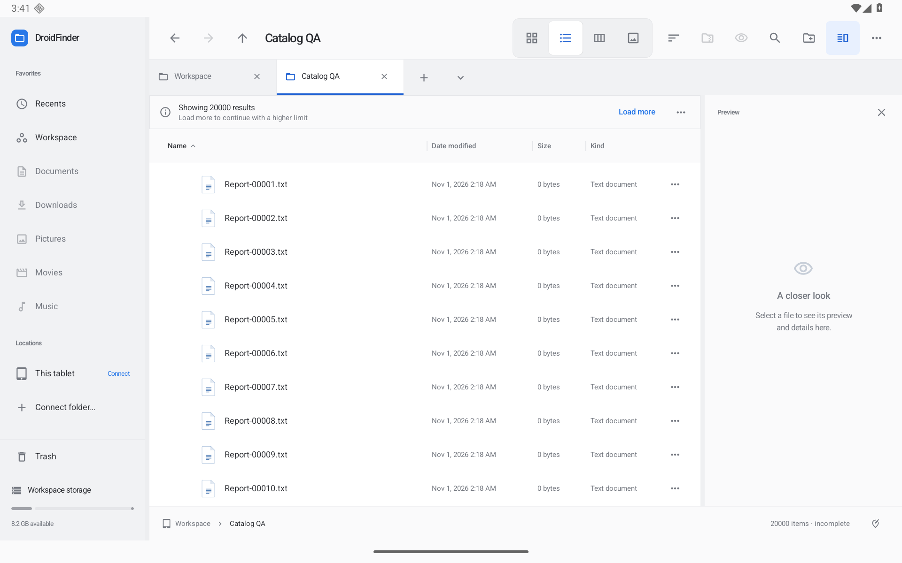

# Progressive folders and search — 0.12.0

Folders and recursive searches publish sorted batches while scanning. Available files can be selected, opened and scrolled before the scan finishes. Storage reads, content matching and sorting run off the UI thread. A compact status row appears after 250 ms for longer scans; fast folders keep the normal browser layout.

Actual optimized tablet captures: [Details](screenshots/loading-details.png) · [All 20,050 files](screenshots/loading-complete.png) · [Cold restoration](screenshots/loading-restored.png) · [Dark](screenshots/loading-dark.png) · [Portrait](screenshots/loading-portrait.png). Controlled debug-provider native captures: [While loading](screenshots/loading-progress.png) · [Stopped, selection retained](screenshots/loading-stopped.png) · [Unreadable subfolder](screenshots/loading-incomplete.png). All documents are synthetic QA data.

## Controls and result accuracy

- **Stop** retains the current results and marks them incomplete. Restart repeats the scan. A new query, tab or location cancels the old request; a late cursor cannot replace newer results.
- **Load more** repeats a limited scan with a larger budget. The default is 20,000 displayed matches / 50,000 scanned entries. Budgets increase to a maximum of 50,000 matches / 2,000,000 scanned entries. Reaching either cap is explicit; results are never presented as a complete listing. Refine the search or open a smaller folder at the final cap.
- Higher limits are remembered per tab and location/search/hidden-file scope, including history, reopened tabs and serialized navigation. Each tab retains up to 32 scopes.
- **Result details** explains stopped, capped, provider-pending and unreadable results, with up to 20 issue examples and five provider notices. Counts represent failed checks and can include more than one check for a file. Empty incomplete results say so rather than claiming that no files match.
- Android providers can return available rows together with loading, error or information extras. These are surfaced explicitly. The app observes provider changes after the scan and offers Refresh. A provider query's cancellation support remains provider-dependent. See Android's [DocumentsContract extras](https://developer.android.com/reference/android/provider/DocumentsContract) and [DocumentsProvider contract](https://developer.android.com/reference/android/provider/DocumentsProvider).
- Text-content search uses a streaming UTF-8 matcher across decoder/buffer boundaries, with no previous 1 MiB cutoff. A proven match stops reading early. Binary text and read failures become incomplete-result issues. This is text search, not extraction from PDF, Office documents or arbitrary encodings.
- Recents keeps the newest 200 files among the entries actually scanned. Limits, unavailable roots and provider-pending states remain visible.

Cancellation marks the request immediately, closes its active text stream and signals provider queries on an IO cleanup scope. Cursors and local directory streams close when iteration exits. A provider that ignores cancellation may finish later, but generation checks prevent publication into the current view.

Saved selection is restored when the scan finishes. An explicit selection or expansion takes precedence over that saved state. A saved scroll anchor can restore as soon as its item appears; scrolling, selecting or keyboard scrolling during loading cancels a deferred jump. Status-row visibility remains fixed during a native drag so scan completion cannot move rows beneath the pointer.

## Local verification

Local JVM checks passed **111/111**. Android lint completed with **0 errors / 69 warnings**. Debug, optimized development-signed preview and unsigned release variants built locally. An initial complete Android run executed **151 checks: 146 passed, 5 failed**. Two older tab tests assumed one unpinned tab despite the saved pinned-tab state; their fixtures now explicitly unpin before testing indexes and reorder. Two list edge-scroll scenarios and one gated-loading scenario timed out. The final focused rerun passed **14/14**, covering all ten loading scenarios and all five initially failing cases (the gated-loading case is among the ten). This is focused validation after the final guards and fixture fixes, not a claim that the complete suite ran cleanly in one batch. The dedicated API 36 tablet emulator uses synthetic documents. Builds and checks run on this PC; no GitHub-hosted runners are used.

The native cases cover provider batches/Stop/Restart, navigation/query cancellation, provider pending/error recovery, text matches beyond 2 MiB, blocked-stream cleanup, scrolling and selection during partial results, stable rows during native dragging, a 6,002-item local folder, and higher limits/history/serialized state with 20,002 local files. Tab history/reorder and both list edge-scroll scenarios also passed in the final batch.

Optimized native QA loaded all **20,050** synthetic local files after Load more. Back navigation retained the raised limit. A cold restart restored all 20,050 entries, the saved viewport and selected `Report-20050.txt`. Landscape, portrait and Dark appearance were visually inspected; normal landscape size, density and Light appearance were restored. These are functional checks, not startup/scroll/memory/battery benchmark results.

## Remaining performance work

This increment streams primary folder/search listings; it is not a disk index or virtualized provider paging implementation. Load more rescans with a higher budget rather than resuming a cursor. Browsing-column previews and expanded-folder child loading still use the earlier bounded IO listing path. Very large indexed catalogs, full preview/verification cancellation, measured startup/scroll/memory/battery benchmarks, and physical-device/provider matrices remain on the [roadmap](ROADMAP.md).
