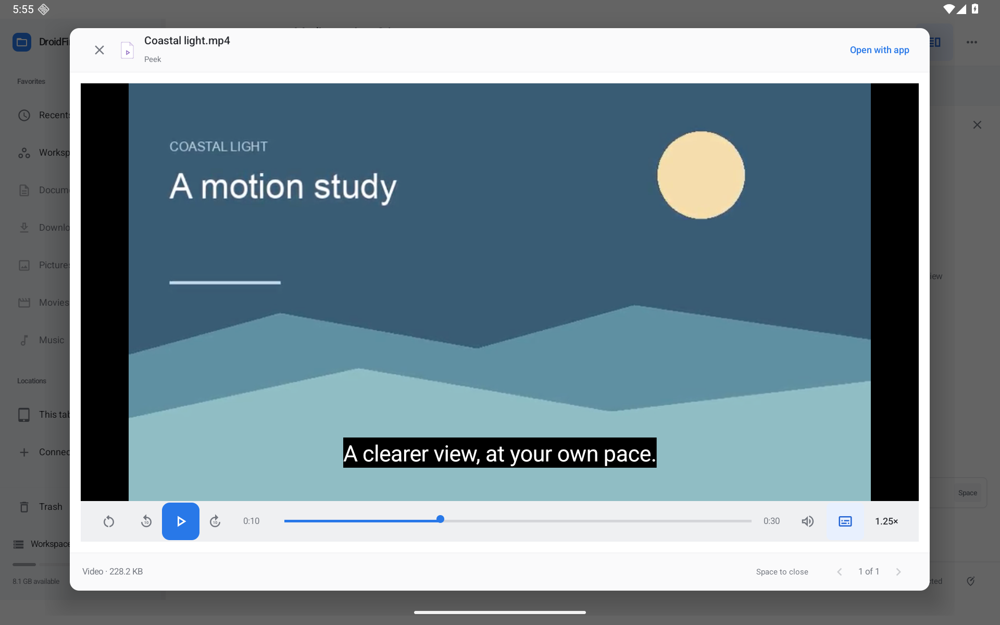

# Media Peek — 0.14.0

Audio and video previews now share Media3 playback, with a compact transport bar, a slim seek control, 10-second skipping, restart, mute and 0.5×–2× playback speed. Wide tablet windows use one row; narrower tablet windows use two rows. Space still closes Peek and arrows still browse files, including after using native video controls.



[Speed menu](screenshots/media-peek-speed.png) · [External captions](screenshots/media-peek-subtitles.png) · [Portrait](screenshots/media-peek-portrait.png) · [Compact window](screenshots/media-peek-window.png) · [Dark appearance](screenshots/media-peek-dark.png)

## Reading your place

Previews open paused at the saved position. Position, speed, subtitle track and subtitle-off state are kept for up to 100 source fingerprints in private app preferences. The fingerprint includes path/document URI, modification time and reported size. A renamed or changed file starts fresh. Provider metadata that does not report changes cannot guarantee invalidation. No source media is edited.

Pause, seeking, speed/track changes, closing and activity stop save progress. During playback it is checkpointed about every five seconds. Returning from background, resizing/recreation, or reopening a preview prepares a paused player. Backgrounding releases codecs and audio resources; playback does not continue as a background service. Audio focus and unplugging headphones are handled by Media3.

## Subtitles

The Subtitles menu lists supported embedded text tracks and Off. **Open subtitle file…** uses Android's document picker for a `.srt` or `.vtt` file. The app requests a persistent read grant when the provider supports one. External subtitle selection is remembered for that media fingerprint. Final external-subtitle load failures turn off subtitles and remove the broken sidecar reference with an explicit notice, while the base media remains playable. Fatal player errors with a sidecar receive one retry without it. Transient load failures do not trigger application-level retries.

External subtitles are chosen explicitly; this release does not scan sibling folders or download captions. The system/provider may revoke access, and some providers do not offer persistent access. Decoding and supported embedded subtitle formats depend on Media3 and the device codecs. Protected media, remote streaming clients, background media sessions, subtitle timing adjustment and audio-track selection remain future work.

## Validation

Local Android 16/API 36 emulator checks cover transport controls, saved position/speed, activity recreation and background pause, embedded and external subtitle cues, missing-sidecar recovery, fingerprint invalidation, existing audio/video Peek and provider playback. The combined native regression run passed 12/12 tests. All 118 JVM tests passed; lint reported 0 errors and 73 warnings. Optimized preview and unsigned release builds passed. Native screenshots use a synthetic 30-second clip from test assets, never user media. The release app does not seed storage with these files.

Verification commands (local JDK 17 / SDK 36):

```sh
./gradlew testDebugUnitTest lintDebug assemblePreview assembleRelease assembleDebug assembleDebugAndroidTest
adb -s emulator-5582 shell am instrument -w -r \
  -e class 'dev.droidfinder.MediaPlaybackWorkflowTest,dev.droidfinder.PeekWorkflowTest,dev.droidfinder.AdvancedWorkflowTest#audioQuickLookPreparesAndPlays' \
  dev.droidfinder.test/androidx.test.runner.AndroidJUnitRunner
```

An initial missing-sidecar test exposed Media3’s nonfatal text-track failure behavior; the app now handles final sidecar load failures explicitly. The playback-restoration assertion was corrected to compare with the actual paused timestamp after playback advances. The combined run was clean. The final picker adjustment moves provider metadata/grant lookups off the UI thread and ignores stale results after switching files; that picker path is checked manually in the optimized build.

Native visual checks cover 1920×1200 landscape, 1200×1920 portrait and 960×1200 compact tablet windows at density 240, plus light/dark appearance. Display overrides and light appearance are restored afterward. The merged Media3 manifest declares ACCESS_NETWORK_STATE and WAKE_LOCK; the optimized APK has no INTERNET permission, is not debuggable, and excludes the fixture provider.

The optimized build was also exercised with Android DocumentsUI selecting both VTT and SRT files from Downloads. Captions rendered at the saved 10-second position, and the selected caption source/speed survived a cold restart. Test assets are synthetic; no physical-provider or external-codec success is inferred from these checks.

Seeking with a selected external SRT track recreates the media source at the requested position to recover an active cue that Media3 otherwise drops on an in-buffer seek. Paused playback remains paused; playing media continues after preparation. Other media uses normal player seeking. The slider previews its timestamp during a drag and commits one seek on release, rather than repeatedly reopening sources while scrubbing. A dedicated native regression reproduces the cue loss without this workaround and verifies repeated paused seeks and seeking during playback with it.

The final optimized APK also passed a real seek-bar drag with SRT captions still visible afterward. The regression suite and both optimized variants were rerun after the SRT workaround.
