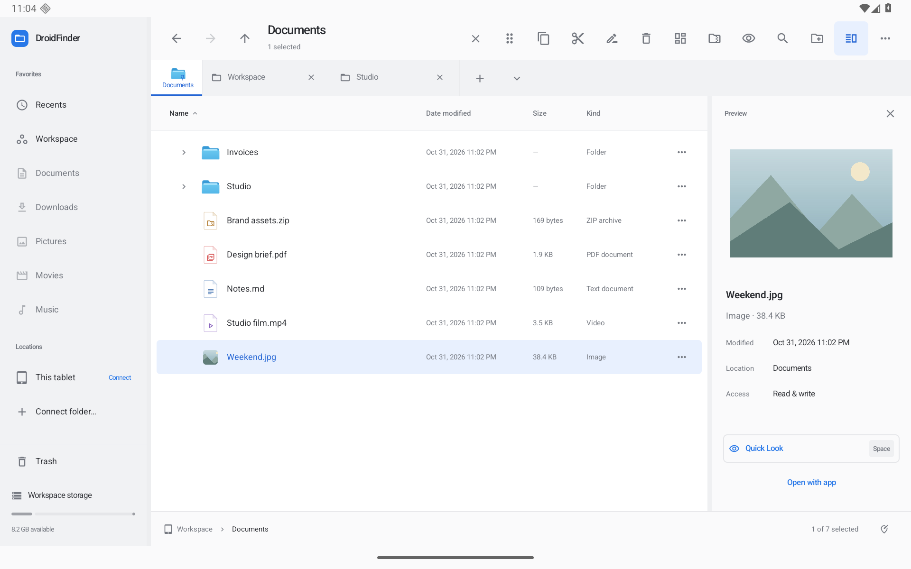

# Tabs, saved layouts and shared thumbnails — 0.9.0

This increment improves tablet navigation and preview reuse. The [full roadmap](ROADMAP.md) remains active.

Actual optimized Android screenshots with synthetic QA documents: [Tab overview](screenshots/navigation-overview.png) · [Saved two-pane layout](screenshots/navigation-workspaces.png) · [Dark](screenshots/navigation-dark.png) · [Dark overview](screenshots/navigation-dark-overview.png) · [Compact tablet window](screenshots/navigation-window.png) · [Compact density](screenshots/navigation-density.png) · [Portrait](screenshots/navigation-portrait.png).

## Tabs that keep your place

Each tab retains its selected items, separate keyboard focus, expanded list folders and viewport. Scroll positions are scoped to the folder, view and search criteria, so switching from a long list to icons does not overwrite the list position. Restoration uses the first visible file's path, with an index fallback when that item disappears. Restoring keyboard focus does not jump away from a manually scrolled position.

The state survives tab switches, reopening a closed tab and process restart. History retains locations and searches; Back/Forward clears the current selection. App-initiated renames and moves, including Undo, update inactive tabs, closed tabs and saved layouts. Changes made by other apps can invalidate path-based metadata.

Long-press or right-click a tab to **Pin tab**. Pins stay at the front, use a compact folder icon with a caption, and are protected from ordinary close and Close Other Tabs. Unpin before closing. The **+** button remains beside the tabs; the adjacent overview control appears with multiple tabs. **Actions → Tab overview…** provides search, full paths, pinning, closing and touch reorder handles. Mouse dragging also reorders the tab strip. Pinned and ordinary tabs remain in separate groups.

Bounds: 64 open tabs per pane, 20 recently closed tabs, 100 history entries per tab, 32 viewport positions per tab, and 1,000 expanded folders. Selection restoration checks the loaded listing and discards unavailable items.

## Named layouts

Open **Actions → Workspaces…**, enter a name and choose **Save current**. A saved layout includes both panes' tabs, history, searches, pins and navigation state; pane order, split ratio and active pane; and view/layout, sort, grouping, hidden-file and folders-first settings, preview/details visibility, icon size, browsing-column width and preview width. Open a layout to restore it in the current window. Use its menu to update, rename or remove it.

These layouts do not include the global theme/density, transient navigation-tree/auto-fit state or file contents. They do not replace the shared clipboard, transfer queue or Undo history. Transfers keep their original destination snapshots even when a different layout is opened. There are at most 24 named layouts; names are case-insensitively unique and contain 1–60 characters.

Layout writes are serialized and atomic. The UI confirms saving after storage succeeds, shows an in-progress indicator, and offers retry after a write failure. Unreadable or unknown-version metadata is preserved and protected from overwrite. App data deletion/uninstallation also deletes saved layouts; this is not a backup feature.

## Shared image thumbnails

Panes and windows share a 24 MiB bitmap LRU cache with at most four concurrent decodes. Requests for the same thumbnail share work; closing one consumer does not cancel another consumer's request. Work is cancelled after its last consumer leaves. Eviction does not recycle a bitmap that is still visible.

The cache key includes the path/URI, name, MIME type, size and modification time. A provider that keeps a document URI stable while changing its filename or type triggers a new thumbnail identity. Unsupported or failed image decodes fall back to the file-type icon and can retry. Memory-pressure decode failures clear cached thumbnails and fall back without claiming the entire app has a 24 MiB memory limit. Visible bitmaps, full Peek previews and provider disk previews have separate lifetimes.

Progressive folder loading, a search index and measured performance benchmarks remain open roadmap work.

## Verification

Local verification uses the isolated Android 16/API 36 tablet emulator. The navigation suite exercises actual list/icon/gallery/column viewports, independent selection and keyboard focus, expanded folders, process-model reload, closed-tab and layout path remapping, pin close protection, touch reorder, named layouts and opening a layout during a gated transfer. Codec tests cover old tab formats, bounded state, atomic layouts and preservation of unknown versions. Thumbnail tests cover shared consumers, byte-budget eviction, cancellation, changed identity, retry and simulated decode memory pressure; a UI test changes an image entry’s name/type to text/PDF while retaining its file identity. An injected storage-failure test checks saving state and successful retry.

The native address-bar regression exposed an IME behavior that briefly clears selected text on hardware Enter. Address Enter/NumPad Enter now commits before the soft keyboard processes that event; the on-screen Go action remains supported. The regression checks native address aliases, typing and Select All before committing.

Local checks: **93 JVM tests passed**, Android lint completed with **0 errors / 75 warnings**, and optimized preview/unsigned release builds succeeded. The full Android run completed **113 checks: 110 passed, 3 failed, no skips**. All **17 new navigation/layout/cache checks passed**. Failures were the pre-existing intermittent native Gallery right-click stress check, transient ETA visibility in the slow-copy test, and leading characters lost during bulk IME injection in the address test.

The input harness now advances the Compose test clock after each injected character. The transfer test observes live ETA before waiting for Android notification delivery, then checks notification totals while paused. Failure diagnostics target the transfer dialog rather than assuming only one UI root. Targeted reruns passed the 16-click, four-view Gallery stress case and the transfer ETA/pause/notification test. The initial per-character input assertion still raced asynchronous IME delivery; it now waits for each character to appear. The final affected run passed **7/7** (five repository checks, icon-refresh UI and native address/Enter/on-screen Go). JVM/lint and both optimized builds passed again after tightening the local thumbnail allocation-failure path. A single clean 113-check pass is **not** claimed; native Gallery automation remains intermittent.

The optimized **0.8.0-preview → 0.9.0-preview** upgrade restored two legacy tabs, their current folder and existing Workspace content. Native QA verified pin/selection restoration and reopening a saved two-pane layout after a cold process restart; the optimized app also retained pins, selection and the saved layout after a cold restart. Optimized native screenshots were inspected in landscape (1280 × 800 dp), portrait (800 × 1280 dp), a 640 × 800 dp tablet window, dark appearance and Compact density. The dark overview's active title uses the same adaptive selected-text color as file rows. Display overrides, Comfortable density and light appearance were restored after QA. Physical-tablet, USB/SD and real third-party-provider coverage remains external.

Release artifacts use `scripts/package-preview.py` to validate version/manifest agreement, the development signature, non-debuggable builds and absence of the test provider. Both APKs ship with SHA-256 checksums and source/build metadata. [Installable preview](https://github.com/moikdev/findroid/releases/tag/v0.9.0-preview).
