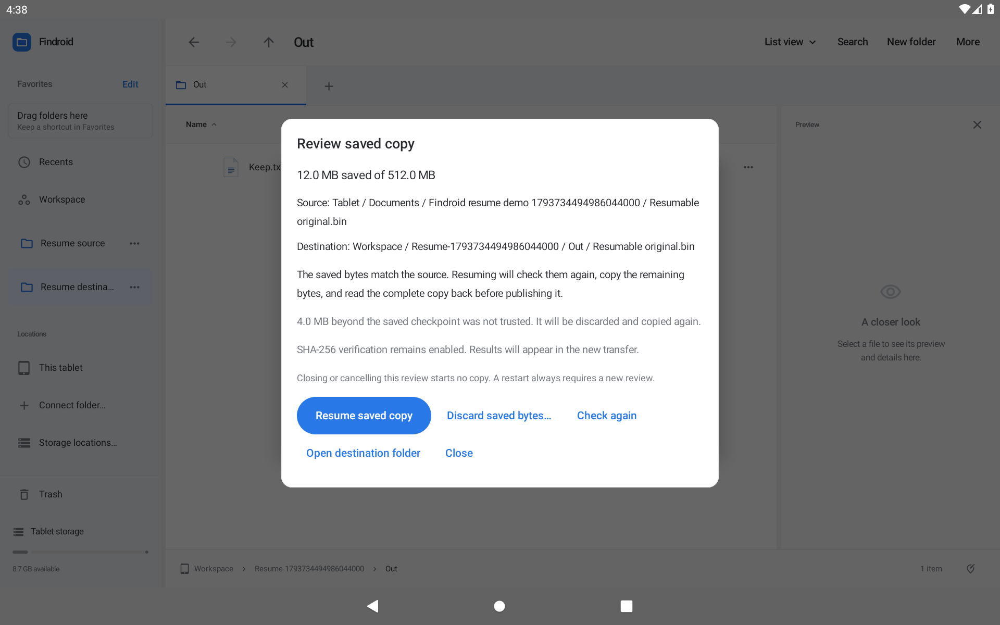
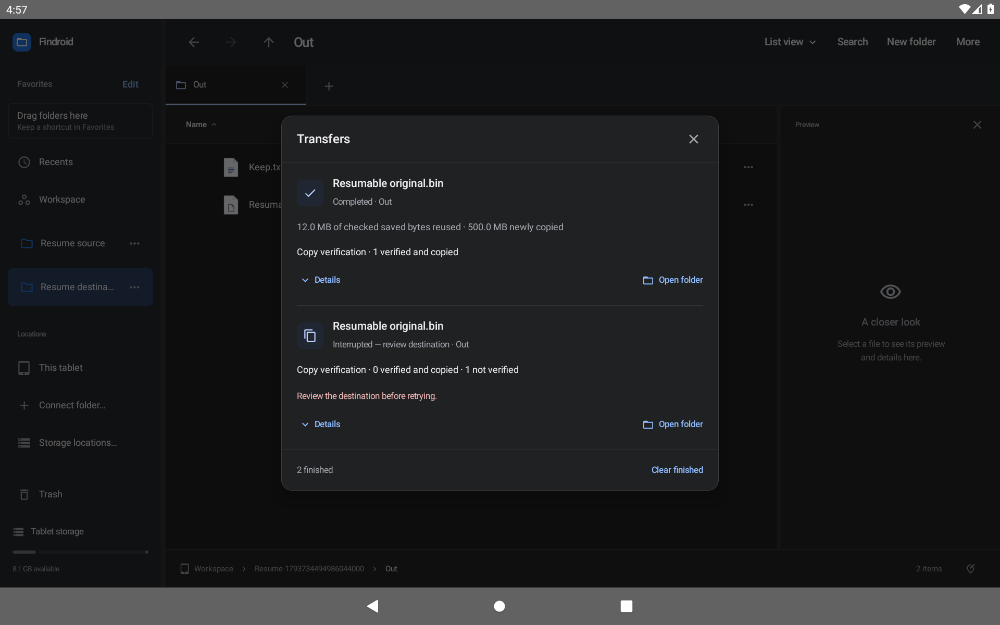

# Resume an interrupted copy

Partial-copy recovery is available in **0.44.0-preview**. Both assigned tablets pass local acceptance and actual public OTA upgrades. Immutable-archive verification is being completed.

When Android stops a large copy, Findroid can keep a private checkpoint instead of losing all its progress. Open **Actions → Transfers**, find the interrupted transfer, and choose **Review saved copy…**.

The review shows the source, destination and amount saved. It checks the whole current source and compares the saved prefix. Choose **Resume saved copy** to continue. Findroid checks the files again when that new transfer starts, copies the remaining bytes and reads the complete working copy back before making it available. Closing or cancelling the review starts no copy.

If the source, destination or saved file has changed, Findroid keeps the files and explains why it cannot resume. **Discard saved bytes…** has a separate confirmation and removes only reviewed private working data. It keeps the source and all destination items. If the copy was finishing when Android stopped it, open the destination folder before cleaning up; the completed copy might already be there.

Saved bytes and newly written bytes have separate counts. The original interrupted history remains available, and a resumed copy has its own transfer entry. **Clear finished** keeps transfers that still own saved data. Every app restart requires a new review.

*Actual optimized Android tablet capture with a synthetic 512 MiB source and a checked 12 MiB checkpoint.*

## Supported copies

The first implementation supports individual local regular files of at least **8 MiB**, with a durable checkpoint every **4 MiB**. The destination must share a filesystem with Findroid's private working storage and support an atomic no-replace rename and directory synchronization. These capabilities are tested before copying source data. Workspace is the main intended destination for this first increment.

Connected document providers, folders, moves, replacements, smaller files and storage that cannot provide those guarantees use the existing copy behavior. Their transfer details explain that an interruption requires restarting. There is no claim that Android shared storage, removable drives or every provider can resume.

A saved working file may contain a little more data than the last durable checkpoint. The review discloses this unchecked tail. Resuming discards and recopies it rather than trusting it.

## Recovery guarantees

- Checkpoints retain native device/inode identity, file kind, link count, length and nanosecond modification/change times. Numeric identities are stored as decimal strings so JSON cannot round 64-bit values.
- Opened descriptors reject final symlinks and non-regular files. Resolved paths and parent identities detect redirected locations.
- Private working files live under `.partial-copies` outside the exported Workspace. Cleanup targets one owned file and an empty owner folder; it never recursively deletes documents.
- The file is synchronized before its checkpoint is saved in the SQLite journal. Schema 4 upgrades existing histories without inventing checkpoints for old copies.
- Resume approval stays in memory. One journal transaction transfers stage ownership to a new single-file job. A failed transaction leaves the old ownership intact.
- A narrow native bridge calls the kernel's `renameat2(RENAME_NOREPLACE)`. A collision preserves the existing destination. There is no fallback to a replacing rename.
- The journal records that publication is starting before the rename. An interrupted publication is review-only; cleanup can acknowledge an absent private stage while preserving a completed destination.
- Source hashes, saved-prefix checks and full readback precede publication. Optional SHA-256 verification and its durable results remain enabled when originally requested.

## Validation status

The current development build passes **613 JVM cases** and **39 focused native cases on each assigned API 30 and API 36 tablet**, with no failures or skips. Focused cases cover real descriptors, symlinks, FIFOs, Unicode publication, no-replace collisions, changed sources/stages/destinations, checked tail truncation, manual controls, owned cleanup, 3→4 SQLite migration and transactional ownership failure.

The full **455-case native regression** passes in **50 fresh-process batches per API**, with identical case sets. The exact optimized APK passes direct **0.43 → 0.44** upgrades, actual process death during a 512 MiB copy, no replay after reopen or cancelled review, manual resume, complete-byte verification and original-state restoration. API 30 reuses 12 MiB and writes 500 MiB; API 36 reuses 36 MiB and writes 476 MiB.

Each API passes **18 layouts**: 1280×800, 800×1280 and 600×800 dp, font scales 1.0/1.5/2.0, and light/dark themes. All 90 named recovery-control captures per API independently prove enabled, complete 48 dp targets. All 198 focused and optimized captures were inspected. The native libraries for all four ABIs pass 16 KiB segment/alignment checks, and the preview retains the previous signing certificate.

Public OTA and immutable-archive acceptance remain pending before proposal 41 is marked complete. No physical tablet, removable-drive or third-party provider result is implied by these emulator checks.

