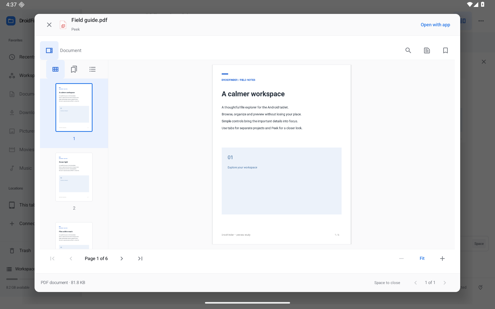

# PDF Peek — 0.13.0

Space opens a PDF in Peek with a page thumbnail rail, document search, selectable reading text, embedded contents and saved page bookmarks. Rendering and text extraction run locally, off the UI thread. PDF routing recognizes the filename extension or a provider’s declared PDF MIME type, including names without an extension. Android renders the page; the portable text reader supports the app's Android 11+ baseline.

Actual optimized Android captures: [Search](screenshots/pdf-peek-search.png) · [Bookmarks](screenshots/pdf-peek-bookmarks.png) · [Selectable reading text](screenshots/pdf-peek-text.png) · [Cold restoration](screenshots/pdf-peek-restored.png) · [Dark](screenshots/pdf-peek-dark.png) · [Portrait](screenshots/pdf-peek-portrait.png) · [Compact tablet window](screenshots/pdf-peek-window.png). Documents are synthetic QA fixtures; the distributed app does not seed files.

## Reading and navigation

- Choose a thumbnail, use previous/next/first/last page, or click the page counter to enter a page number. Page numbers are validated before navigation.
- Fit, zoom buttons and pinch gestures share one bottom control row with page navigation. Zoom stays in place between pages. Panning is bounded so the document cannot be lost outside the viewport.
- The bookmark button saves the current page in DroidFinder's app data. The bookmark rail returns to saved pages and removes individual entries. The document itself is unchanged. Up to 500 page bookmarks are stored per document, and 100 document fingerprints are retained.
- Peek stays open across activity recreation when rotating or resizing a tablet window. Reading position and bookmarks survive closing Peek and process restarts. Their fingerprint includes the source path/URI, modification time and size. A changed path or document can start a new record. Provider state uses the original document URI, rather than a temporary preview-cache filename.
- The contents rail reads internal page links from the PDF's outline. It does not launch external actions. Deep, cyclic or very large outlines are bounded (500 displayed entries, 2,000 visited nodes, 12 nested levels) and explicitly marked when incomplete.
- **Read PDF text** provides selectable text and a Copy page text button. Text extraction permissions are respected. Image-only pages remain viewable and explain that there is no searchable text layer. This mode does not perform OCR or edit the PDF. Direct selection on the rendered page remains future work.

## Finding text

Ctrl/Meta+F opens Find in PDF. Search works across pages with case-insensitive, literal text and normalized whitespace. Result snippets identify their pages; selecting a result jumps to it. Highlights follow glyph bounds, page rotation, text rotation and cropping. Complex text whose glyphs cannot be mapped individually falls back to broader text-run bounds.

Find accepts ordinary spaces and cursor editing. Choosing a result or submitting the touch keyboard hides the keyboard so the document is visible again. Escape closes Find before closing Peek. The window reserves Page Up/Down for PDF pages, Ctrl+Home/End for the first/last page, and F3 / Shift+F3 for next/previous matches. Unmodified arrows continue browsing files; Space closes Peek when the search field is not being edited.

Search publishes available matches as pages are checked. Stop retains partial results; Restart checks again. Unreadable or overly complex pages produce explicit incomplete counts and a bounded details list. The first 2,000 matches are shown, with a refine-search notice at that limit. Text extraction is bounded to 200,000 characters/glyph positions per page; pages reaching that bound are reported as incomplete. Empty text search does not claim OCR coverage.

## Resources and cancellation

- One native rendering session serializes page and thumbnail rendering. Full-page bitmaps fit within 1,800 × 2,400 pixels; thumbnails fit within 220 × 300. The thumbnail cache retains at most 18 images. Higher zoom magnifies this bounded raster; tiled high-resolution rendering remains future work.
- The text cache retains at most three pages / 250,000 characters. PDFBox scratch streams use an 8 MB main-memory / 128 MB combined-storage setting; this is not a bound on the parser's total memory or processing time.
- Cancelled searches check their coroutine before publishing. Glyph extraction has cancellation checkpoints; closing the preview stops future work and schedules independent cleanup of renderer and text resources. An in-flight native/parser call can finish before cleanup obtains its lock.
- Closing or replacing a provider preview cancels its active input stream, signals its provider request, and removes an unpublished partial cache file. Materialized provider previews keep the existing 128 MB limit. Other active consumers can still request the same document.
- Malformed PDFs show an error and retain file navigation/Open with app. Password entry, OCR, direct page-surface selection, large-image navigation and richer media controls remain on the broader roadmap.

The [dependency notes](../THIRD_PARTY.md) record PDFBox-Android, aligned Bouncy Castle dependencies, bundled licenses and the optional JPX decoder boundary. Native page rasterization remains Android's responsibility.

## Local validation

JVM checks passed **118/118**. Android lint completed with **0 errors / 71 warnings**. Debug, optimized development-signed preview and unsigned release variants built locally. The final targeted Android run passed **22/22**, repeated cleanly after the activity-retention and thumbnail-reveal fixes, covering all eight new PDF checks, the six existing Peek workflows, PDF/audio integration, five provider workflows and thumbnail identity/type invalidation. This is targeted preview validation; the complete Android suite was not rerun in this increment. All fixtures are synthetic documents on the dedicated API 36 tablet emulator. GitHub-hosted runners are not used.

The geometry check compares search bounds with rendered glyph pixels across **32 combinations** of page rotation, text rotation and cropping. It exposed collapsed highlights on rotated pages; glyph corners now transform from crop-box PDF coordinates before normalization. New native cases also cover spaces and keyboard input in Find, cross-page results, embedded chapter links, page-number validation, retained zoom, text copying, local/provider bookmark restoration, unchanged source bytes, image-only pages, malformed-document recovery and blocked provider cache cleanup.

The final recreation regression keeps Peek open on page 6 and requires its selected thumbnail to be fully inside the rail viewport. A subsequent optimized-APK check verifies persisted page 4/bookmark state across a cold launch; appearance and layout captures use the actual app, not mockups.

Optimized native QA verified full-document search, saved bookmarks, selectable reading text and page/bookmark restoration after a cold start. Peek stayed open through 1,200 × 1,920 portrait and 960 × 1,200 compact-window display changes at density 240. Dark appearance was inspected with rendered page content present. Normal 1,920 × 1,200 landscape size, density and Light appearance were restored. Physical devices, other Android versions and third-party provider accounts remain outside this emulator pass.

After adding MIME-based provider routing, a final focused batch passed **4/4**: a provider PDF without an extension, bookmark/activity restoration, photo/PDF/video/text navigation and provider preview/create/rename. These overlap the 22-case regression except for the new MIME case; they are not 26 distinct tests.
