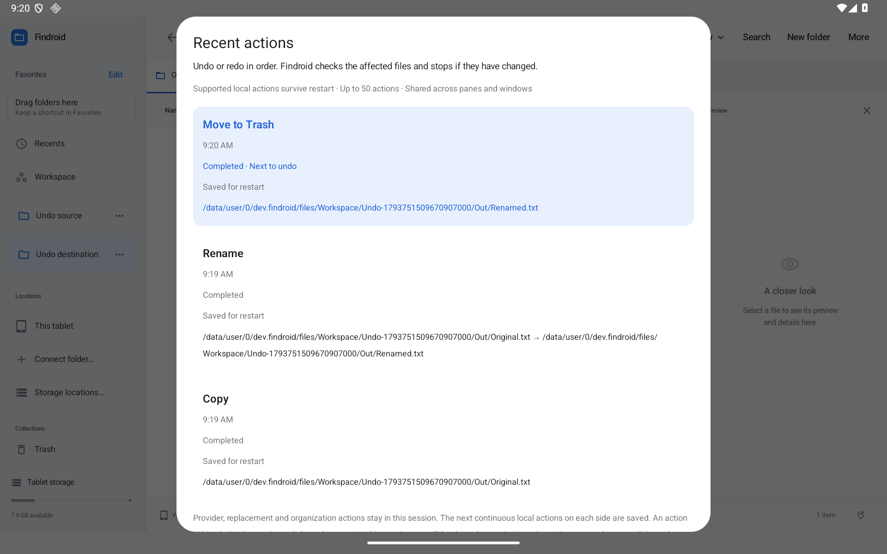
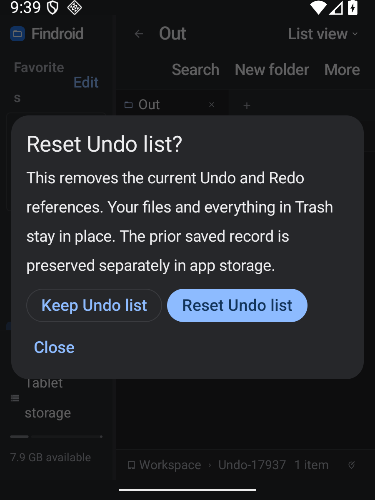

# Undo after reopening Findroid

Persistent Undo is available in **0.45.0-preview**. Native, optimized-build and actual public OTA acceptance pass on both assigned tablets. The immutable public validation archive also passes independent digest, entry and source-commit verification. Proposal 42 is implemented.

Open **More → Recent actions…**, a file menu, or the action launcher. The next eligible Undo and Redo have named buttons. Actions run in order. Nothing runs automatically when the app reopens.

Supported local actions show **Saved for restart** after their files and recovery record have been saved. The initial scope includes new files and folders, copies, moves, renames, grouping into a folder, Trash and restoration from Findroid's own Trash. The storage must support the required file and directory checks. Actual execution uses an atomic no-replace rename; an occupied destination is kept.

Provider actions, replacements, organization callbacks, links, special files and unsupported or oversized operations stay **This session only**. An action hidden behind one of those boundaries stays in that session even if the boundary action is later undone. A restart never skips an intervening action to reach an older one.

## When a check stops Undo

Findroid compares the affected files with the saved native identities, resolved paths and parent identities. It also checks the original content fingerprints and exact destinations. A later edit, recreated file, redirected parent, occupied name, missing document or changed Trash mapping stops the action. There is no force-overwrite option.

The list keeps the reason visible. If a check stopped before any mutation, reviewing and retrying performs those checks again. If a mutation or its metadata save may have stopped partway through, saved Undo becomes read-only and asks for review.

## Review and reset

**Saved Undo needs review** means the list may describe the state before an interrupted operation. Check the affected folders and Trash. Findroid does not replay the saved operation or choose an older backup automatically.

Choose **Reset Undo list…** to review the reset. **Keep Undo list** leaves the exact record alone. **Reset Undo list** removes the current Undo and Redo references while preserving the complete old journal directory separately in app-private storage. Your documents and every item in Trash stay in place. New supported actions can start a new saved list.

The entire dialog scrolls, including its named action and confirmation controls, for narrow tablet windows and enlarged text. No permanent toolbar icon is added.

## What is saved

The shared session keeps up to 50 actions across panes and windows. The saved list also has limits on command size, tracked paths, native proof entries and UTF-8 bytes. Older references or oversized actions can remain available only in the current session. Retiring a reference never deletes a document or recovery item.

The private record contains concrete local step state, original fingerprints, owned Trash references, applied/undone state and native file proofs. Decimal strings preserve 64-bit identifiers exactly. Loading a record does not read, recreate or fingerprint a missing document.

A separate, synchronized write-ahead marker is written before file mutations. It stays present while file changes, path remapping, preferences and queued workspace/folder-view saves finish. A completed snapshot is written atomically before the marker is removed. Failed prewrites prevent the Undo mutation; ambiguous completion and corrupt or incomplete records stay available for manual review. A backup is never silently substituted.

Only the owned journal is reset. Original files, Trash content, other recovery records and permissions are retained.

## Acceptance

`PersistentUndoTest` covers reopened local action chains, session boundaries, changed identities and content, occupied names, marker/snapshot failures, corrupt records, exact reset preservation and storage bounds. `PersistentUndoNativeTest` checks actual Android descriptors, FIFO/symlink refusal, Unicode names, kernel collisions and durable recovery on the assigned API30/API36 tablets. `PersistentUndoWorkflowTest` exercises the named controls, edit refusal and review/reset through the tablet UI. Its composition-level font override did not enlarge the captured dialog text, so the native images are not evidence of enlarged text.

`scripts/check-persistent-undo.py` performs actual 0.44 → 0.45 upgrades, completed local copy/rename/Trash actions, cold-process Undo/Redo, occupied destinations, corrupt-record review/reset and an 18-layout matrix using the exact optimized APK. It changes the real Android system font setting for enlarged-text acceptance. Measured TextView bounds and raster glyph dimensions must increase at 1.0, 1.5 and 2.0 font scales in all six size/theme groups. Its private backups and URI-grant payloads are excluded from public evidence.

Final release results and remaining physical/OEM/provider acceptance are recorded in [VALIDATION.md](../VALIDATION.md) and the [improvement tracker](IMPROVEMENT-TRACKER.md).
