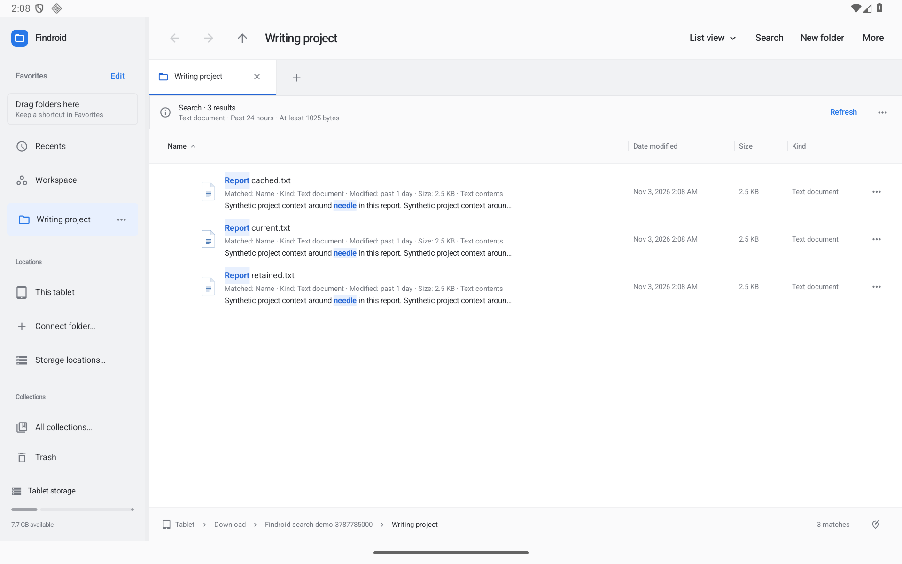
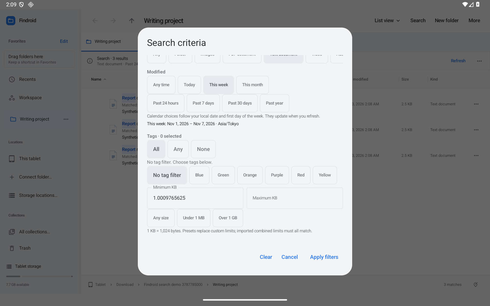
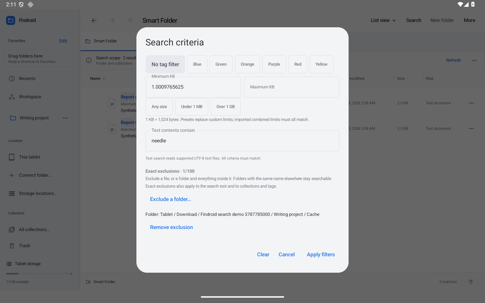

# Search that explains its results

Open **More → Search filters…**, or open Search and use its filter control. Criteria apply together: a file must pass every active criterion. You can save them as a Smart Folder from More. To reuse a query without naming a Smart Folder, open **More → Recent searches…** or choose a suggestion while typing. [Recent-search guide](RECENT-SEARCHES.md).

## See why a file matched

The filename highlights the matching words. Each result also has a short explanation, such as **Matched: Name · Tags: Review · Kind: Text document**. A content search adds a nearby plain-text snippet with its matching words highlighted. These explanations work in List, Icons, Columns and Gallery.

Compact cells can shorten the explanation. Select a result and open its preview/details pane for the complete explanation and bounded snippet. If a hidden extension contains the name match, that result shows the full filename so you can see the match.

Content search reads supported UTF-8 text files. It captures the snippet during that read; showing an explanation does not reopen the document. Snippets remain in the current listing's memory and are omitted from saved tabs, Smart Folders, workspaces and setup exports. The content query itself remains part of the saved criteria, as before.

## Choose dates, sizes and kinds

- **Today**, **This week** and **This month** use your local calendar. The editor shows the dates and time zone. This week follows your locale's first day of the week. Refresh reevaluates a saved calendar choice.
- **Past 24 hours**, **Past 7 days**, **Past 30 days** and **Past year** are rolling windows. An older saved “Today” rule keeps its original rolling 24-hour meaning and now appears as Past 24 hours.
- **Under 1 MB** and **Over 1 GB** are strict bounds. Here, 1 KB is 1,024 bytes, 1 MB is 1,048,576 bytes, and 1 GB is 1,073,741,824 bytes. A file exactly 1 GB does not match Over 1 GB.
- **Images** selects the existing Image kind criterion. The other kind choices remain available alongside it.
- Minimum and Maximum KB accept lossless decimal values. A saved bound of 1,025 bytes opens as `1.0009765625` KB. Invalid, fractional-byte or reversed bounds must be corrected before Apply becomes available.

A size preset replaces the custom size limits. Editing a custom size clears the preset. If an imported search contains both, they intersect: all its bounds must match. Files with an unknown size are skipped under a size filter, and Result details explains the incomplete check.

## Exclude one location

Scroll to **Exact exclusions** in the criteria editor:

1. Choose **Exclude a folder…**, navigate to the folder, and confirm **Exclude this folder**. A read-only folder can still be excluded.
2. Or select files/folders in the browser first, open the criteria, and choose **Exclude selection (n)**.
3. Review the listed locations and apply. **Cancel** keeps the current search. **Remove exclusion** removes one draft rule; apply to confirm it.

A selected file excludes itself. A selected folder excludes itself and the files and folders inside it. For example, excluding `Project A/Cache` keeps `Project B/Cache` searchable. Exact exclusions apply to the search root and to items checked through collections and tags. Up to 100 exact locations can be saved per search.

**Exclude folder names** keeps its earlier behavior: an exact, case-sensitive name excludes every matching folder encountered below the root. That name rule always scans the chosen root itself. It is separate from exact locations.

Connected document providers use their document identities and actual ancestry checks. Findroid does not guess ancestry from a document ID's spelling. When a provider cannot verify an exact exclusion, the affected branch is skipped and the results are marked incomplete. Result details explains the issue; reconnect storage or remove the exclusion and refresh.

## Keep searches portable

New criteria survive tabs, app restarts, Smart Folders and saved workspaces. Exact exclusions also enter the setup backup's reference inventory. A reviewed restore remaps them alongside the rest of the setup, including saved navigation budgets. Original documents and snippet contents are not included in the backup. See [setup backup](SETUP-BACKUP.md).

The criteria increment implements proposals 20, 23 and 24. [Recent searches](RECENT-SEARCHES.md) ship in 0.37, and [chosen search folders](SEARCH-LOCATIONS.md) ship in 0.38.1. The same criteria and literal exclusions apply across every chosen folder. [Nested All/Any/None rule groups](SEARCH-RULE-GROUPS.md) ship in 0.39.0 and intersect with these simple criteria. Optional indexing remains open on the [improvement tracker](IMPROVEMENT-TRACKER.md).
