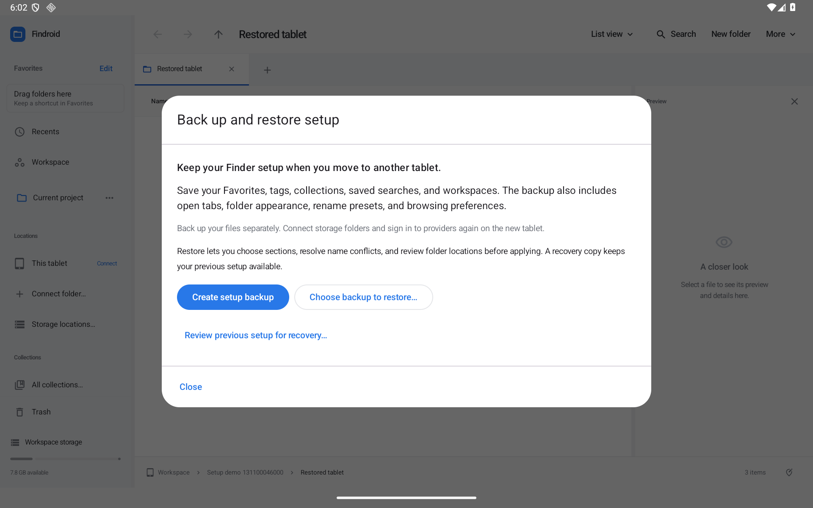
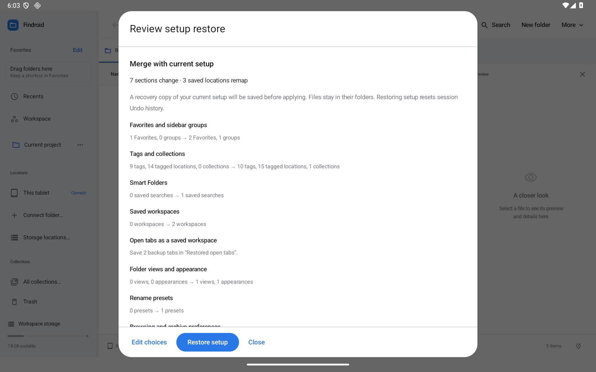

# Take your setup to another tablet

Findroid 0.33 adds **Back up or restore setup…** in Preferences, the action launcher, and the organization window. It saves a readable JSON file, then lets you review what to restore and where the saved folders live on this tablet.

A setup backup contains references and settings. Copy or back up the actual files separately.

*Actual optimized Android 16 tablet capture with synthetic project data.*

## Create a backup

1. Open **More → Preferences… → Back up or restore setup…**. You can also search for “backup” in **Ctrl+Shift+P** or choose **Back up or restore all setup…** in the organization window.
2. Choose **Create setup backup**. Findroid prepares a snapshot and records the relative locations of saved references.
3. Review the included sections and choose **Save backup…**. Android's save dialog lets you pick the file name and destination.

The backup includes:

| Section | What is saved |
| --- | --- |
| Favorites | Shortcut order, labels, groups, collapse state, and built-in location visibility/order. |
| Tags and collections | Tag names/colors, assignments, and collection references. |
| Smart Folders | Names, roots, and saved search rules, including tags, subfolder scope, calendar/size choices and exact file/folder exclusions. |
| Workspaces | Named pane layouts and their tabs, history, searches, selection, and scroll anchors. |
| Open tabs | The current window's tabs and pane layout, offered as a named workspace during import. |
| Folder appearance | Remembered folder views, colors, and symbols. |
| Rename presets | Reusable rename recipes and ordering choices. |
| Preferences | Density, extensions, theme, sidebar width/visibility, tag visibility, gesture-tip state, conflict default, and ZIP resource limits. |

File contents, Android access grants, provider sign-ins, notification/file-picker permissions, transfer jobs, Undo/Redo history, recent-search history and its recording preference, Trash, caches, and updater state remain on the original installation. Findroid's Android automatic backup exclusion remains enabled; this feature is an explicit user-created export.

Exact search exclusions and, from 0.38.1, every chosen search folder enter the reference review and follow explicit root mappings. This includes Smart Folders, saved/open tabs and scan-budget scopes. Match snippets remain in the current listing and are omitted from the backup. Recent searches remain outside setup backups. See [Search locations](SEARCH-LOCATIONS.md).

The JSON can reveal folder names, file paths, tag names, and saved search text. Choose a suitable place to keep it.

## Restore and map storage folders

1. Copy the backup and your files to the new tablet. Connect the relevant storage folders and sign in to any document providers there.
2. Choose **Choose backup to restore…** and select the JSON through Android's document picker.
3. Select the sections you want. **Merge** is the default.
4. Under **Storage folders**, choose a replacement folder for each old storage root. For example, map the old tablet's `Projects` storage root to the new tablet's `Work` folder. References keep the relative names below that root. Findroid's private Workspace maps to this installation's Workspace automatically.
5. Choose **Review changes**. Review section counts, folder mappings, conflicting names, and unavailable references.
6. Fix missing storage or explicitly choose **Keep unavailable references for later repair**. Findroid preserves those references without creating missing files or folders.
7. Choose **Restore setup**. Keep the app open until it reports completion.

Restoring is available from the main Findroid window after other Findroid windows are closed and ongoing file/setup writes have finished. File folders remain available while you review. The final apply rechecks storage availability and the reviewed setup; a changed grant, mapping, or current setting requires a new review.

## How conflicts are handled

| Situation | Merge | Replace selected sections |
| --- | --- | --- |
| The same Favorite folder is already saved | Keep its label, position, and group. Append new Favorites. | Use the backup's selected sidebar setup. |
| A group has the same name | Reuse the existing group and its collapse setting. | Use the backup's groups with the sidebar. |
| A tag has the same library name | Keep the current name/color and combine assignments. Saved search/tag destinations use that existing name. | Use the backup's tag library and assignments. |
| A collection has the same library name | Combine references, preserving the existing collection ID/color. Saved tabs use its ID. | Use the backup's collections. |
| A saved search, workspace, or rename preset name conflicts | Reuse an unchanged restored entry; otherwise keep both with a ` (restored)` suffix. | Use the backup's selected list. |
| The same folder has remembered view/appearance settings | Keep the current setting and explain the conflict in review. | Use the backup's selected settings. |
| Browsing/archive preferences differ | Keep this tablet's preferences and explain that choice. | Restore the allowlisted preference values. |

Only selected sections change. Capacity limits are checked on the complete merged result before any write. Reimporting an unchanged backup reuses entries already restored under a new name.

**Open tabs become “Restored open tabs,” a saved workspace.** Open it from the completion screen when you want to switch. Saved tab destinations whose tag, collection, or Smart Folder is absent are included in the unavailable-reference review.

## Provider references

Local references use a validated relative path below a recorded root. Known Workspace aliases are recorded separately and map to the new Workspace.

For document providers, Findroid records relative names only when it can establish their parent chain. During import it browses the chosen destination and uses the provider's actual document IDs. It does not build IDs by appending file names to a URI. Read-only destinations are supported because restoring references requires reading, not writing, those folders.

An unknown parent chain, missing item, duplicate visible name, loading provider, or unavailable grant stays explicit in the review. An unresolved opaque provider reference keeps its original URI for later individual repair. No backup can transfer an Android access grant or recreate a provider's private ID scheme.

Resolution is cancellable, limited to 128 path components and 200,000 scanned provider entries. Choose closer roots or fewer sections if that scan budget is reached. Actual third-party provider/account and physical-media acceptance remain separate from the emulator fixture checks.

## Recovery and failure behavior

Before applying, Findroid stages validated metadata and saves a private recovery copy of the previous setup. **Review previous setup for recovery…** uses the same section, mapping, and merge review; it is not an automatic file operation. The copy contains the setup immediately before the latest successful restore.

A private write-ahead journal covers the fixed app-owned metadata files and allowlisted preference keys. A failed apply rolls back. After process death, a prepared journal is rolled back before the browser model loads; a committed journal only needs cleanup. If recovery metadata is damaged, browsing is blocked and the recovery files are kept for **Retry setup recovery**. Storage failures that prevent recovery must be resolved before retrying. Clearing app data removes the recovery copy.

Restoring setup resets session Undo/Redo history so old metadata callbacks cannot overwrite the newly restored library. It does not execute rename presets, copy/move referenced files, replay transfers, or restore Trash.

The format is `dev.findroid.setup`, version `1`, with a 32 MiB file limit. Strict parsing rejects repeated fields, trailing input, excessive nesting, unknown schema fields, coercion/clamping/truncation, unsupported versions, traversal segments, inconsistent reference inventories, and invalid section capacities. Corrupt or future existing metadata is preserved rather than silently replaced. The format is metadata-only and does not accept imported output file names or preference-store targets.

## Organization-only export

The organization window still offers its existing scoped tag/collection export. Use that for metadata about selected items or the organization library. The new named setup action includes Favorites, layouts, searches, and preferences as well. Both exports describe references; the original files stay in their folders.

## Repeatable acceptance

[VALIDATION.md](../VALIDATION.md) records exact counts, devices, and screenshots. The native suite uses controlled local/document-provider fixtures, including read-only and loading states. `scripts/check-setup.py` drives the optimized APK through Android's real CreateDocument/OpenDocument dialogs, root selection, reviewed import, restart, enlarged text, startup rollback, and the damaged-recovery gate. On API30 it compiles a transient shell helper that supplies explicit finger events; no instrumentation or process restart is used to select a file in the external picker. It verifies original fixture bytes and an unrelated preference and restores the exact original metadata without clearing app data.

From 0.39.0, [nested search groups](SEARCH-RULE-GROUPS.md) travel with Smart Folders, workspaces and open tabs. Reviewed tag remapping updates nested references as well as simple tag criteria. Unsupported groups reject the affected saved data instead of silently widening a search.
