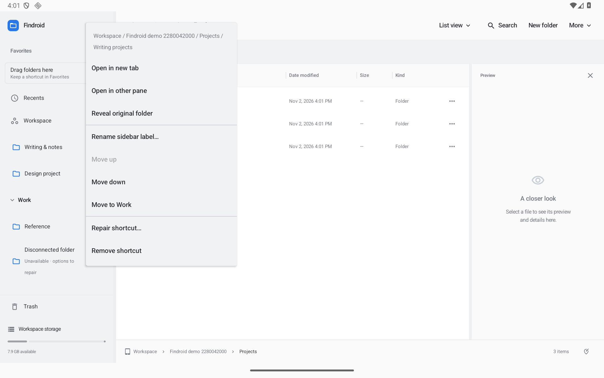
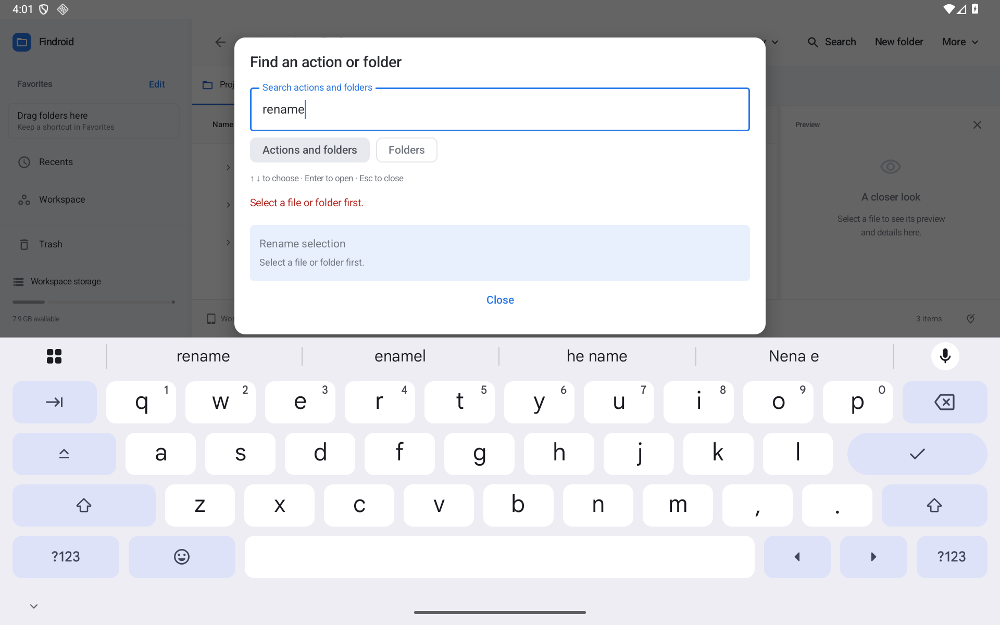

# Your sidebar, your order

Findroid 0.32.0 preview makes Favorites manageable directly in the sidebar. Every shortcut is a reference: changing its order, label or group never moves, renames or deletes the original folder.

## Reorder a favorite

Hold the favorite's **folder icon**, drag it between shortcuts, and release at the blue insertion line. With a mouse, drag the icon directly. The chosen order survives restarting Findroid. You can reorder a shortcut even when its storage is disconnected.

A sidebar shortcut drag only changes the sidebar. To move the actual folder, drag its icon from the file browser. Dropping browser files onto a favorite folder still performs the usual transfer. Dropping browser folders onto **Drag folders here** saves shortcuts; insertion lines also accept folders from the browser.

The **…** button beside each shortcut opens its Options menu. **Move up** and **Move down** provide a named alternative to dragging.

## Labels, groups and built-in locations

The shortcut menu can:

- Open the original folder in a new tab or the other pane.
- Reveal and select the original folder in its parent.
- Change the sidebar label without renaming the folder. A blank label restores its folder name.
- Move the shortcut into a group, out of a group, up or down.
- Repair its saved location, reconnect storage, or remove only the shortcut.

Choose **Edit** beside Favorites to hide or reorder the seven built-in Favorites locations: Recents, Workspace, Documents, Downloads, Pictures, Movies and Music. **Restore built-in defaults** restores their visibility/order and keeps your custom shortcuts.

Create a named group in the same editor. Tap the group's heading to collapse or expand it; this state is remembered. Its Options menu can rename the group or remove it while keeping every shortcut. Folders can be pinned directly at a group's insertion line, including when the group is collapsed.

Two shortcuts with the same display name show their paths underneath. Unavailable folders have an explicit subtitle and open a recovery dialog, rather than an apparently empty folder. Reconnect the storage, choose a replacement folder, check again, or remove the reference. Repair can choose a read-only folder because the shortcut needs only read access.

The first upgrade from an older release keeps existing favorites. An unordered legacy set has no saved user order, so its first ordered representation sorts by folder name and then path. Once you rearrange it, your order is authoritative. Labels, groups and order are shared by the panes and independent Findroid windows in the same app process, and persisted together with an atomic preference commit. A damaged or newer sidebar schema is preserved and produces an error; it is never silently overwritten by an empty sidebar.

## Find an action or jump to a folder

Open **More → Find an action or folder…**, or press **Ctrl+Shift+P**. Search by words such as “rename,” “show hidden,” “recovery,” or “preferences.” Unavailable actions explain their reason. Choosing a disabled action keeps the launcher open and shows that explanation.

Choose **More → Jump to folder…**, or press **Ctrl+K**, to focus on destinations. It includes current-folder children, Favorites, connected roots, breadcrumbs and recent destinations from saved tab histories. Search their names or paths, or enter a full authorized folder path. The list is bounded to 100 visible matches; narrowing the query searches the whole collected catalog. This switcher does not recursively scan the filesystem and does not replace file search.

Use **Up/Down**, **Enter** and **Escape** in either mode. A destination is rechecked before navigation. A missing location explains the problem and keeps the switcher open. Existing **Ctrl+L**, **Alt+D** and **F4** address controls are unchanged.

## Understand selection and empty views

The first-use file hint explains holding a name to select and holding an icon to drag. **Got it** dismisses it. Open the keyboard shortcut guide from Help and choose **Show file gesture tips again** to replay it.

A selection strip shows the count and path for its pane. Changing views preserves the selection; in two-pane layouts both strips identify their own scope, including when the other pane is active.

An empty search offers **Clear search**. Clearing a Smart Folder view returns to its root without deleting its saved rules. A folder whose contents were hidden offers **Show hidden files**. Empty, missing and disconnected folders retain their distinct states. The empty-state layout adapts when a keyboard or short split window leaves little height.

Preferences separates **Browsing** from **Advanced**. The advanced page contains conflict behavior, Trash/cache maintenance, archive safety budgets, storage capabilities and gesture-tip replay. These tools remain available without adding permanent toolbar buttons.

## Validation limits

The release evidence records the exact local checks. Native Android 11/API 30 and Android 16/API 36 tablets are emulators; physical stylus, trackpad, screen-reader, removable-storage and third-party-provider acceptance remain separate open work. The full authorized improvement list is tracked in [IMPROVEMENT-TRACKER.md](IMPROVEMENT-TRACKER.md).
