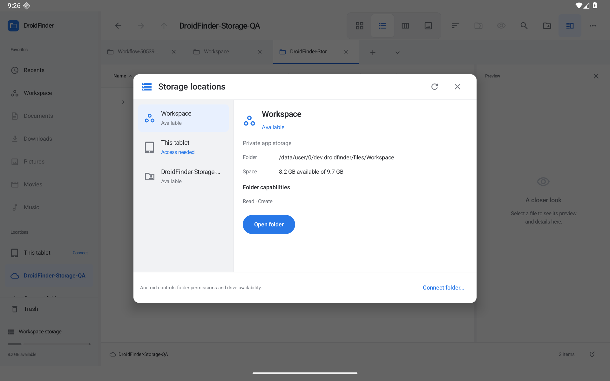

# Storage and permission recovery — 0.18.0

**Storage locations…** is available in the sidebar and Actions menu. Its tablet dialog lists Workspace, tablet storage, remembered removable volumes and connected Android document-provider folders. Select a location to see its status, reported free space, folder capabilities and access actions. Detail fields use compact label/value rows; provider-app and remove-connection controls share the primary action row with tooltips and accessibility labels. Compact tablet windows use a vertically scrolling layout. The dialog is capped at 720 × 480 dp, with a scrolling detail area and fixed close/refresh controls.

Workspace and readable local volumes use Android's filesystem space report. A provider's available-byte report is shown only when its root can be matched unambiguously to the connected folder, using the provider's document identity/child API. Opaque document IDs are never treated as filesystem paths. Missing/ambiguous space is shown as unknown; it is not estimated from file sizes. The root lookup is bounded to 64 rows. No recursive storage scan runs when opening this screen.

[Connected folder](screenshots/storage-connected.png) · [Read-only grant](screenshots/storage-readonly.png) · [Expired folder](screenshots/storage-expired-folder.png) · [Reconnect](screenshots/storage-reconnect.png) · [Restored browsing/create](screenshots/storage-restored.png) · [Dark](screenshots/storage-dark.png) · [Portrait](screenshots/storage-portrait.png) · [Smaller tablet window](screenshots/storage-window.png)

## Status and recovery

- **Available / Read only / Limited access** reflect readable location metadata, provider capability flags and any saved read-only grant. Individual files may have different capabilities. Available metadata does not prove every remote file is online.
- **Access needed** offers Android's tablet storage permission settings or a specific folder connection through the system picker.
- **Reconnect needed** identifies a provider permission denial without a saved read grant. Choose the original folder in Android's picker. The original tabs, pane locations and navigation history are retained and refreshed.
- Selecting a different tree during reconnect shows an explicit choice: add it as a new location, or choose the original folder. Existing tabs are never silently redirected into the new tree.
- **Unavailable** covers disconnected drives or provider failures while a saved grant still exists. Retry or open the provider app to check its account/network/drive. **Provider unavailable** distinguishes a missing or disabled provider application.
- Removing a saved connection releases its persisted permission. Open tabs remain so their paths/history can be recovered; unrelated virtual views and other panes remain usable. Removal is blocked while a file operation is active.

Refresh checks location metadata on IO workers, with at most four probes executing at once. Opening a removable volume also refreshes the navigation drive inventory, so a volume detected by the status refresh can be admitted without an app restart. Stop cancels the request, signals provider cancellation, retains completed results and prevents late publication into a newer request. Android or a provider may take time to return an already-running filesystem/Binder call; this is not a hard timeout or a promise that every provider honors cancellation.

Android's saved permissions are refreshed on resume, connection changes and status refresh. Provider write/create/rename/delete capabilities are intersected with a known saved read-only grant. An active session-only grant can still provide access when no persisted grant exists. The OS remains the final authority for each operation.

## Protected directories

Shared `Android/data` and `Android/obb` folders for other apps, private app data and system folders are not presented as unlockable through all-files access. The file view explains Android's restriction and offers Workspace or storage locations. Local admission checks require an existing target and use canonical path boundaries, including symlinks; provider identities remain opaque. `Android/media` remains ordinary shared storage subject to Android's access rules. This app does not provide root access, formatting or privileged drive ejection.

## Verification

Local JDK 17 / SDK 36 checks passed: 145 JVM tests, optimized preview/unsigned release builds, and Android lint with 0 errors / 88 warnings. A combined 20-case native run passed on the dedicated Android 16 / API 36 emulator: five storage workflows, six provider workflows and nine existing Finder workflows. Storage checks cover provider capability/free-space reporting, read-only browsing, permission/offline/missing-provider/removed-drive distinctions, same-tree reconnect, explicit different-tree choice, tab/pane/history/viewport retention, connection removal during an operation, protected paths, valid/dangling symlinks, and cancellation with a late provider result.

After the detail/action layout polish and drive-inventory refresh, the focused five-case storage class passed again.

The first runs exposed harness assumptions about pre-existing Trash items/tabs and automatically saved viewport fields. The harness now selects its own Trash item by original path, identifies the original tab by ID, separates route checks from viewport checks, and removes only tabs it created. The dangling-link admission check was also tightened before the final passing run. Physical USB/SD removal, third-party cloud accounts, disabled-provider behavior across device vendors and multiple Android releases still need a real-device/provider matrix. The emulator uses synthetic QA data only; the distributed app does not seed documents.

The real DocumentsUI check also passed for saved read-only permission and explicit revocation, with cold process restarts to remove temporary grants. Read-only browsing remained available and the New folder button was disabled. Revocation retained the tab and displayed the expired-access/reconnect states. The smaller detail-row layout was inspected with those real grant states. The optimized APK then cold-started with revoked access, reconnected the same original tree through DocumentsUI, restored saved read/write access and created the synthetic Restored-access folder in that provider location. The final optimized APK also passed cold-start, storage opening and remove-confirmation/cancel checks; landscape, dark, portrait and smaller-window layouts were inspected. Display overrides and light appearance were restored.

The real-permission QA procedure uses only `Documents/Findroid-Storage-QA` on the dedicated emulator:

1. Create the synthetic folder and a text file, then connect it through the real Android DocumentsUI picker.
2. Run the opt-in helper `StorageGrantRecoveryTest#restrictExplicitSyntheticTreeToReadOnly` with instrumentation argument `storageQaReadOnly=true`. Cold-start the app and verify read-only browsing and disabled create actions.
3. Run `StorageGrantRecoveryTest#revokeExplicitSyntheticTreeOnly` with `storageQaRevoke=true`. Cold-start again to remove temporary activity grants; verify the reconnect state.
4. Reconnect the same folder using DocumentsUI, cold-start, and verify browsing and create support return without redirecting the tab.

Run these helpers against the debug build: the AndroidTest APK is compiled for that variant and cannot instrument the R8-shrunk runtime dependencies in the optimized APK. Reinstalling the development-signed optimized preview preserves the synthetic connection/grants for its cold-start and picker checks. Both helpers skip unless explicitly opted in, and target only that exact synthetic tree. Do not run UIAutomator alongside instrumentation. No hosted GitHub runners are required.

## Android 11 reconnect follow-up — 0.28.0

Reconnect now supplies the connected root's document URI to `EXTRA_INITIAL_URI`; Android 11 ignores a bare tree URI there. The existing saved grant URI and provider/document identities are unchanged. The real-picker regression initially timed out at the storage root, then passed on the Android 11 tablet and both Android 16 layouts after this fix.

An optional setup helper, `StorageGrantRecoveryTest#grantExplicitSyntheticTreeThroughSystemPicker` with instrumentation argument `storageQaGrant=true`, launches the existing reconnect path at exactly `Documents/Findroid-Storage-QA` and clicks the real system picker/confirmation controls. Create the synthetic directory first. This English-UI QA helper is disabled by default and does not inject a permission; it exists to make real grant acceptance repeatable on dedicated emulators where root-directory taps are unreliable. Continue with the read-only/revoke helpers and cold starts described above. Always wait for the returned activity to persist the grant before force-stopping the app.

On API 30, read-only browsing kept the synthetic text file visible and disabled New folder. Revocation retained the tab and showed the expired-access and reconnect-needed states. The normal Storage locations → Reconnect folder flow reopened the exact original directory, restored saved access across a cold start, and created the synthetic `Restored-access` folder. Evidence is under `captures/audit-0.28.0/api30-real-*`; the initial failed/too-early attempts are preserved alongside the successful callback/cold-start records. The updated metadata/archive/storage native follow-up passed 15/15 cases.
