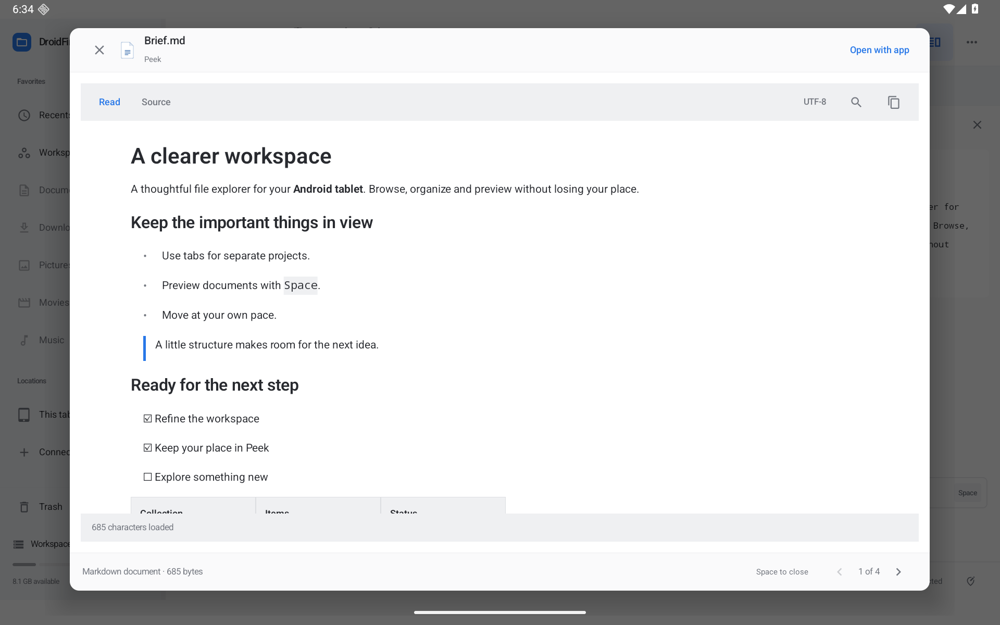

# Structured Peek — 0.15.0

Markdown, delimited tables, JSON, source code and plain text now have a native tablet reader in Peek. Local files and connected document-provider streams use the same reader. Routing recognizes supported extensions and text/Markdown/CSV/JSON MIME metadata, including names without extensions. No source file is modified.

- Markdown: Read/Source modes, headings, emphasis, nested lists, task markers, quotations, code blocks, tables and selectable text. HTML is shown literally. Images appear as alt-text placeholders. HTTP/HTTPS/mailto links open an external app only when tapped; relative/custom links do not navigate. Read is a document preview, not a browser or Markdown editor.
- CSV/TSV: quoted delimiters, escaped quotes and multiline cells; automatic or explicit comma/semicolon/tab/pipe delimiters; optional first-row headers; shared horizontal scrolling; full-cell inspection and copy. Malformed/partial records are omitted with a notice, preserving earlier complete records. No spreadsheet formula runs.
- JSON: strict streaming validation and indentation, preserving key order, duplicate keys and number spelling. Malformed, excessively nested or oversized formatting falls back to Source with a reason. This is formatting, not schema validation.
- Code/text: line numbers, lightweight token coloring, wrapping or horizontal scrolling, selection and copy. Coloring is not a complete language grammar. More common source extensions also receive the code file icon.
- Find searches displayed source lines or parsed table rows; Markdown Find switches to Source. Ctrl/Meta+F opens Find, F3/Shift+F3 moves between matching rows/lines, Escape closes Find before closing Peek. Spaces stay in the input. Matches scroll into view; per-line highlights are capped at 200, and matching row/line navigation at 2,000.

[CSV table](screenshots/structured-csv.png) · [JSON](screenshots/structured-json.png) · [Code](screenshots/structured-code.png) · [Find](screenshots/structured-find.png) · [Portrait](screenshots/structured-portrait.png) · [Compact window](screenshots/structured-window.png) · [Dark](screenshots/structured-dark.png)

## Loading, limits and encoding

The reader loads at most 512 KiB plus one byte by default. **Load up to 2 MiB** explicitly increases the byte budget. The extra byte determines whether the source is incomplete without trusting provider size metadata. Provider opening and stream reads run on IO workers, with cancellation signals and stream closure on Stop/dismiss/source change. Parsing runs off the UI thread and checks cancellation between tokens/nodes. CommonMark's parser itself is synchronous; cancellation is checked before/after that bounded parse, not on every internal parser operation.

Auto uses UTF-8 or a UTF-8/UTF-16 BOM. UTF-8, UTF-16LE/BE and Windows-1252 can be chosen explicitly. Invalid input reports a decoding error; no silent replacement characters are introduced. A capped byte prefix may omit an incomplete final Unicode code point. BOMs are removed, and line endings are normalized to LF for display and copying. UTF-32 and decoded NUL/binary data are not displayed.

Source display is limited to 20,000 lines and 4,096 characters per line. Markdown parsing uses nesting limits of 64 and rendering limits of 50,000 visited nodes/2,000 blocks; individual rendered blocks stop at 16,384 characters and code lines at 4,096. Markdown tables stop at 50 rows/16 columns and 16,384 rendered characters per table; a row that would cross the character budget is omitted rather than publishing partial cells. CSV stops at 5,000 records, 64 columns, 100,000 cells or a 16,384-character cell; a record that exceeds a limit is omitted. JSON formatting stops at nesting 64, 100,000 tokens or roughly 4 MiB of formatted output. Input/rendering limits and incomplete content are shown explicitly. CommonMark may treat syntax beyond its parser nesting limits as plain text. Use Source/Copy/Open with app for further work.

Copy includes the loaded text (formatted JSON when that view is selected), including portions beyond the source-display line cap. Up to 65,536 characters use a plain clipboard item. Larger copies use a UTF-8 text snapshot through Android's content-URI clipboard, avoiding large Binder payloads. Standard `coerceToText()` consumers can read the full stream; other apps decide what clipboard types they accept. Private clipboard snapshots are serialized across app windows and retained up to eight files/32 MiB. Android can clear cache files or clipboard access, so this is not permanent document storage.

## Local verification

Checks use the dedicated API 36 / Android 16 emulator and local JDK 17 / SDK 36 builds. Native workflows cover Read/Source, literal HTML, full CSV-cell copy, formatted/invalid JSON, input focus/Space/Escape, decoding recovery, larger read budgets, streamed clipboard text, MIME-only provider Markdown and cancelling a blocked provider stream. JVM checks cover Unicode boundaries/BOMs, RFC-style quoting/multiline records, malformed/limited records, strict JSON, Markdown structure/resource bounds and cancellation checkpoints. Physical/provider/version matrices remain open in the roadmap. The release app contains no seeded sample documents.

Verification: 126/126 JVM tests, a combined 17/17 native regression run, and a subsequent 6/6 focused structured-preview run passed. Lint: 0 errors, 79 warnings. Optimized preview and unsigned release builds passed locally. The focused run follows the final text-search geometry and clipboard changes; the six cases overlap the combined run and are not six additional distinct tests.

A final focused CSV test passed after the touch-target refinement, asserting the header toggle is at least 48 dp in Comfortable mode. Its label toggles the same checkbox; Compact mode keeps denser controls. This is a repeat of one of the six structured cases, not another distinct workflow.
