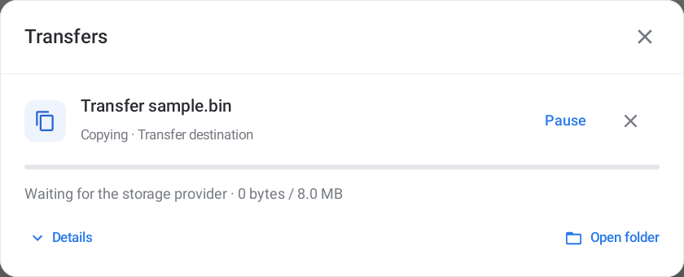
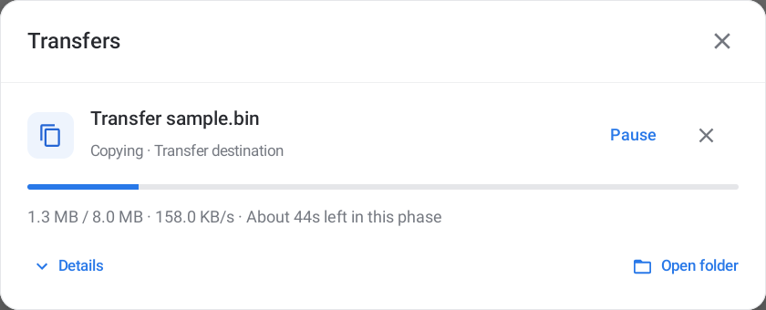

# Transfer progress

Findroid explains what a transfer is doing in **Actions → Transfers**, the compact transfer strip, and its Android transfer notification. This update adds recent speed, estimates for the current phase, inspected-item counts during preparation, and specific messages when a storage call takes time.

## Read the current phase

A job can prepare files, copy data, verify contents, and finish changes. The amount and estimate describe the phase currently shown. **About 20s left in this phase** does not promise that verification, publication, or the rest of the queue will also finish in 20 seconds.

Preparation counts the items inspected as Findroid checks metadata. It has no invented byte total or time estimate. Verification counts bytes checked separately from bytes transferred, so checking a completed copy does not count the file twice in transfer history.

## Recent speed and estimates

Speed uses a bounded window of recent progress, rather than the average since the transfer started. It needs at least 1.5 seconds of observations, retains at most six seconds of samples, and samples no more often than every 250 milliseconds. A new phase starts a new window.

A time estimate appears only when Findroid has a valid total for the phase and enough recent byte progress. A provider that omits its file size can still show bytes processed and a recent speed. It cannot supply an exact total or remaining time.

Rates expire after three seconds without new bytes. After a long wait, the rate warms up again so a recovered read does not appear to be an instantaneous burst. Explicitly paused time is excluded, and the paused interface hides the speed and time estimate. The elapsed-time clock includes device sleep, so an old estimate expires when the tablet wakes.

## Storage waits

An actual source read, destination write, or provider request lasting at least three seconds can show **Waiting for the source file**, **Waiting for the destination**, **Waiting for the storage provider**, or **Waiting for storage**. These messages identify the pending call; they do not declare the job stalled or failed.

Work that has not reported a new item or byte for ten seconds can show **No new progress reported**. The running service samples progress once a second so these explanations can appear even while a worker is blocked. Sampling stops when the operation finishes.

In narrow panes or with enlarged text, the compact strip puts its named controls below the filename and phase summary. Controls can wrap onto another line when needed.

Pause, Resume and Cancel keep their existing meanings. Files are staged and checked before publication; cancellation keeps source files and removes unpublished staging where storage permits. An unresponsive third-party provider still controls when its own call returns. A progress message does not create a universal provider timeout.

## In the app

These are actual optimized-app captures using a separate read-only test provider and synthetic files.

[Compact controls with enlarged text](screenshots/transfer-paused-large-text.png) · [Unknown-size progress](screenshots/transfer-unknown-size.png).

## Validation

The 0.42.0 local and public OTA acceptance record is complete; immutable archive verification is being finalized. All 525 JVM tests pass, including changing rates, expiry/recovery, pause accounting, preparation counts, verification totals, blocking-call cleanup and very large estimates. Focused native cases on API30 and API36 exercise a real gated provider pipe, recovery, pause/resume, exact output bytes and cancellation.

The exact optimized APK passes the direct 0.41 → 0.42 upgrade, a real system-picker connection to the separate read-only provider, known/unknown-size 8 MiB copies, visible wait/recovery, pause/resume, cancellation and foreground-service cleanup on both APIs. All six 600/800/1280 dp × font 1.0/1.6 layouts pass independently checked complete 48dp controls and readable progress-text widths. The same active transfer survives every configuration change. All 40 actual screenshots were inspected. The two copies per API match the deterministic source bytes; checking contents does not inflate their recorded copied-byte totals.

Original URI permissions and all 495/API30 and 443/API36 managed files and original absences are restored. The Android11 picker can reopen its cached provider root without a folder-selection action; the bounded test-driver recovery navigates to a known local root and back, grants access only to the synthetic provider and retains no local-directory hierarchy. Rejected attempts remain excluded.

The final full regression passes 405 identical cases on each API, in 47 fresh-process batches per tablet with the exact same app/test APK pair. Final reports have zero failures or skips. The two rejected API36 attempts are retained: an existing archive-preview wait exceeded ten seconds, and an existing single-pane reconnect assertion ran before asynchronous refresh. Each exact case and its complete batch passed unchanged in fresh processes; no product fix is claimed.

Both immutable original private states and absences are restored exactly, and the three owned full-suite screenshots per tablet are retained privately and removed from shared storage. Independent local acceptance passes. Real public-feed 0.41 → 0.42 download and Android installation pass on both tablets, with exact public bytes, preserved synthetic file/Favorite/preference and no repeat offer. API36’s production-source check also passes 1/1. Both tablets finish with font 1.0, exact original metadata/databases/cache/absences and the public APK. The retained Android11 relaunch race is corrected in the host checker by waiting for installer completion. The immutable validation archive still requires independent verification before proposal 39 is marked complete.
