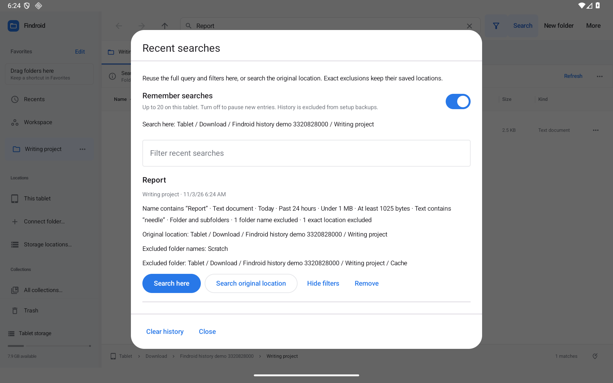

# Findroid 0.37.0-preview

Reuse finished searches without making a Smart Folder for each one. Open **More → Recent searches…**, or start typing and choose a previous query with its full filters.

- Up to 20 recent searches shared by panes and windows, saved across restarts.
- Three matching suggestions, with touch or arrow keys and Enter. The typed prefix is discarded when a suggestion replaces it.
- Named **Search here**, **Search original location**, **Show filters** and **Remove** actions.
- Persistent **Remember searches** and **Clear history** controls. Old pane drafts cannot undo a clear/pause; explicit submission is a fresh intent.
- Unavailable locations leave the current tab unchanged. Slow provider responses cannot overwrite a newer tab, query or active pane.
- Smart Folder reuse copies the rules into an independent plain search. Exact exclusions keep their original references.
- Criteria/references only; no result entries or snippets in history, and no history in setup backups.

[Recent-search guide](../RECENT-SEARCHES.md) · [Download the preview](https://github.com/moikdev/findroid/releases/tag/v0.37.0-preview)

## Verified delivery

422 JVM tests and 279 native cases per API30/API36 tablet pass, with zero failures/skips and 29 isolated batches per API. Lint: 0 errors, 147 warnings, 11 hints. Exact optimized 0.36 upgrades, full criteria reuse, Smart Folder independence, pause/clear/restart and six width/font layouts per API pass. Actual screenshots are inspected. Real public-feed download and Android installation pass on both tablets; the separate API36 production-source check passes 1/1.

Source `d33d5a0bcc8825855d919fe828daad4873c5a900`. Code **38**, name **0.37.0-preview**, Android **11+**. Preview **8,373,423 bytes**, SHA-256 `03c01c299a6a8ac2a19015e32d71aa1cf3f1f7d20d439626a7b7305520a89803`. Development signing is unchanged from 0.36. All five original assets match anonymous downloads and GitHub digests. Both tablets finish with exact original metadata/preferences, font scale 1.0 and the public APK.

Proposal **21** completes **24/72** improvements; **48 remain open or partial**. Physical/OEM/provider and accessibility acceptance remain separately tracked. [Detailed evidence](../../VALIDATION.md) · [Improvement tracker](../IMPROVEMENT-TRACKER.md). Hosted Actions remains manual-only.

The frozen [validation ZIP](https://github.com/moikdev/findroid/releases/download/v0.37.0-preview/Findroid-0.37.0-validation.zip) is **10,399,058 bytes**, with **1,028 entries** and SHA-256 `52e88b2c6bbcd712a213683bbc2db557d1aff7166da4037837b83d5f34151eeb`. Its anonymous download matches the local archive and GitHub digest; every manifest entry is verified. The application, instrumentation and evidence commits are recorded separately in `EVIDENCE.json`.
