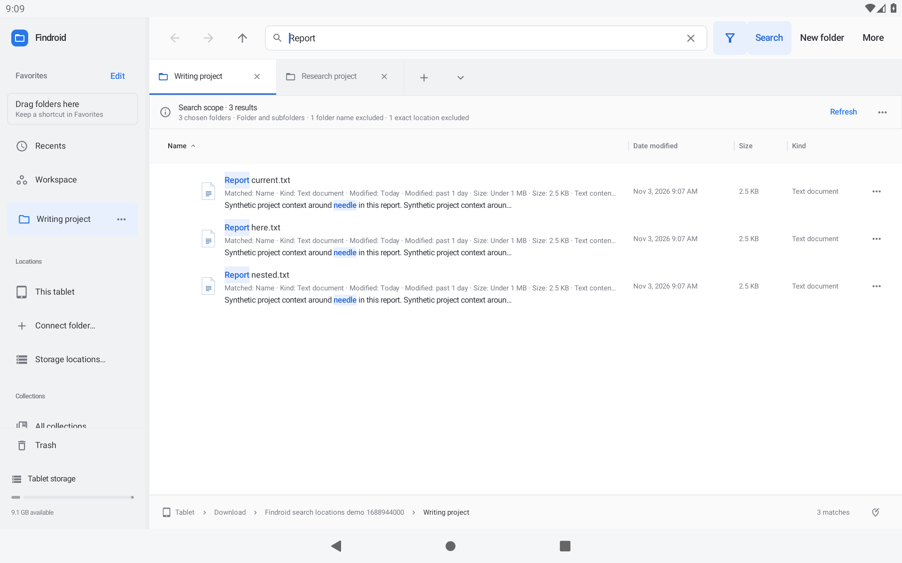

# Findroid 0.38.1-preview

Search several project folders together. Open **More → Search locations…**, add up to ten folders, and apply the complete scope. Read-only connected folders can be included.

- Each folder has its own complete, unavailable, pending, excluded or incomplete status in Result details.
- A missing first folder keeps results from the other chosen roots. Overlapping locations show each document once.
- All filters and literal exclusions apply consistently. Tabs, Smart Folders and recent searches preserve the full scope across restarts.
- **Search here** and typing suggestions reuse filters in the current folder. **Search original location** keeps the chosen list when any saved root is available.
- Same-tree reconnect and root notifications refresh affected searches. Reviewed setup backups include all chosen roots.
- Workspace recovery can replace a missing secondary root while preserving the working locations. Smart Folder repair inside a workspace keeps the shared saved search independent.

Reopening the same secondary window after an OTA update no longer crashes. The first 0.38.0 candidate was withdrawn when public OTA testing exposed this issue; 0.38.1 includes the fix and new regression checks.

[Search-location guide](../SEARCH-LOCATIONS.md) · [Download the preview](https://github.com/moikdev/findroid/releases/tag/v0.38.1-preview)

## Verified delivery

451 JVM tests and 308 native cases per API30/API36 tablet pass, with zero failures/skips and 32 isolated batches per API. Lint: 0 errors, 147 warnings, 11 hints. Exact optimized 0.37 upgrades, real folder choice, Cancel/Search, overlaps, literal exclusions, unavailable first roots, Smart Folder/restart, five optimized custom-window task replacements and all six width/font layouts per API pass. Actual screenshots and full 48dp controls are inspected. Real public-feed upgrades from both 0.37 and withdrawn 0.38 pass on both tablets; the separate API36 production-source check passes 1/1.

Source `0ec3ff8ef2810b18dab0853a75489d871e5d3993`. Code **40**, name **0.38.1-preview**, Android **11+**. Preview **8,389,807 bytes**, SHA-256 `8324a7a88e46840ec02f57bc843937af75506e7feecd630f79b5c4f74a98aefc`. Development signing is unchanged from 0.37. All five original assets match anonymous downloads and GitHub digests. Both tablets finish with exact original metadata/preferences, font scale 1.0 and the public APK.

Proposal **22** completes **25/72** improvements; **47 remain open or partial**. Physical/OEM/provider and accessibility acceptance remain separately tracked. [Detailed evidence](../../VALIDATION.md) · [Improvement tracker](../IMPROVEMENT-TRACKER.md). Hosted Actions remains manual-only.

The frozen [validation ZIP](https://github.com/moikdev/findroid/releases/download/v0.38.1-preview/Findroid-0.38.1-validation.zip) is **14,338,493 bytes**, with **869 entries** and SHA-256 `913585c9ea1558f4ef5651e65aa505cbd3b67a3708ee612c13dc19e1d490b865`. Its anonymous download matches the local archive and GitHub digest; every manifest entry is verified. Application and native-test source `0ec3ff8ef2810b18dab0853a75489d871e5d3993` and evidence snapshot `e99661d5c58721dbf77fc983f84e72fd60596085` are recorded separately in `EVIDENCE.json`.
