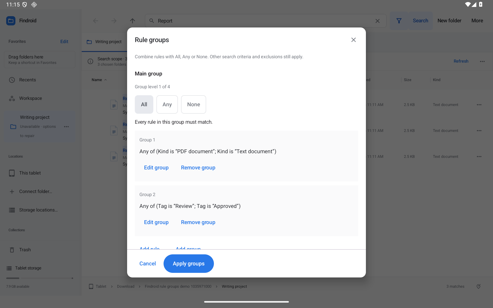

# Findroid 0.39.0-preview

Find PDFs or text documents tagged Review or Approved, or combine your own rules with **All**, **Any**, and **None**.

Open **More → Search filters… → Add rule groups…**. Add name, kind, tag, modified-date, or size conditions, then use **Add group** for nested alternatives. The plain-language summary explains the complete expression. **Apply groups** changes the draft; **Apply filters** runs the search. Cancel preserves the parent draft.

- Four group levels and up to 48 total rules/groups, with bounded saved values.
- Chosen folders, subfolder depth, and exact exclusions apply to the whole expression.
- Text contents remain one global criterion, read after metadata admission.
- Unknown provider sizes remain explicit: another Any alternative may match; None cannot guess that an unknown size failed.
- Tabs, Smart Folders, recent history, workspaces, and reviewed setup backups preserve groups. Nested tag changes refresh results and follow reviewed tag remapping.
- Unsupported Smart Folder data is protected from accidental overwrite. Older searches without groups retain their behavior.
- Named, scrolling tablet editors with fixed Cancel/Apply controls and no new permanent toolbar icons.

[Rule-group guide](../SEARCH-RULE-GROUPS.md) · [Download the preview](https://github.com/moikdev/findroid/releases/tag/v0.39.0-preview)

## Verified delivery

472 JVM tests and 324 native cases per API30/API36 tablet pass, with zero failures/errors/skips and 34 isolated batches per API. Lint: 0 errors, 146 warnings, 11 hints. The exact optimized 0.38.1 upgrade passes actual nested editing, complete criteria/history persistence, real folder choice, exact exclusions, overlapping roots, unavailable first roots, Smart Folder/restart, and five live custom-window replacements with independent tabs. All six 600/800/1280 dp × font 1.0/1.6 layouts pass per API, including full 48dp controls and scrolling in Search criteria, Rule groups, and condition editors. Actual screenshots are inspected.

Real public-feed 0.38.1 → 0.39.0 download and Android installation pass on both tablets. API36's separate production-source check passes 1/1. Both tablets finish with exact private original metadata/preferences, font scale 1.0, and the public optimized APK. Earlier scrolling-fixture failures, the explicitly interrupted superseded suite, a platform UI inspection crash, and checker selector/title mistakes are retained separately and excluded from final totals. Read retries are bounded and recorded; actions and full visibility assertions are unchanged.

Clean source `9aa5b76dcbe2c31ef824bd3279cac89495b404e2`. Code **41**, Android **11+**. Preview **8,438,959 bytes**, SHA-256 `dcf4f353e1a3c3b53bdf4a7815b241659e55f7dadda29c74fa61a890bd1a6ffa`. Development signing is unchanged from 0.38.1. All five original assets match anonymous downloads and GitHub digests.

Proposal **25** completes **26/72** improvements; **46 remain open or partial**. Physical/OEM/provider and accessibility acceptance remain separately tracked. [Detailed evidence](../../VALIDATION.md) · [Improvement tracker](../IMPROVEMENT-TRACKER.md). Hosted Actions remains manual-only.

The immutable [validation ZIP](https://github.com/moikdev/findroid/releases/download/v0.39.0-preview/Findroid-0.39.0-validation.zip) is **28,258,911 bytes**, with **1,449 entries** verified from an anonymous download. SHA-256: `331db7ce17d3cbcfa13bc5acaa56e9476f9eaa37adcd0b695ae204b0f09055f8`. Evidence snapshot: `18c729deac06b3df8372c16af305fae1ad4f6466`.
